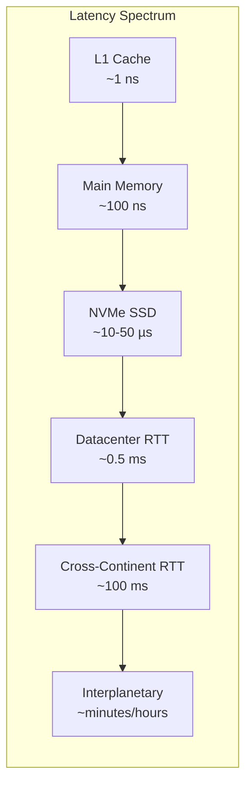
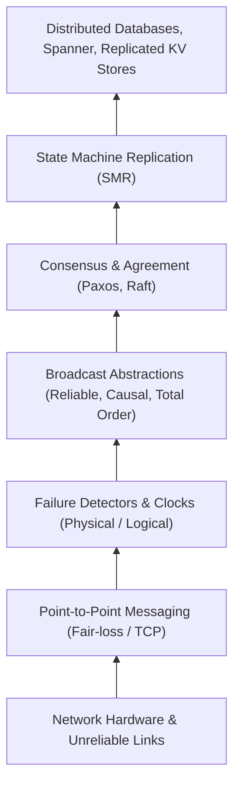

# Distributed Systems Overview

A distributed system is a collection of autonomous computing entities that communicate via a network to coordinate actions and share state, without sharing physical memory or a centralized physical clock.

---

## 1. Problem Statement and Motivation

On a single computer, concurrent processes or threads share physical RAM. Communication occurs via memory dereferencing (pointers, shared variables) or kernel primitives (pipes, Unix domain sockets). If physical memory fails or the CPU halts, the entire machine typically crashes synchronously—a **total failure**.

In contrast, distributed systems arise from two intrinsic realities:
1. **Physical Distribution**: Users, hardware assets, sensors, and databases are geographically dispersed (e.g., cell phones, inter-datacenter replication).
2. **Horizontal Scaling and High Availability**: A single physical machine has hard thermodynamic, memory, and bandwidth limits. Achieving higher availability requires surviving the failure of individual components while the overall system continues operating—tolerating **partial failure**.

The central challenge of distributed systems is coordinating concurrent entities over an unreliable communication channel where **message delay is unbounded and process state is hidden**. As Leslie Lamport famously observed:
> *"A distributed system is one in which the failure of a computer you didn't even know existed can render your own computer unusable."*

---

## 2. Shared Memory Concurrency vs. Message Passing

The transition from single-node concurrency to distributed systems fundamentally alters correctness reasoning:

| Dimension | Single-Node Concurrent Systems | Distributed Systems |
| :--- | :--- | :--- |
| **Address Space** | Unified virtual/physical address space. Pointers are globally meaningful within a process. | Disjoint address spaces. Pointers are local and invalid across process boundaries. |
| **Communication Mechanism** | Direct memory writes, cache-coherency protocols (MESI/MOESI), atomic CPU instructions (`CAS`, `LL/SC`). | Explicit message passing across network links (network packets, serializing/deserializing bytes). |
| **Failure Modes** | Typically fate-sharing: if hardware crashes, all threads halt. Partial failures are rare and handled by OS. | Independent partial failures: individual nodes crash, pause, or misbehave while others continue executing. |
| **Timing & Clocks** | Single CPU crystal oscillator drives the monotonic cycle counter (`RDTSC`). Negligible clock skew across cores. | Independent, drifting physical quartz oscillators. Variable network delays. No universal physical time. |
| **State Observation** | A thread can read a memory location and inspect current state instantaneously (subject to memory barriers). | Information cannot travel faster than network latency. Observed remote state is inherently historical and potentially stale. |

---

## 3. Core Characteristics of Distributed Systems

Formally, a distributed system consists of:
- A set of processes $\Pi = \{p_1, p_2, \dots, p_n\}$.
- A set of bidirectional communication channels connecting process pairs.
- An execution driven by local state transitions and message exchange events.

### 3.1 Concurrency
Processes execute concurrently at independent, time-varying speeds. No global scheduler coordinates step execution. Between two process interactions, an arbitrary number of local steps can occur on either side.

### 3.2 Lack of a Global Clock
Because information transmission is bounded by the speed of light and subjected to variable queueing delays in network hardware, no process can access a single, instantaneously updated global physical clock. Time must either be approximated using synchronisation protocols (e.g., NTP, PTP) with bounded error, or tracked logically using causality (happens-before relations).

### 3.3 Independent Failures (Partial Failure)
A system may contain $n$ nodes. At time $t$, a subset $F \subset \Pi$ may crash or become disconnected by a network partition, while the remainder $\Pi \setminus F$ remains fully functional. A distributed algorithm must enable the non-faulty processes to make progress without waiting indefinitely for crashed processes.

---

## 4. The Two Fundamental Tensions

### 4.1 Latency vs. Throughput
- **Latency ($\delta$)**: The duration elapsed between initiating an operation and receiving its result.
- **Throughput ($T$)**: The rate of operations successfully completed per unit time.

Over local buses, memory access latency is measured in nanoseconds ($10\text{--}100\text{ ns}$). In local datacenters, network round-trips take fractions of a millisecond ($0.1\text{--}1\text{ ms}$). Across continents, latency is bounded by the speed of light in optical fibre ($\approx 5\text{ \mu s/km}$), yielding round-trips exceeding $100\text{--}200\text{ ms}$. Distributed algorithms must minimize synchronous communication round-trips along the critical path.

### 4.2 Consistency vs. Availability
Replicating state across nodes is mandatory to survive node crashes. However, updating multiple replicas requires network communication. When the network partitions or links drop packets:
- **Strong Consistency (e.g., Linearizability)**: The system refuses to process operations until replicas coordinate, sacrificing availability during network disruptions.
- **High Availability**: The system allows individual replicas to process operations locally, causing replicas to diverge and requiring eventual conflict resolution.

---

## 5. Architectural Building Blocks

Distributed systems are organized as layered abstractions where higher-level guarantees are built upon lower-level primitives:

---

## 6. Common Misconceptions

- **"Networks are reliable in modern datacenters"**: Switches drop packets due to buffer exhaustion; optical transceivers degrade; firmware bugs drop VLAN routes. High availability requires algorithms that treat message loss as normal.
- **"Latency is zero or negligible"**: Network round-trip delays dominate processing times by several orders of magnitude. Designing an algorithm that requires synchronous round-trips per read degrades scalability.
- **"Bandwidth is infinite"**: Moving large state across WAN links creates bottlenecks; algorithms must communicate concise metadata, diffs, or digests.
- **"All nodes are homogeneous"**: Stragglers (slow nodes suffering JVM garbage collection pauses, noisy neighbors, or throttled disk I/O) delay coordinated steps unless quorums are used.

---

## 7. Revision Questions

1. Why does shared-memory concurrency allow instantaneous observation of state while message-passing distributed systems do not?
2. What constitutes a *partial failure*, and why is it qualitatively more difficult to handle than a crash of a single-node operating system?
3. What is the fundamental physical barrier that prevents physical clock synchronization from achieving zero skew across distributed nodes?

---

## 8. Authoritative References

- **[Lamport 1978]** Leslie Lamport. *Time, Clocks, and the Ordering of Events in a Distributed System*. CACM 21(7), 1978.
- **[Waldo et al. 1994]** Jim Waldo, Geoff Wyant, Ann Wollrath, and Sam Kendall. *A Note on Distributed Computing*. Sun Microsystems Laboratories Technical Report, 1994.
- **[Kleppmann 2021]** Martin Kleppmann. *Distributed Systems Lecture Notes*, Chapter 1: Introduction. University of Cambridge, 2021/22.
- **[van Steen, Tanenbaum 2017]** Maarten van Steen and Andrew S. Tanenbaum. *Distributed Systems*, Chapter 1: Introduction. 2017.
