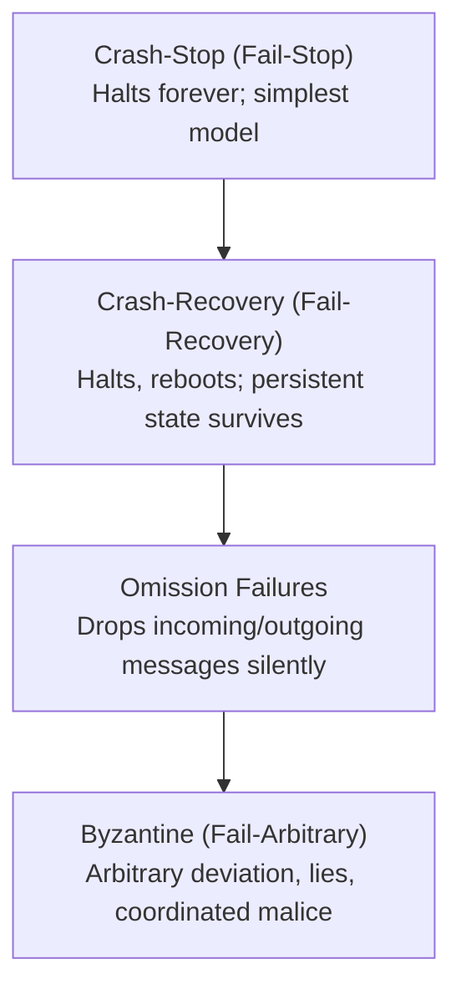
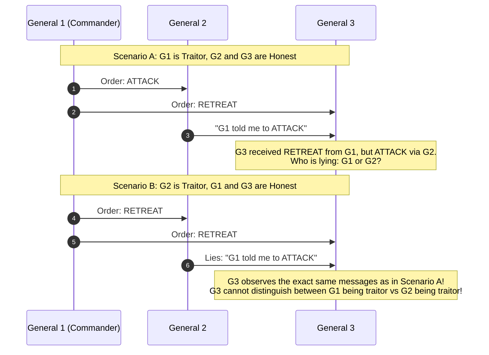

# Failure Models in Distributed Systems

A failure model defines the ways in which components (processes and network communication links) may deviate from their specified algorithm.

---

## 1. Terminology: Faults, Errors, and Failures

Distributed systems engineering strictly differentiates between three related concepts [Laprie 1992]:
- **Fault**: A defect or internal abnormality within a component (e.g., bit-flip in RAM, severed undersea cable, software bug, power outage).
- **Error**: An invalid internal system state resulting from a fault (e.g., corrupted memory register, missed heartbeat deadline).
- **Failure**: A deviation between the externally observable behavior of a system (or subsystem) and its specified functional contract (e.g., service unavailability, corrupted database record returned to a client).

The objective of **fault tolerance** is to design algorithms such that internal faults do not translate into overall system failures.

---

## 2. Process Failure Hierarchy

Process failure models are organized in a strict hierarchy of severity:

### 2.1 Crash-Stop (Fail-Stop)
- **Model**: A process executes strictly according to its protocol until it halts. Once halted, it transitions to a permanent terminal state $\bot$ and never executes another step or emits another packet.
- **Applicability**: Catastrophic unrecoverable hardware destruction (e.g., burnt motherboard, node dropped in water).
- **Theoretical Role**: Simplifies algorithm design and formal correctness proofs. In real systems, a rebooted node must be treated as a brand new node joining the cluster.

### 2.2 Crash-Recovery (Fail-Recovery)
- **Model**: A process can halt execution without warning, remain offline for an arbitrary duration, and subsequently recover.
- **State Partitioning**:
  - **Volatile State ($S_{\text{volatile}}$)**: RAM contents, ephemeral in-memory caches, active TCP connection handles. Completely wiped upon crash.
  - **Non-Volatile Stable Storage ($S_{\text{stable}}$)**: Write-Ahead Logs (WAL), fsync'd disk files, non-volatile RAM. State survives crashes.
- **Recovery Procedure**: Upon reboot, a process executes a recovery routine $\text{recover}(S_{\text{stable}})$ to reconstruct valid internal state before rejoining active message exchanges.
- **Relevance**: Standard model for production distributed databases (PostgreSQL, Cassandra, CockroachDB, Raft/Paxos clusters).

### 2.3 Omission Failures
- **Send Omission**: Process $p_i$ attempts to send message $m$, but $m$ is never placed on the network link (e.g., OS socket buffer overflow).
- **Receive Omission**: Message $m$ arrives at the physical network interface of $p_j$, but $p_j$ never delivers $m$ to the application layer (e.g., context switch starvation, incoming buffer drop).

### 2.4 Byzantine (Fail-Arbitrary) Failures
- **Model**: A faulty process can behave completely arbitrarily [Lamport, Shostak, Pease 1982]. It may:
  - Transmit contradictory information to different peers (equivocation).
  - Forge, corrupt, or selectively drop messages.
  - Coordinate actively with other Byzantine processes under the command of a malicious adversary.
- **Distinction**: Non-faulty nodes are termed **correct** or **honest**. Faulty nodes are termed **Byzantine** or **malicious**.
- **Applicability**: Public blockchains (Bitcoin, Ethereum), multi-stakeholder consensus (Aero/military avionics, inter-bank settlement).

---

## 3. Mathematical Fault Tolerance Thresholds

Distributed algorithms can only tolerate a bounded fraction of faulty processes $f$ out of a total population of $n$ nodes.

### 3.1 Crash Fault Threshold: $n \ge 2f + 1$ (or $f < n/2$)
To survive $f$ crashed nodes without violating safety in consensus or atomic shared registers:
- A write or proposal must be acknowledged by a quorum $Q_w$.
- A read or inspection must query a quorum $Q_r$.
- To guarantee that any two quorums overlap in at least one surviving node:
  $$|Q_1 \cap Q_2| \ge 1 \implies |Q| \ge \left\lfloor \frac{n}{2} \right\rfloor + 1$$
- If $f \ge n/2$ nodes crash, the surviving nodes cannot form a strict majority quorum and must safely halt. Hence, **a majority quorum system tolerates strictly fewer than half the nodes failing**:
  $$n = 2f + 1 \implies f = \frac{n - 1}{2}$$
  - $n = 3 \implies \text{tolerates } f = 1$ crash.
  - $n = 5 \implies \text{tolerates } f = 2$ crashes.

### 3.2 Byzantine Fault Threshold: $n \ge 3f + 1$ (or $f < n/3$)
In an unauthenticated system (where nodes cannot cryptographically prove message authenticity), tolerating $f$ Byzantine nodes requires:
$$n \ge 3f + 1$$

#### Proof Sketch for $n = 3, f = 1$ (Impossibility)
Consider three generals: General 1 (Commander), General 2 (Lieutenant), General 3 (Lieutenant).
Suppose $f = 1$ is traitorous.

Because General 3's local observations in Scenario A and Scenario B are identical ($\text{trace}_3(A) \sim \text{trace}_3(B)$), General 3 must take the same decision in both. But if it obeys General 1 in Scenario A, it violates agreement in Scenario B. Thus, 3 nodes cannot tolerate 1 Byzantine node. Tolerating $f=1$ requires at least $3(1) + 1 = 4$ nodes.

---

## 4. Network Failure Models

Distributed algorithms model network failures through link abstractions:

| Network Failure Mode | Formal Description | Remediation Mechanism |
| :--- | :--- | :--- |
| **Packet Loss** | Channel drops message $m$ in transit. | Retransmission + Acknowledgment (fair-loss to reliable link). |
| **Duplication** | Channel delivers multiple copies of $m$. | Monotonic sequence numbers + receiver deduplication table. |
| **Reordering** | Message $m_2$ sent after $m_1$ arrives before $m_1$. | Receiver buffer + sequence reassembly (FIFO link). |
| **Network Partition** | Network graph splits into disjoint subgraphs $\Pi_A, \Pi_B$ where no link allows packet delivery. | Quorum sensing: only the partition with a strict majority ($> n/2$) can make progress. |
| **Asymmetric Partition** | Node $A$ can send to $B$, but $B$ cannot send to $A$. | Bidirectional heartbeats + pre-vote validation protocols. |

---

## 5. Availability, MTTF, and MTTR Metrics

High availability quantifies the proportion of time a distributed service successfully responds to valid client requests.

### Formal Formulation
$$\text{Availability } (A) = \frac{\text{Uptime}}{\text{Total Time}} = \frac{\text{MTBF}}{\text{MTBF} + \text{MTTR}}$$
where:
- **MTBF (Mean Time Between Failures)**: The average operational duration between service disruptions.
- **MTTR (Mean Time to Repair)**: The average time required to detect a failure, elect a new leader, and recover state.

### The "Nines" of Availability

| Availability | Allowed Downtime per Year | Allowed Downtime per Day |
| :--- | :--- | :--- |
| **99% (Two Nines)** | $3.65\text{ days}$ | $14.4\text{ minutes}$ |
| **99.9% (Three Nines)** | $8.77\text{ hours}$ | $1.44\text{ minutes}$ |
| **99.99% (Four Nines)** | $52.6\text{ minutes}$ | $8.64\text{ seconds}$ |
| **99.999% (Five Nines)** | $5.26\text{ minutes}$ | $864\text{ milliseconds}$ |

Achieving four and five nines requires **automated failover without human intervention**, as human incident response latencies ($15\text{--}30\text{ minutes}$) instantly exhaust an entire annual downtime budget.

---

## 6. Revision Questions

1. Distinguish between a fault, an error, and a failure using a real-world server crash scenario.
2. In the crash-recovery model, what must be written to stable storage before acknowledging a client write, and why?
3. State the minimum number of nodes required to tolerate $f = 2$ crashes in a majority quorum system, and the minimum required to tolerate $f = 2$ Byzantine nodes.
4. Draw the message sequence diagram for an asymmetric network partition between three nodes $A$, $B$, and $C$, where $A \to B$ works, $B \to A$ is severed, and all other links work.

---

## 7. Authoritative References

- **[Lamport, Shostak, Pease 1982]** Leslie Lamport, Robert Shostak, and Marshall Pease. *The Byzantine Generals Problem*. ACM TOPLAS, 4(3):382–401, 1982.
- **[Laprie 1992]** Jean-Claude Laprie. *Dependability: Basic Concepts and Terminology*. Dependable Computing and Fault-Tolerant Systems, Vol. 5, Springer, 1992.
- **[Cachin, Guerraoui, Rodrigues 2011]** *Introduction to Reliable and Secure Distributed Programming*, Chapter 2: System Models. Springer, 2011.
- **[Kleppmann 2021]** Martin Kleppmann. *Distributed Systems Lecture Notes*, Section 2.3–2.4. University of Cambridge, 2021/22.
