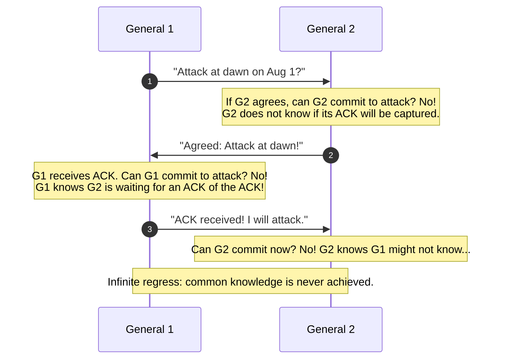
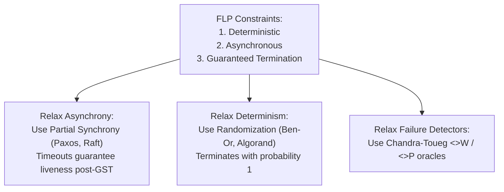
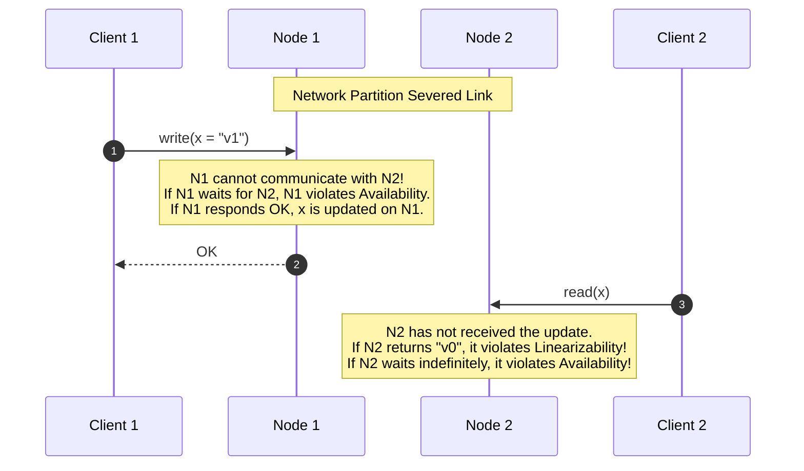

# Fundamental Impossibility Results in Distributed Systems

Impossibility theorems define the theoretical limits of distributed computing. They establish what guarantees are mathematically unachievable under given system assumptions.

---

## 1. The Two Generals Problem [Gray 1978]

The Two Generals Problem is the earliest formal impossibility result in distributed computing. It demonstrates that **two processes communicating exclusively over an unreliable channel cannot reach common knowledge or guaranteed agreement on a coordinated action**.

### 1.1 The Model and Problem Formulation
- Two armies are camped outside a fortified enemy city, led by General 1 and General 2.
- The armies must attack simultaneously to capture the city. If only one army attacks, it will be annihilated.
- The generals can communicate only by sending messengers across enemy territory. Messengers may be captured (fair-loss or lossy channel).
- **Desired Objective**: Design a protocol such that:
  $$\text{General 1 attacks} \iff \text{General 2 attacks}$$

### 1.2 The Inductive Proof of Impossibility

> **Theorem**: There is no deterministic protocol that guarantees both generals attack if and only if the other attacks, using any finite number of messages over an unreliable link.

#### Proof by Contradiction and Induction
1. Suppose there exists a correct protocol $\mathcal{P}$ that solves the problem in a finite sequence of messages.
2. Let $\sigma = \langle m_1, m_2, \dots, m_k \rangle$ be the **shortest execution of $\mathcal{P}$** in which both generals decide to attack ($k \ge 1$).
3. Consider message $m_k$, the final message sent in the protocol (suppose from $G_1$ to $G_2$).
4. Because the communication channel is unreliable, $m_k$ could be captured by the enemy and never delivered.
5. In this execution $\sigma' = \langle m_1, m_2, \dots, m_{k-1} \rangle$:
   - $G_1$ sent $m_k$, but does not know if $m_k$ arrived. If $G_1$ attacks only when $m_k$ is delivered, $G_1$ cannot attack. If $G_1$ attacks regardless, then $m_k$ was completely superfluous.
   - For $G_2$, $m_k$ was lost. If $G_2$ attacks without receiving $m_k$, then $m_k$ was not needed to decide, contradicting that $\sigma$ was the minimal length sequence ($k$ messages).
   - If $G_2$ does not attack because $m_k$ was lost, then $G_1$ attacks while $G_2$ retreats, violating safety.
6. Thus, the last message $m_k$ can never be relied upon. By induction, removing all messages down to $k = 0$ preserves the same dilemma. No finite protocol exists. $\blacksquare$

### 1.3 Epistemic Logic: Common Knowledge
In epistemic logic:
- Let $E_G(p)$ mean "everyone in group $G$ knows proposition $p$".
- Common knowledge $C_G(p)$ is defined as the infinite conjunction:
  $$C_G(p) \iff p \land E_G(p) \land E_G(E_G(p)) \land E_G(E_G(E_G(p))) \dots$$
Halpern and Moses [1990] proved that **common knowledge cannot be attained in any distributed system where communication is subject to unbounded delay or message loss**.

---

## 2. The FLP Impossibility Theorem [Fischer, Lynch, Paterson 1985]

The FLP Theorem is arguably the most influential result in theoretical distributed systems.

> **Theorem (FLP 1985)**: In an asynchronous message-passing system ($\mathcal{ASYNCH}$), no deterministic consensus algorithm can guarantee both Safety and Liveness in the presence of even a single unannounced crash-stop failure ($f \ge 1$).

### 2.1 The Intuition Behind FLP
In an asynchronous system, message transmission delays are unbounded. If process $p_1$ is awaiting a message from $p_2$, $p_1$ cannot determine whether:
1. $p_2$ has crashed, or
2. $p_2$ is operating normally but the network message is delayed.

The proof shows that any consensus algorithm must have initial **bivalent** configurations (configurations from which both a decision of $0$ and a decision of $1$ are still reachable). In an asynchronous network, an adversarial scheduler can delay messages in such a way that the system remains locked in a bivalent state forever, preventing termination.

### 2.2 Navigating FLP in Practice
Real-world systems circumvent FLP by relaxing at least one of its three premises:

---

## 3. The CAP Theorem [Fox-Brewer 1999, Gilbert-Lynch 2002]

The CAP theorem formalizes the fundamental tension between consistency and availability across partitioned networks.

### 3.1 Formal Definitions
- **Consistency ($C$)**: Specifically defined as **Linearizability** (every read returns the value of the most recent write in global real-time order).
- **Availability ($A$)**: Every non-failing node must return a non-error response to every request it receives.
- **Partition Tolerance ($P$)**: The system continues to operate despite arbitrary message drops or network delays that partition nodes into disconnected subgraphs.

### 3.2 The Proof by Indistinguishability
Consider a system of two nodes, $N_1$ and $N_2$, maintaining a single replicated variable $x$ (initially $v_0$).
Suppose a network partition occurs, completely severing communication between $N_1$ and $N_2$.

- If $N_2$ returns $v_0$, the system violates **Linearizability ($C$)**, because Client 2's read started after Client 1's write completed in real time.
- If $N_2$ refuses to answer or blocks indefinitely waiting for the partition to heal, the system violates **Availability ($A$)**.

### 3.3 The Misconception: "Pick 2 Out of 3"
As Martin Kleppmann [2015] notes, framing CAP as "pick 2 of 3" is misleading:
- A network partition ($P$) is not a configurable choice; it is an unpreventable physical phenomenon (backhoe cutting fiber, router crash).
- Therefore, the real architectural choice is: **In the presence of a partition, choose between Consistency ($CP$) or Availability ($AP$).**

---

## 4. Quorum and Byzantine Resilience Bounds

| Problem Context | Fault Model | Minimum Nodes Required ($n$) | Quorum Size Required |
| :--- | :--- | :--- | :--- |
| **Crash Consensus / Registers** | Crash-Stop ($f$) | $n \ge 2f + 1$ | $\lfloor n/2 \rfloor + 1$ (Majority) |
| **Crash Recovery Consensus** | Crash-Recovery ($f$) | $n \ge 2f + 1$ (with WAL) | $\lfloor n/2 \rfloor + 1$ |
| **Byzantine Agreement (Unauthenticated)** | Byzantine ($f$) | $n \ge 3f + 1$ | $\lfloor (2n)/3 \rfloor + 1$ |
| **Byzantine Agreement (Authenticated/Signatures)** | Byzantine ($f$) | $n \ge 2f + 1$ (Synchronous) | Quorums depend on synchrony |
| **PBFT (Practical BFT)** | Byzantine ($f$, Asynch/Partial) | $n \ge 3f + 1$ | $2f + 1$ |

---

## 5. Summary Matrix of Distributed Impossibilities

| Result | Year | System Model | What is Impossible | How Systems Cope |
| :--- | :---: | :--- | :--- | :--- |
| **Two Generals** | 1978 | Unreliable channels, 2 nodes | Certain agreement over lossy channels | Probabilistic retries, compensating transactions |
| **FLP** | 1985 | Asynchronous, 1 crash-stop failure | Deterministic consensus with guaranteed termination | Partial synchrony (Paxos/Raft timeouts), randomization |
| **CAP** | 2002 | Asynchronous / Partitioned network | Simultaneous Linearizability and Availability | Choose CP or AP; use CRDTs / Eventual Consistency |
| **Byzantine Bound** | 1982 | Asynchronous/Synchronous unauthenticated | Byzantine agreement with $n \le 3f$ | Deploy $\ge 3f+1$ nodes; enforce cryptographic digital signatures |

---

## 6. Revision Questions

1. Why does the Two Generals proof fail if we assume that messages can be delayed but are guaranteed to never be lost?
2. In the FLP theorem, what specific condition prevents an asynchronous consensus algorithm from terminating?
3. In the CAP theorem, why cannot an AP database guarantee that a client will read its own prior writes across different nodes during a partition?
4. What is the fundamental reason Byzantine fault tolerance requires $3f+1$ nodes rather than $2f+1$ nodes in an unauthenticated network?

---

## 7. Authoritative References

- **[Gray 1978]** Jim N. Gray. *Notes on Data Base Operating Systems*. Springer LNCS 60, 1978.
- **[Fischer, Lynch, Paterson 1985]** Michael J. Fischer, Nancy A. Lynch, and Michael S. Paterson. *Impossibility of Distributed Consensus with One Faulty Process*. JACM, 32(2):374–382, 1985.
- **[Gilbert, Lynch 2002]** Seth Gilbert and Nancy A. Lynch. *Brewer's Conjecture and the Feasibility of Consistent, Available, Partition-Tolerant Web Services*. ACM SIGACT News, 33(2):51–59, 2002.
- **[Halpern, Moses 1990]** Joseph Y. Halpern and Yoram Moses. *Knowledge and Common Knowledge in a Distributed Environment*. JACM, 37(3):549–587, 1990.
- **[Kleppmann 2015]** Martin Kleppmann. *A Critique of the CAP Theorem*. arXiv:1509.05393, 2015.
