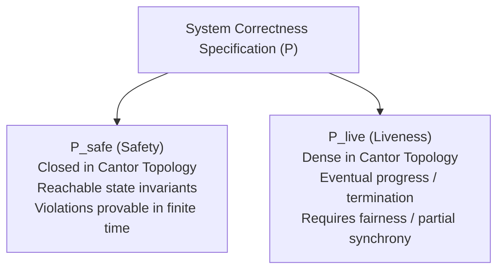

# Safety, Liveness, and Invariants

Every formal guarantee in distributed systems is mathematically classified as either a **safety property**, a **liveness property**, or a combination of both [Alpern and Schneider 1985].

---

## 1. Problem Statement and Motivation

When specifying a distributed protocol, we must define what constitutes correct execution.
- If a protocol promises that *"no two processes ever hold the lock simultaneously"*, how do we prove it? Can a finite execution trace demonstrate a bug? (Yes—observe a state with two processes in the critical section.)
- If a protocol promises that *"a process requesting the lock will eventually obtain it"*, can a finite execution trace prove that the algorithm has failed? (No—perhaps the lock will be granted in the very next step.)

The mathematical distinction between Safety and Liveness governs how protocols are verified, tested, model-checked, and proven correct.

---

## 2. Mathematical Formalization (Alpern & Schneider 1985)

Let $\Sigma$ denote the set of global system states, and let $\Sigma^\omega$ denote the set of all infinite execution sequences (traces) $\sigma = s_0 s_1 s_2 \dots$ where $s_i \in \Sigma$.
A **property** $\mathcal{P}$ is a subset of infinite traces: $\mathcal{P} \subseteq \Sigma^\omega$. An execution $\sigma$ satisfies property $\mathcal{P}$ if $\sigma \in \mathcal{P}$.

Let $\Sigma^*$ denote the set of finite prefixes of traces. For $\alpha \in \Sigma^*$ and $\beta \in \Sigma^\omega$, let $\alpha \cdot \beta$ denote their concatenation.

### 2.1 Safety Properties
Informally: *"Something bad never happens."*

#### Formal Definition
A property $\mathcal{P}$ is a **safety property** if:
$$\forall \sigma \in \Sigma^\omega \setminus \mathcal{P}, \; \exists \alpha \in \Sigma^* \text{ such that } \alpha \text{ is a prefix of } \sigma, \text{ and } \forall \beta \in \Sigma^\omega: \alpha \cdot \beta \notin \mathcal{P}$$

#### Crucial Implications
1. **Irremediability**: Once the "bad thing" occurs at the end of finite prefix $\alpha$, it can never be undone or remedied by any future sequence of events $\beta$.
2. **Refutability by Finite Traces**: A safety violation can always be detected and proven by a finite counterexample trace.

### 2.2 Liveness Properties
Informally: *"Something good eventually happens."*

#### Formal Definition
A property $\mathcal{P}$ is a **liveness property** if:
$$\forall \alpha \in \Sigma^*, \; \exists \beta \in \Sigma^\omega \text{ such that } \alpha \cdot \beta \in \mathcal{P}$$

#### Crucial Implications
1. **Irrefutability by Finite Traces**: No finite prefix $\alpha$ can ever prove that a liveness property is violated. No matter how much time has passed without the "good thing" occurring, it remains possible that it occurs in the future.
2. **Infinite Horizon**: Liveness properties can only be formally evaluated over infinite execution traces.

---

## 3. The Alpern-Schneider Decomposition Theorem

> **Theorem (Alpern and Schneider 1985)**: Every distributed systems property $\mathcal{P} \subseteq \Sigma^\omega$ can be expressed as the intersection of a safety property $\mathcal{P}_{\text{safe}}$ and a liveness property $\mathcal{P}_{\text{live}}$:
> $$\mathcal{P} = \mathcal{P}_{\text{safe}} \cap \mathcal{P}_{\text{live}}$$

In topological terms under the Cantor topology on $\Sigma^\omega$:
- Safety properties correspond to **closed sets**.
- Liveness properties correspond to **dense sets**.

---

## 4. Deconstructing Canonical Distributed Protocols

| Protocol Problem | Safety Component ($\mathcal{P}_{\text{safe}}$) | Liveness Component ($\mathcal{P}_{\text{live}}$) |
| :--- | :--- | :--- |
| **Consensus** | **Agreement**: No two correct processes decide different values. **Validity**: Any decided value must have been proposed. | **Termination**: Every correct process eventually decides a value. |
| **Mutual Exclusion** | **Mutual Exclusion**: At most one process is in the critical section at any given time. | **Starvation Freedom**: Every process requesting entry eventually enters the critical section. |
| **Reliable Broadcast** | **Integrity**: Every message is delivered at most once, and only if previously sent. **FIFO/Causal Order**: Messages are delivered in causal order. | **Validity**: If a correct process broadcasts $m$, all correct processes eventually deliver $m$. |
| **Shared Register (Linearizability)** | **Linearizability**: All completed operations and non-overlapping operations take effect at a discrete linearization point. | **Wait-Freedom / Termination**: Every invoked operation eventually returns a response. |
| **Two-Phase Commit (2PC)** | **Atomicity**: Never commit on one node while aborting on another. | **Termination**: All participants eventually reach a final commit or abort decision. |

---

## 5. Proving Safety: Inductive Invariants

Because safety violations occur at finite states, safety properties are proven using **Inductive Invariants**.

### Formal Verification Method
To prove that predicate $I: \Sigma \to \{\text{true}, \text{false}\}$ is an invariant:
1. **Base Case (Initialization)**:
   $$I(s_0) = \text{true}$$
   The initial system state satisfies the invariant.
2. **Inductive Step (Consecution)**:
   $$\forall s \in \Sigma, \forall e \in \mathcal{E}: (I(s) = \text{true} \land s \xrightarrow{e} s') \implies I(s') = \text{true}$$
   Every valid transition preserving the protocol rules from a state satisfying $I$ leads to a state satisfying $I$.

If $I(s) \implies \mathcal{P}_{\text{safe}}(s)$ for all reachable states, then safety is unconditionally guaranteed across all possible execution schedules.

---

## 6. Proving Liveness: Fairness and Timing Assumptions

Liveness cannot be proven by inductive state predicates alone, because an adversary or scheduler could starve a process by never assigning it execution steps (unfair scheduling) or indefinitely delaying messages.

Liveness proofs require:
1. **Fairness Assumptions**:
   - **Weak Fairness**: If an action is continuously enabled, it must eventually be executed.
   - **Strong Fairness**: If an action is infinitely often enabled (even if disabled intermittently), it must eventually be executed.
2. **Synchrony / Failure Detector Bounds**:
   In partially synchronous systems, liveness relies on reaching **Global Stabilization Time (GST)** or activating an eventually perfect failure detector ($\diamondsuit\mathcal{P}$).

---

## 7. Common Misconceptions

- **"If a timeout triggers, safety is preserved"**: Timeouts belong to failure detectors. In an asynchronous system, using a timeout to decide an update can violate safety if the remote node was merely paused.
- **"Liveness means fast performance"**: Liveness only asserts that an event occurs in finite time ($t < \infty$). It makes no quantitative bound on execution duration.
- **"Trivial algorithms can't satisfy safety"**: An algorithm where processes do nothing (halt immediately) trivially satisfies Agreement and Validity in consensus, and satisfies Mutual Exclusion in locking. It only fails Liveness (Termination).

---

## 8. Revision Questions

1. Formally define a safety property using prefixes of infinite traces.
2. Why is the property *"the transaction aborts if a node crashes"* a safety property, while *"the transaction eventually completes"* is a liveness property?
3. State the Alpern-Schneider Decomposition Theorem and decompose the specification of a reliable FIFO channel into its safety and liveness components.
4. Why is model checking or automated testing capable of producing concrete counterexamples for safety violations, but cannot do so for liveness violations without liveness-to-safety reductions?

---

## 9. Authoritative References

- **[Alpern, Schneider 1985]** Bowen Alpern and Fred B. Schneider. *Defining Liveness*. Information Processing Letters, 21(4):181–185, 1985.
- **[Lamport 1977]** Leslie Lamport. *Proving the Correctness of Multiprocess Programs*. IEEE Transactions on Software Engineering, 3(2):125–143, 1977.
- **[Lynch 1996]** Nancy A. Lynch. *Distributed Algorithms*, Chapter 8: Invariants and Simulation. Morgan Kaufmann, 1996.
- **[Kleppmann 2021]** Martin Kleppmann. *Distributed Systems Lecture Notes*, Chapter 2: Models of Distributed Systems. University of Cambridge, 2021/22.
