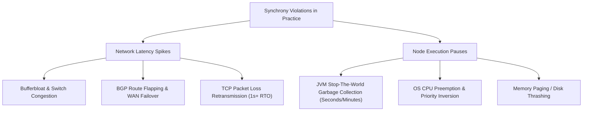
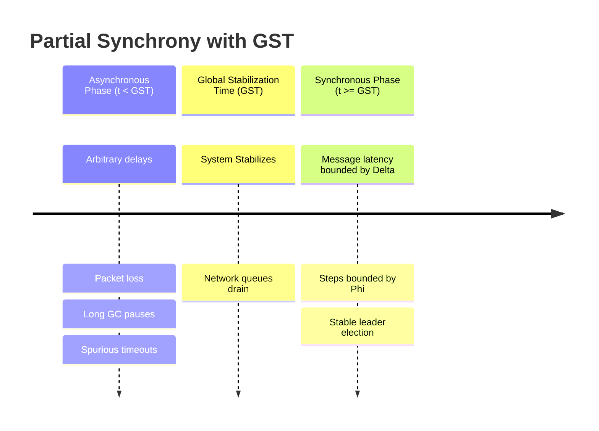

# Synchrony, Asynchrony, and Partial Synchrony

The synchrony model defines what assumptions an algorithm can safely make regarding the passage of physical time, transmission delays across channels, and process execution rates.

---

## 1. Problem Statement and Motivation

In distributed computing, timing assumptions dictate what is algorithmically solvable. 
- If an algorithm assumes that every message arrives within 10 milliseconds, a temporary network congestion event delaying a packet by 12 milliseconds can violate safety invariants (e.g., causing a healthy leader to be prematurely replaced, leading to split-brain).
- Conversely, if an algorithm makes zero timing assumptions, fundamental problems like Consensus cannot be solved deterministically in the presence of crashes (the FLP impossibility result).

To engineer robust systems, we must formalize the boundary between synchronous, asynchronous, and partially synchronous environments.

---

## 2. The Synchronous Model ($\mathcal{SYNCH}$)

### 2.1 Formal Definition
A distributed system is **synchronous** if there exist known, fixed, finite constants:
1. **Bounded Message Delay ($\Delta$)**: Every message $m$ sent by a correct process at time $t$ over a reliable channel arrives at the destination by time $t + \Delta$.
2. **Bounded Execution Speed ($\Phi$)**: The time taken by any correct process to execute an elementary computation step lies strictly within $[\Phi_{\min}, \Phi_{\max}]$, where $0 < \Phi_{\min} \le \Phi_{\max} < \infty$.
3. **Bounded Clock Drift ($\rho$)**: Every correct physical clock $C_i(t)$ satisfies:
   $$1 - \rho \le \frac{dC_i(t)}{dt} \le 1 + \rho$$

### 2.2 Algorithmic Implications
In a synchronous system:
- **Perfect Failure Detection ($\mathcal{P}$)** is trivial: If process $p_1$ sends a heartbeat ping to $p_2$ at time $t_0$, and $p_2$ does not respond by time $t_0 + 2\Delta + \Phi_{\max}$, $p_1$ can **conclusively declare that $p_2$ has crashed**.
- **Round-Based Algorithms**: Execution proceeds in discrete lock-step synchronous rounds $r \in \{1, 2, 3, \dots\}$. In each round, processes send messages, receive all messages sent in that round, and update local state.
- **Consensus Bound**: Consensus under crash-stop failures can be solved in exactly $f + 1$ rounds for up to $f$ crashed nodes.

---

## 3. Violations of Synchrony in Practice

While networks and servers operate predictably under nominal load, real production environments systematically violate strict synchrony bounds:

### Real-World Evidence
- **Garbage Collection (GC)**: Java, Go, and V8 runtimes periodically pause application threads to trace and sweep memory. Stop-the-world pauses exceeding 30 to 60 seconds are well-documented in high-throughput database systems [Thompson 2013]. To remote peers, a paused node is indistinguishable from a crashed node.
- **Datacenter Network Reconfiguration**: A top-of-rack (ToR) switch failover can pause packet delivery for 10 to 60 seconds [Imbriaco / GitHub 2012].
- **Virtualization Steal Time**: In multi-tenant cloud environments (AWS EC2, GCP), hypervisors deschedule guest virtual CPUs to service noisy neighbors, causing physical time to "freeze" from the guest's perspective.

> **Catastrophic Failure of Synchronous Assumptions**: If an algorithm assumes $\Delta = 500\text{ ms}$ and drops locks when a heartbeat is not received within that window, a 1-second GC pause causes another node to acquire the same lock, violating mutual exclusion and corrupting persistent state.

---

## 4. The Asynchronous Model ($\mathcal{ASYNCH}$)

### 4.1 Formal Definition
A distributed system is **asynchronous** if:
1. Message transmission delay is finite but arbitrarily large. No upper bound $\Delta$ exists.
2. Process execution speeds are arbitrary and unpredictable. A process may pause for days and resume execution without notice.
3. No synchronized physical clocks exist. Local timers cannot be used to deduce whether another process is alive.

### 4.2 Advantages and Fundamental Barriers
- **Resilience**: Algorithms designed for an asynchronous system (e.g., Lamport Clocks, Vector Clocks, ABD Registers, CRDTs) are mathematically immune to network latency spikes, GC pauses, or routing delays. They never violate safety due to timing anomalies.
- **Impossibility**: The **Fischer-Lynch-Paterson (FLP) Theorem (1985)** proves that deterministic Consensus is **impossible** in an asynchronous system if even a single process can experience an unannounced crash-stop failure ($f \ge 1$).

---

## 5. The Partially Synchronous Model ($\mathcal{PARTIAL}$)

Introduced by Dwork, Lynch, and Stockmeyer (DLS 1988), partial synchrony bridges the gap between the unrealistic perfection of $\mathcal{SYNCH}$ and the harsh impossibility limits of $\mathcal{ASYNCH}$.

### 5.1 Formal Formulations

#### Variant 1: Global Stabilization Time (GST)
The system behaves asynchronously for an arbitrary, finite duration, but eventually reaches a **Global Stabilization Time (GST)**:
- Before GST: Message delays and execution speeds are completely unbounded.
- After GST: There exist known bounds $\Delta$ and $\Phi$ such that all messages sent at $t \ge \text{GST}$ arrive within $\Delta$, and steps take $\le \Phi$.
- *Crucial property*: Processes do not know when GST has arrived; they only know that GST is finite.

#### Variant 2: Unknown Bounds
The bounds $\Delta$ and $\Phi$ hold permanently from $t = 0$, but their numerical values are **unknown to the algorithm**. The protocol must adaptively discover or back off its timeouts until they exceed the true physical bounds.

---

## 6. The Golden Rule of Practical Protocol Design

Modern consensus protocols (Paxos, Raft, Viewstamped Replication) and distributed databases (Spanner, CockroachDB) adhere to a fundamental engineering principle:

$$\text{Safety under Asynchrony } (\mathcal{ASYNCH}), \quad \text{Liveness under Partial Synchrony } (\mathcal{PARTIAL})$$

| Protocol Property | Operating Guarantee | Consequence of Synchrony Breakdown |
| :--- | :--- | :--- |
| **Safety** | Guaranteed under pure asynchrony ($\mathcal{ASYNCH}$). Independent of clocks, network delays, or processing pauses. | Split-brain never occurs. Replicas never commit divergent histories. |
| **Liveness** | Guaranteed only when the system behaves synchronously ($\mathcal{PARTIAL}$ post-GST). | If the network remains unstable or partitions indefinitely, the system safely halts progress rather than corrupting state. |

---

## 7. Comparison Matrix

| Property | Synchronous ($\mathcal{SYNCH}$) | Asynchronous ($\mathcal{ASYNCH}$) | Partially Synchronous ($\mathcal{PARTIAL}$) |
| :--- | :--- | :--- | :--- |
| **Message Delay Bound $\Delta$** | Known and constant | Does not exist | Exists after GST (or unknown) |
| **Failure Detection** | Perfect ($\mathcal{P}$) via static timeouts | Impossible (indistinguishable) | Eventually Perfect ($\diamondsuit\mathcal{P}$) |
| **Deterministic Consensus** | Solvable in $f+1$ rounds | **Impossible** (FLP Theorem) | Solvable (Paxos, Raft, PBFT) |
| **Safety Invariants** | Vulnerable if $\Delta$ is exceeded | Immune to all timing variations | Immune to all timing variations |
| **Typical Use Case** | Hard real-time avionics, CAN bus | Causal broadcast, CRDTs, ABD | Cloud infrastructure, Raft, etcd |

---

## 8. Revision Questions

1. Formally define why an algorithm cannot use timeouts to achieve a perfect failure detector in an asynchronous system.
2. In the partially synchronous model with Global Stabilization Time (GST), why must an algorithm maintain safety *before* GST arrives?
3. What is the fundamental difference between an algorithm's safety depending on synchrony versus its liveness depending on synchrony?
4. How do Stop-The-World garbage collection pauses in Java or Go systems simulate network partitions or crash failures to external observers?

---

## 9. Authoritative References

- **[Dwork, Lynch, Stockmeyer 1988]** Cynthia Dwork, Nancy A. Lynch, and Larry Stockmeyer. *Consensus in the Presence of Partial Synchrony*. JACM, 35(2):288–323, 1988.
- **[Fischer, Lynch, Paterson 1985]** Michael J. Fischer, Nancy A. Lynch, and Michael S. Paterson. *Impossibility of Distributed Consensus with One Faulty Process*. JACM, 32(2):374–382, 1985.
- **[Chandra, Toueg 1996]** Tushar Deepak Chandra and Sam Toueg. *Unreliable Failure Detectors for Reliable Distributed Systems*. JACM, 43(2):225–267, 1996.
- **[Kleppmann 2021]** Martin Kleppmann. *Distributed Systems Lecture Notes*, Chapter 2: Describing Nodes and Network Behaviour. 2021/22.
