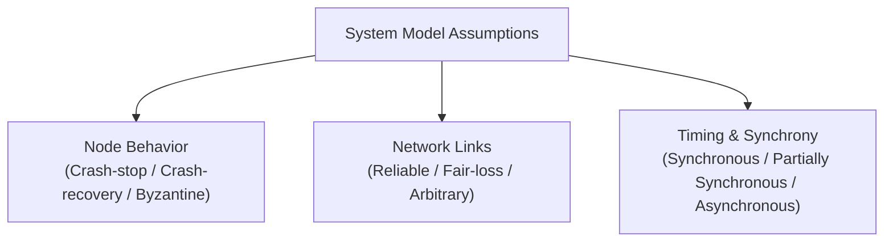
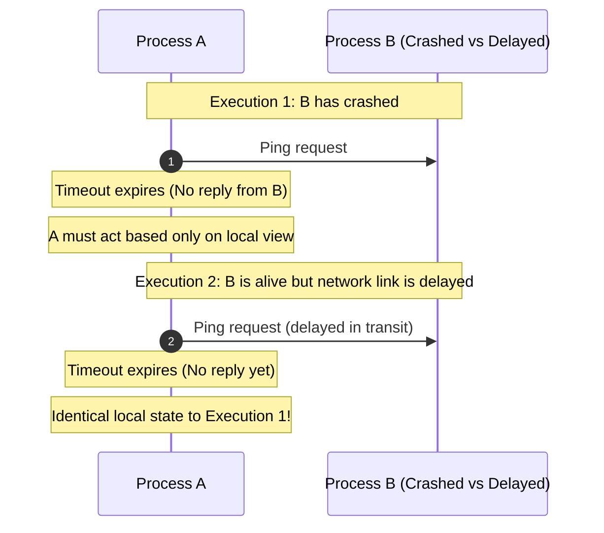

# System Models in Distributed Computing

A system model is a formal specification of the assumptions an algorithm makes regarding process behavior, network communication channels, timing guarantees, and failure modes.

---

## 1. Problem Statement and Motivation

A distributed algorithm cannot be asserted as "correct" in the abstract. Correctness is strictly conditional upon the environment in which it executes. An algorithm provably correct under a synchronous network with fail-stop nodes will fail catastrophically if exposed to arbitrary delays or silent node reboots.

A system model formalizes the boundary between what the algorithm assumes and what an adversary (or network faults) can alter. It provides the axioms used to mathematically prove safety and liveness.



---

## 2. Mathematical Formalization of Distributed Executions

Formally, a distributed system consists of a set of $n$ processes:
$$\Pi = \{p_1, p_2, \dots, p_n\}$$

### 2.1 Process State and Transitions
Each process $p_i$ is modeled as a state machine:
- A set of internal states $\mathcal{S}_i$, including an initial state $s_{i,0}$.
- A local transition function:
  $$\delta_i: \mathcal{S}_i \times \mathcal{E}_i \to \mathcal{S}_i$$
  where $\mathcal{E}_i$ is the set of events occurring at $p_i$.

### 2.2 Event Types
Events $\mathcal{E}_i$ at process $p_i$ fall into three disjoint categories:
1. **Send Event**: $\text{send}_i(m, p_j)$, dispatching message $m$ to process $p_j$.
2. **Receive Event**: $\text{recv}_i(m, p_j)$, receipt of message $m$ sent by process $p_j$.
3. **Internal Event**: $\text{step}_i$, an internal state transition (e.g., timeout expiry, computation).

### 2.3 System Execution History and Configurations
- A **Global Configuration** $C$ is a vector of local process states plus the set of messages currently in transit in the network:
  $$C = \langle s_1, s_2, \dots, s_n, M_{\text{transit}} \rangle$$
  where $s_i \in \mathcal{S}_i$ and $M_{\text{transit}} \subseteq \mathcal{M}$.
- An **Execution (or Run)** $\alpha$ is an alternating sequence of configurations and events:
  $$\alpha = C_0 \xrightarrow{e_1} C_1 \xrightarrow{e_2} C_2 \xrightarrow{e_3} \dots$$
  where $C_0$ is the initial configuration, and each transition $C_{k-1} \xrightarrow{e_k} C_k$ obeys the transition rules of the target process and link model.

---

## 3. The Three Orthogonal Model Axes

Every distributed system model is classified along three orthogonal axes:

```text
               Synchronous (Δ known, bounded)
              /
             /--- Partially Synchronous (GST, unknown Δ)
            /   /
TIMING ----+---/---- Asynchronous (no timing assumptions)
           |
           |   Reliable Links (no loss, no duplication)
           |  /
NETWORK ---+-/------ Fair-Loss Links (loss, retransmit eventually arrives)
           |/
           +-------- Arbitrary Links (tampering, spoofing, active adversary)
           |
           |   Crash-Stop (fail-stop, never recovers)
           |  /
NODES -----+-/------ Crash-Recovery (restarts, stable storage WAL)
           |/
           +-------- Byzantine (fail-arbitrary, malicious collusion)
```

### 3.1 Network Link Models
Let channel $(p_i, p_j)$ denote the directed communication link from $p_i$ to $p_j$.

1. **Reliable (Perfect) Links**:
   - **Liveness (No Loss)**: If $p_i$ sends $m$ to $p_j$, and neither crashes, $p_j$ eventually receives $m$.
   - **Safety (Integrity)**: If $p_j$ receives $m$ from $p_i$, then $p_i$ previously sent $m$, and $m$ is delivered at most once.
2. **Fair-Loss Links**:
   - If $p_i$ continually retransmits $m$ to $p_j$ across an infinite execution, and both are correct, $p_j$ receives $m$ infinitely often.
   - *Reduction*: A fair-loss link + sequence numbers + retransmission buffer = a reliable link.
3. **Arbitrary Links (Adversarial)**:
   - An active adversary may intercept, replay, alter, or inject messages.
   - *Reduction*: Arbitrary links + cryptographic TLS (authenticated encryption, HMACs, ephemeral nonces) = Fair-loss links (provided the adversary cannot block traffic indefinitely).

### 3.2 Process Node Failure Models
1. **Crash-Stop (Fail-Stop)**:
   A process $p_i$ executes correctly until some event $e_c$. After $e_c$, $p_i$ halts permanently.
2. **Crash-Recovery (Fail-Recovery)**:
   A process $p_i$ may halt unexpectedly at any point. When restarted, volatile memory is cleared, but persistent state on stable storage (disk/WAL) remains intact. A crashed node may never recover or may recover after an unbounded delay.
3. **Byzantine (Fail-Arbitrary)**:
   A faulty node may execute arbitrary state transitions, send contradictory messages to different peers, forge packet contents, or collude maliciously with other faulty nodes [Lamport, Shostak, Pease 1982]. Non-faulty nodes are termed **correct** or **honest**.

### 3.3 Synchrony Models
1. **Synchronous ($\mathcal{SYNCH}$)**:
   - Guaranteed message transmission delay: $\exists \Delta > 0$ such that all messages sent at time $t$ arrive by time $t + \Delta$.
   - Guaranteed execution speed: bounded clock drift $\rho$ and bounded step intervals $[\Phi_{\min}, \Phi_{\max}]$.
2. **Asynchronous ($\mathcal{ASYNCH}$)**:
   - Message delay is finite but unbounded.
   - Process execution speed is arbitrary and can pause indefinitely (e.g., GC pause, OS thread preemption).
   - Timeouts cannot distinguish between a crashed process and an infinitely slow channel.
3. **Partially Synchronous ($\mathcal{PARTIAL}$)** [Dwork, Lynch, Stockmeyer 1988]:
   - Bounds $\Delta$ and $\Phi$ exist, but are unknown *a priori*, OR:
   - Bounds hold only after an unknown but finite **Global Stabilization Time (GST)**. Before GST, delays can be arbitrary.

---

## 4. The Indistinguishability Principle

A foundational proof technique in distributed systems theory is the **Indistinguishability Argument**.

### Definition
Two execution traces $\alpha_1$ and $\alpha_2$ are **indistinguishable to process $p_i$** (written $\alpha_1 \sim_i \alpha_2$) if the sequence of local events and states observed by $p_i$ in $\alpha_1$ is identical to the sequence of local events and states observed by $p_i$ in $\alpha_2$:
$$\text{trace}(p_i | \alpha_1) = \text{trace}(p_i | \alpha_2)$$

### Consequence
Because a process is a deterministic state machine driven purely by its local state and incoming events:
$$\alpha_1 \sim_i \alpha_2 \implies p_i \text{ must perform the exact same actions in both runs.}$$



This single observation explains why timeouts cannot provide absolute truth in asynchronous or partially synchronous networks prior to GST: **a crashed node and an arbitrarily slow node are locally indistinguishable**.

---

## 5. Summary Matrix of Foundational Models

| Model Combination | Typical Environment | Solvable Problems | Key Theoretical Result |
| :--- | :--- | :--- | :--- |
| $\mathcal{SYNCH}$ + Crash-Stop | Synchronous lock-step multiprocessors, specialized hardware | Consensus, Perfect Failure Detectors, Atomic Commit | Bounded rounds: $f+1$ rounds for consensus |
| $\mathcal{PARTIAL}$ + Crash-Recovery | Production datacenters, cloud services, ZooKeeper, etcd | Paxos, Raft, Viewstamped Replication, 2PC with recovery | Feasible via $\diamondsuit\mathcal{P}$ or $\Omega$ leader election |
| $\mathcal{ASYNCH}$ + Crash-Stop | General Internet, unconstrained WAN | ABD Atomic Registers, Causal Broadcast, CRDTs | **FLP Theorem**: Deterministic consensus is impossible |
| $\mathcal{PARTIAL}$ + Byzantine | Public blockchains, consortium networks | PBFT, Tendermint, HotStuff | Needs $n \ge 3f + 1$ nodes, 2/3 quorums |

---

## 6. Revision Questions

1. Formally define an execution history $\alpha$ as an alternating sequence of configurations and events.
2. What are the three properties required for a link to be considered *Reliable (Perfect)*?
3. Using an indistinguishability argument, explain why process $p_1$ cannot distinguish between a crashed process $p_2$ and a network partition isolating $p_2$ in an asynchronous model.
4. Why is the Crash-Recovery model more realistic for database servers than the Crash-Stop model, and what hardware primitive is strictly necessary to make it workable?

---

## 7. Authoritative References

- **[Cachin, Guerraoui, Rodrigues 2011]** *Introduction to Reliable and Secure Distributed Programming*, Chapter 2: Basic Abstractions. Springer, 2011.
- **[Lynch 1996]** Nancy A. Lynch. *Distributed Algorithms*, Chapter 2: System Models. Morgan Kaufmann, 1996.
- **[Dwork, Lynch, Stockmeyer 1988]** *Consensus in the Presence of Partial Synchrony*. Journal of the ACM, 35(2):288–323, 1988.
- **[Lamport, Shostak, Pease 1982]** *The Byzantine Generals Problem*. ACM TOPLAS, 4(3):382–401, 1982.
