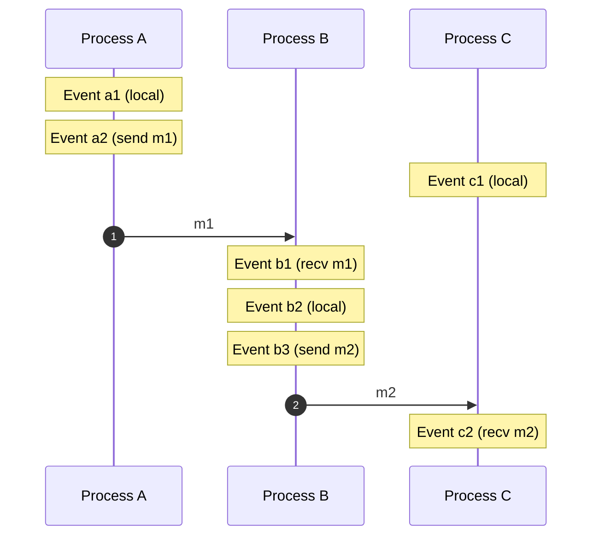
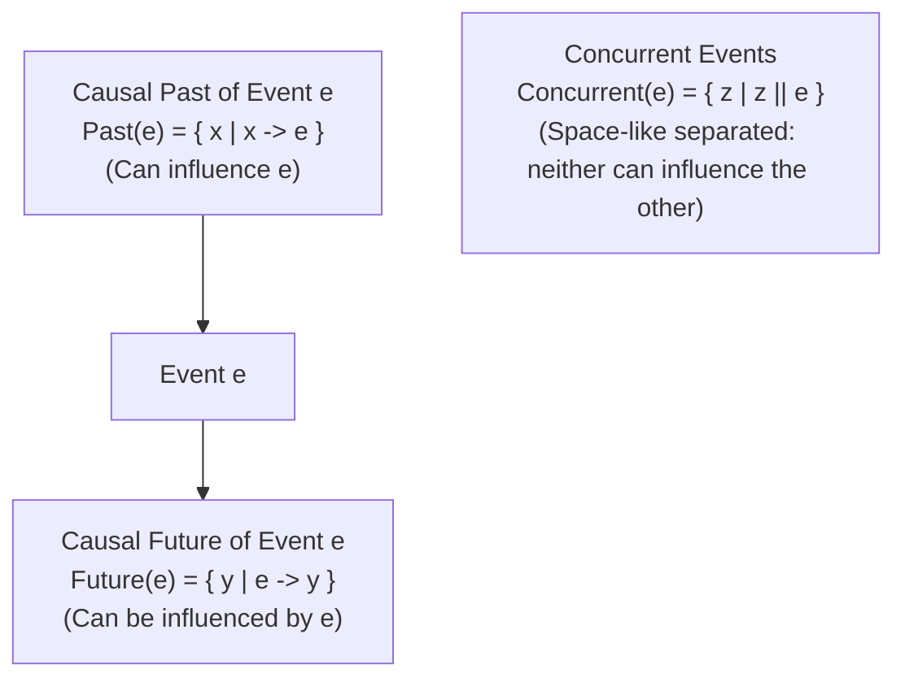

# The Happens-Before Relation and Causal Ordering

The **happens-before relation** ($\to$), introduced by Leslie Lamport in his seminal 1978 paper, provides the fundamental mathematical framework for reasoning about time, causality, and concurrency in distributed systems without relying on physical clocks.

---

## 1. Problem Statement and Motivation

In a single-threaded program on a single machine, execution order is strictly linear: if operation $A$ appears before operation $B$ in code, $A$ executes before $B$ in physical time.

In a distributed system, this assumption completely breaks down:
- Processes execute on separate hardware with independent, drifting physical clocks.
- Network latency is non-zero, asymmetric, and unpredictable.
- If Process 1 transmits message $m_1$ to Process 2, and Process 2 reacts by sending message $m_2$ to Process 3, Process 3 may receive $m_2$ before $m_1$ due to link reordering.
- Relying on physical wall-clock timestamps can produce absurd anomalies where a response appears to have been sent *before* the request was dispatched ($t_{\text{reply}} < t_{\text{request}}$).

We need an ordering definition grounded entirely in **information flow** rather than physical time.

---

## 2. Formal Definition of the Happens-Before Relation ($\to$)

Let $\Pi = \{p_1, p_2, \dots, p_n\}$ be a set of processes.
An **event** $e$ is an execution step at a process: an internal computation step, the sending of a message $\text{send}(m)$, or the receipt of a message $\text{recv}(m)$.

The **happens-before relation** $\to$ is defined as the smallest relation on events satisfying three conditions:

1. **Local Program Order**: If events $a$ and $b$ occur at the same process $p_i$, and $a$ occurs before $b$ in the local execution sequence of $p_i$, then:
   $$a \to b$$
2. **Message Transmission**: If event $a$ is the sending of a message $m$ by process $p_i$, and event $b$ is the receipt of that same message $m$ by process $p_j$, then:
   $$a \to b$$
   *(Physical principle: information cannot travel backwards in time; a message cannot be received before it is sent).*
3. **Transitive Closure**: If $a \to c$ and $c \to b$, then:
   $$a \to b$$

---

## 3. Mathematical Properties: Strict Partial Order

> **Theorem**: The happens-before relation $\to$ is a **strict partial order** over the set of events $\mathcal{E}$.

### 3.1 Proof of Strict Partial Order

A relation $R$ is a strict partial order if and only if it is **irreflexive** and **transitive** (which together imply **asymmetry**).

1. **Transitivity**: By definition (Condition 3), $\to$ is transitively closed:
   $$\forall a, b, c \in \mathcal{E}: (a \to b \land b \to c) \implies a \to c$$
2. **Irreflexivity**: We must show that $\forall a \in \mathcal{E}, \; a \not\to a$.
   - *Physical Axiom*: In the physical universe, information transmission is bounded by the speed of light $c < \infty$, and local computations take non-zero duration $\Delta t > 0$.
   - Any chain of events $e_1 \to e_2 \to \dots \to e_k$ corresponds to a sequence of physical time instants $t(e_1) < t(e_2) < \dots < t(e_k)$.
   - If $a \to a$, there would exist a causal cycle such that $t(a) < t(a)$, which is a contradiction. Hence, $a \not\to a$.
3. **Asymmetry (Anti-Symmetry)**:
   $$\forall a, b \in \mathcal{E}: a \to b \implies b \not\to a$$
   - Suppose $a \to b$ and $b \to a$. By transitivity, $a \to a$, which contradicts irreflexivity. Thus, $\to$ is asymmetric. $\blacksquare$

---

## 4. Concurrency ($a \parallel b$)

Because $\to$ is a *partial* order, not all pairs of events are comparable.

### Definition
Two distinct events $a$ and $b$ are **concurrent** (denoted $a \parallel b$) if and only if neither causally precedes the other:
$$a \parallel b \iff (a \not\to b) \land (b \not\to a)$$

### Trichotomy Property
For any two events $a, b \in \mathcal{E}$, **exactly one** of the following three statements holds:
1. $a \to b$ ($a$ causally precedes $b$)
2. $b \to a$ ($b$ causally precedes $a$)
3. $a \parallel b$ ($a$ and $b$ are concurrent / causally independent)

> **Critical Insight**: In distributed systems, "concurrent" does *not* mean "occurring at the exact same physical millisecond". It means **there is no causal path of messages connecting $a$ and $b$ in either direction**. Event $a$ occurred without knowledge of event $b$, and event $b$ occurred without knowledge of event $a$.

---

## 5. Worked Example and Space-Time Diagram

Consider three processes $A$, $B$, and $C$:
- Process $A$ executes event $a_1$, then sends message $m_1$ at event $a_2$.
- Process $B$ receives message $m_1$ at event $b_1$, executes local step $b_2$, and sends message $m_2$ at event $b_3$.
- Process $C$ executes event $c_1$ concurrently with $A$ and $B$, then receives $m_2$ at event $c_2$.

### Trace Analysis
1. **Local program order**:
   - $a_1 \to a_2$
   - $b_1 \to b_2 \to b_3$
   - $c_1 \to c_2$
2. **Message transmission**:
   - $a_2 \to b_1$ (via $m_1$)
   - $b_3 \to c_2$ (via $m_2$)
3. **Transitive deductions**:
   - $a_1 \to b_1$, $a_1 \to b_2$, $a_1 \to b_3$, $a_1 \to c_2$
   - $a_2 \to c_2$
4. **Concurrent pairs ($a \parallel b$)**:
   - $c_1 \parallel a_1$, $c_1 \parallel a_2$
   - $c_1 \parallel b_1$, $c_1 \parallel b_2$, $c_1 \parallel b_3$
   - Event $c_1$ happened completely outside the causal chain of $m_1$ and $m_2$.

---

## 6. Causal Pasts, Futures, and Relativistic Light Cones

The happens-before relation mirrors the relativistic spacetime geometry of physics (Minkowski light cones):

### Mathematical Definitions
- **Causal Past of $e$**: $\text{Past}(e) = \{x \in \mathcal{E} \mid x \to e\}$
- **Causal Future of $e$**: $\text{Future}(e) = \{y \in \mathcal{E} \mid e \to y\}$
- **Concurrent Region of $e$**: $\text{Concurrent}(e) = \{z \in \mathcal{E} \mid z \parallel e\} = \mathcal{E} \setminus (\text{Past}(e) \cup \text{Future}(e) \cup \{e\})$

An event $e$ can only be causally affected by events in its causal past. No information from $\text{Concurrent}(e)$ or $\text{Future}(e)$ could have reached $e$ before it occurred.

---

## 7. Common Misconceptions

- **"Happens-before implies real physical time ordering"**: If $a \to b$, then in true physical time $a$ happened before $b$. But the converse is **false**: if $t(a) < t(b)$ in physical wall-clock time, it does **not** imply $a \to b$. If no message connects $a$ to $b$, they are concurrent ($a \parallel b$).
- **"Concurrent events happen at the exact same instant"**: In distributed systems, two events occurring days apart in physical time can still be mathematically concurrent ($a \parallel b$) if they occurred on disconnected nodes without message exchange.
- **"Happens-before is a total order"**: It is strictly a partial order. Extending it into a total order requires tie-breaking schemes (e.g., Lamport clocks with node ID prioritization), but such total orderings are arbitrary for concurrent events.

---

## 8. Revision Questions

1. State the three axiomatic conditions that define the happens-before relation.
2. Formally prove that the happens-before relation is irreflexive.
3. Draw a space-time diagram with two processes $P$ and $Q$ where $P$ executes $p_1, p_2$ and $Q$ executes $q_1, q_2$ such that $p_1 \to q_2$ but $p_2 \parallel q_2$.
4. Explain how the happens-before relation models causality in an asynchronous distributed database without access to physical clocks.

---

## 9. Authoritative References

- **[Lamport 1978]** Leslie Lamport. *Time, Clocks, and the Ordering of Events in a Distributed System*. Communications of the ACM, 21(7):558–565, 1978.
- **[Mattern 1989]** Friedemann Mattern. *Virtual Time and Global States of Distributed Systems*. Workshop on Parallel and Distributed Algorithms, 1989.
- **[Kleppmann 2021]** Martin Kleppmann. *Distributed Systems Lecture Notes*, Chapter 3: Time, Clocks, and Ordering of Events. University of Cambridge, 2021/22.
