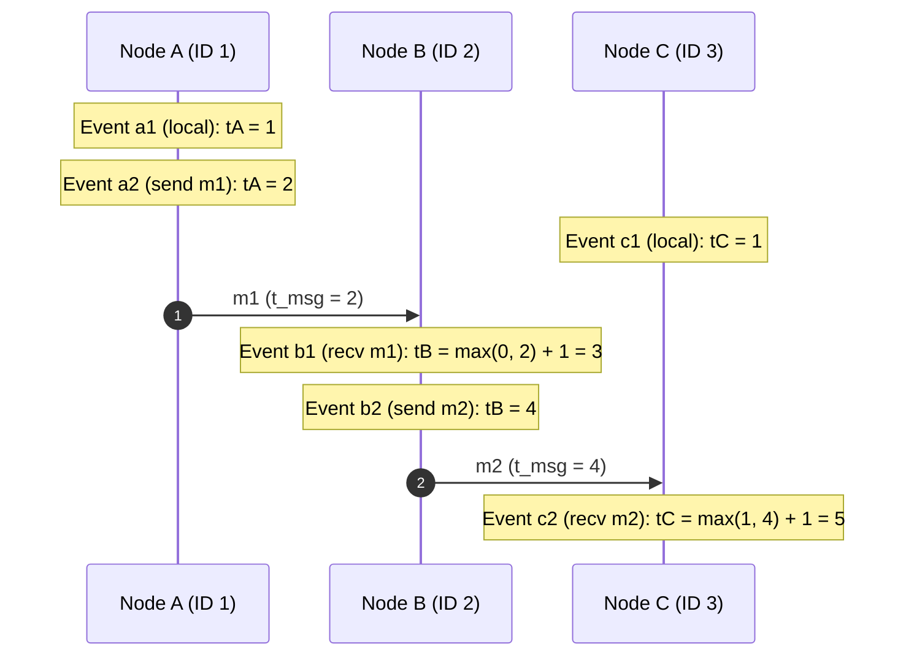

# Lamport Logical Clocks

Lamport Logical Clocks [Lamport 1978] provide a mechanism for capturing causal relationships in distributed systems by assigning a monotonically increasing integer timestamp to every event.

---

## 1. Problem Statement and Motivation

Physical clocks drift and suffer from unpredictable network skew. If two processes generate timestamps using unsynchronized physical clocks, an event $b$ causally caused by $a$ ($a \to b$) might receive a physical timestamp $t_b < t_a$.

Lamport observed that many distributed algorithms do not need to know *what time it is* on a wall clock; they only need to preserve **causality**:
$$\text{If } a \text{ causally preceded } b, \text{ then the timestamp of } a \text{ must be strictly less than the timestamp of } b.$$

---

## 2. The Clock Condition

Formally, let $C(e)$ be the timestamp assigned to event $e \in \mathcal{E}$.

> **The Clock Condition**: For any two events $a, b \in \mathcal{E}$:
> $$a \to b \implies C(a) < C(b)$$

A clock system is valid if and only if it satisfies this condition.

---

## 3. The Lamport Clock Algorithm

Each process $p_i \in \Pi$ maintains a local integer variable $t_i \in \mathbb{N}$, initialized to $0$.

### 3.1 Algorithm Pseudocode

```text
// Initialization at process p_i
on initialization do
    t_i := 0
end on

// Local execution event at process p_i
on local event e do
    t_i := t_i + 1
    assign timestamp L(e) := t_i
end on

// Sending a message m from process p_i
on request to send message m do
    t_i := t_i + 1
    send (m, t_i) over network
    assign timestamp L(send(m)) := t_i
end on

// Receiving a message (m, t_msg) at process p_i
on receiving (m, t_msg) from network do
    t_i := max(t_i, t_msg) + 1
    deliver m to application
    assign timestamp L(recv(m)) := t_i
end on
```

### 3.2 Proof of Correctness (Satisfying the Clock Condition)

> **Theorem**: The Lamport clock algorithm satisfies the Clock Condition: $\forall a, b \in \mathcal{E}, \; a \to b \implies L(a) < L(b)$.

#### Proof
By definition of the happens-before relation $\to$, we examine the three base cases:
1. **Case 1 (Same process)**: Events $a$ and $b$ occur at process $p_i$ with $a$ preceding $b$. Because $p_i$ increments $t_i$ by at least 1 between consecutive events, $L(b) \ge L(a) + 1 > L(a)$.
2. **Case 2 (Message send and receive)**: Event $a = \text{send}(m)$ at $p_i$ and event $b = \text{recv}(m)$ at $p_j$. The sender attaches $t_{\text{msg}} = L(a)$. Upon receipt, $p_j$ computes:
   $$L(b) = \max(t_j, t_{\text{msg}}) + 1 \ge t_{\text{msg}} + 1 = L(a) + 1 > L(a)$$
   Thus, $L(a) < L(b)$.
3. **Case 3 (Transitivity)**: If $a \to c$ and $c \to b$, by induction $L(a) < L(c)$ and $L(c) < L(b)$. By transitivity of $<$ over $\mathbb{N}$, $L(a) < L(b)$. $\blacksquare$

---

## 4. Total Ordering of Events ($\prec$)

While $\to$ is a partial order, many applications (e.g., distributed mutual exclusion, distributed lock managers) require a **strict total order** over all events in the system.

### 4.1 Tie-Breaking via Process Identifiers
We can extend Lamport timestamps into a strict total order $\prec$ by pairing each event's timestamp with the unique identifier of the process where it occurred:

$$\text{For events } a \text{ at } p_i \text{ and } b \text{ at } p_j:$$
$$a \prec b \iff (L(a) < L(b)) \lor (L(a) = L(b) \land i < j)$$

### 4.2 Causal Extension Property
> **Theorem**: The relation $\prec$ is a strict total order that is consistent with causality:
> $$a \to b \implies a \prec b$$

*Proof*: If $a \to b$, then $L(a) < L(b)$ by the Clock Condition. By definition of $\prec$, $L(a) < L(b) \implies a \prec b$. If $a \parallel b$, the tie-breaking on process IDs arbitrarily but deterministically orders them. $\blacksquare$

---

## 5. Worked Example and Trace Execution

Consider three processes $A$, $B$, and $C$:
- Process $A$ (ID 1) starts at $t_A = 0$.
- Process $B$ (ID 2) starts at $t_B = 0$.
- Process $C$ (ID 3) starts at $t_C = 0$.



### Trace Table

| Event | Node | Action | Local Counter Computation | Lamport Timestamp $L(e)$ | Total Order Identity $(L(e), \text{nodeId})$ |
| :--- | :--- | :--- | :--- | :---: | :---: |
| $a_1$ | A (1) | Local step | $0 + 1 = 1$ | 1 | $(1, 1)$ |
| $a_2$ | A (1) | Send $m_1$ | $1 + 1 = 2$ | 2 | $(2, 1)$ |
| $c_1$ | C (3) | Local step | $0 + 1 = 1$ | 1 | $(1, 3)$ |
| $b_1$ | B (2) | Recv $m_1$ | $\max(0, 2) + 1 = 3$ | 3 | $(3, 2)$ |
| $b_2$ | B (2) | Send $m_2$ | $3 + 1 = 4$ | 4 | $(4, 2)$ |
| $c_2$ | C (3) | Recv $m_2$ | $\max(1, 4) + 1 = 5$ | 5 | $(5, 3)$ |

Total order ranking ($\prec$):
$$(1, 1) \prec (1, 3) \prec (2, 1) \prec (3, 2) \prec (4, 2) \prec (5, 3)$$
Note that $a_1$ and $c_1$ were concurrent ($a_1 \parallel c_1$), but $\prec$ broke the tie consistently because $\text{NodeID}(A) = 1 < \text{NodeID}(C) = 3$.

---

## 6. The Fundamental Limitation of Lamport Clocks

The single greatest limitation of scalar Lamport clocks is that **the converse of the Clock Condition does not hold**:

$$L(a) < L(b) \not\implies a \to b$$

In the trace above:
- $L(c_1) = 1$ and $L(a_2) = 2 \implies L(c_1) < L(a_2)$.
- Yet, inspecting the execution reveals that $c_1$ and $a_2$ are completely causally independent: $c_1 \parallel a_2$.
- Looking at two Lamport timestamps $L(a)$ and $L(b)$ with $L(a) < L(b)$, an observer **cannot determine whether $a$ caused $b$ or whether $a$ and $b$ were concurrent**.

To detect concurrency and reconstruct exact causal dependencies, the system must use **Vector Clocks**.

---

## 7. Common Misconceptions

- **"Lamport timestamps tell us which event occurred first in physical time"**: False. A process that sits idle in a corner without receiving messages will have a very low counter, even if its events occur hours later in physical time than those of an active cluster.
- **"If $L(a) = L(b)$, the events must be concurrent"**: True if $a \ne b$, because distinct events on the same process always have strictly different counters. However, concurrent events can also have unequal timestamps ($L(a) < L(b)$ with $a \parallel b$).
- **"Lamport clocks require synchronous networks"**: False. The algorithm operates correctly in completely asynchronous networks ($\mathcal{ASYNCH}$).

---

## 8. Revision Questions

1. State the Clock Condition and explain why Lamport clocks satisfy it.
2. Given two events $e_1$ and $e_2$ with $L(e_1) = 4$ and $L(e_2) = 7$, what can you deduce about their causal relationship? Can you deduce that $e_1 \to e_2$?
3. Show how two concurrent writes to a key-value store ordered purely by Lamport timestamps can result in silent data loss under Last-Writer-Wins (LWW).
4. How is the total order relation $\prec$ defined to resolve ties between events with identical Lamport timestamps?

---

## 9. Authoritative References

- **[Lamport 1978]** Leslie Lamport. *Time, Clocks, and the Ordering of Events in a Distributed System*. Communications of the ACM, 21(7):558–565, 1978.
- **[Cachin, Guerraoui, Rodrigues 2011]** *Introduction to Reliable and Secure Distributed Programming*, Chapter 2. Springer, 2011.
- **[Kleppmann 2021]** Martin Kleppmann. *Distributed Systems Lecture Notes*, Chapter 4: Logical Time. University of Cambridge, 2021/22.
