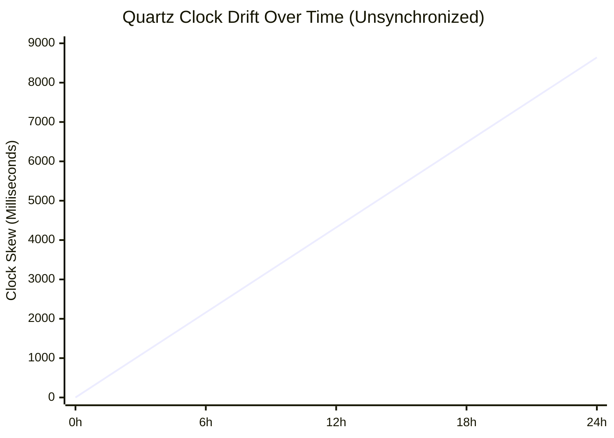
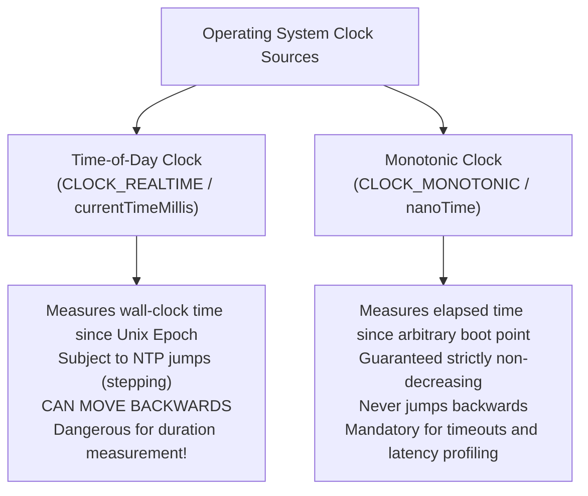
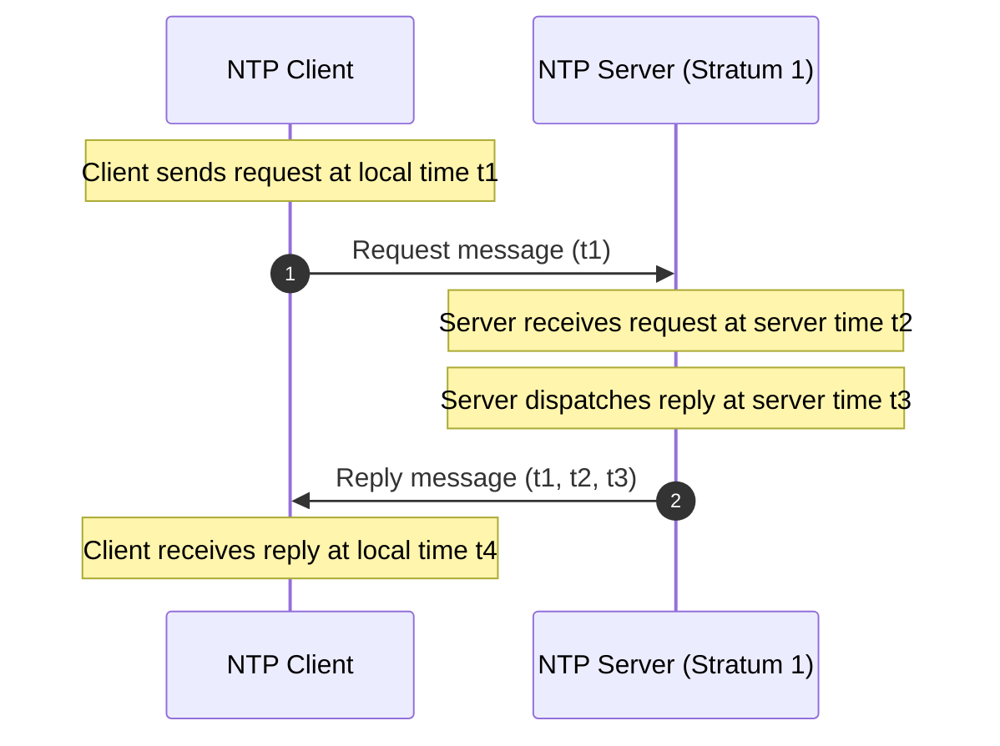

# Physical Clocks, NTP, and Google TrueTime

Physical clocks measure the passage of real physical time in seconds. In distributed systems, relying on physical clocks introduces fundamental hazards due to hardware oscillator drift, network jitter, and leap seconds.

---

## 1. Problem Statement and Motivation

Many distributed operations naturally want to reference physical wall-clock time:
- Expiring authentication tokens and cache leases.
- Ordering financial trades or log entries across datacenters.
- Debugging correlated failures across multiple independent servers.

However, computer clocks do not tell the absolute truth. Each machine relies on a quartz crystal oscillator that vibrates at a frequency sensitive to temperature, aging, and voltage fluctuations. Unsynchronized clocks drift apart, producing **clock skew**. When physical timestamps are used to order events, an update sent by process $A$ can arrive at process $B$ with a timestamp that is *older* than $B$'s current clock, violating causality.

---

## 2. Hardware Clocks and Drift Mechanics

### 2.1 Quartz Crystal Oscillators
Computers, smartphones, and network switches use quartz crystals tuned by the piezoelectric effect (typically oscillating at $32{,}768\text{ Hz}$).
- **Drift Rate ($\rho$)**: The rate at which a clock runs faster or slower than true International Atomic Time (TAI).
- **Units**: Measured in parts per million (ppm).
  $$1\text{ ppm} = 1\text{ \mu s/second} \approx 86.4\text{ ms/day} \approx 31.5\text{ seconds/year}$$
- Typical computer quartz oscillators exhibit drift of $\approx 10\text{--}50\text{ ppm}$. In non-temperature-controlled environments, drift can exceed $100\text{--}200\text{ ppm}$.

If two clocks drift in opposite directions at $50\text{ ppm}$, they drift apart by $100\text{ \mu s}$ every second—accumulating **8.6 seconds of skew in a single day** without synchronization.



### 2.2 Atomic Clocks and GPS
- **Caesium-133 Atomic Standard**: One SI second is defined as exactly $9{,}192{,}631{,}770$ cycles of the hyperfine transition frequency of caesium-133. Drift is less than 1 second in 3 million years ($10^{-14}$).
- **GPS Timing**: GPS satellites carry on-board rubidium/caesium atomic clocks and broadcast synchronized time. A receiver with an antenna on a datacenter roof can achieve clock accuracy within $\approx 100\text{ nanoseconds}$.

---

## 3. Time Standards and Leap Seconds

- **TAI (International Atomic Time)**: Continuous physical atomic timescale counting SI seconds.
- **UT1 (Universal Time)**: Solar time based on Earth's physical rotation on its axis. Because Earth's rotation fluctuates due to tidal friction and geological movement, UT1 deviates from TAI.
- **UTC (Coordinated Universal Time)**: The international civil standard. It tracks TAI ticks but inserts **leap seconds** (positive or negative) on June 30 or December 31 to keep $| \text{UTC} - \text{UT1} | < 0.9\text{ seconds}$.

### The Leap Second Hazard
When a positive leap second occurs, the clock sequence is:
$$23:59:59 \to 23:59:60 \to 00:00:00$$
Many operating systems and applications assume every minute has exactly 60 seconds ($86{,}400\text{ seconds/day}$). On June 30, 2012, a leap second bug in the Linux kernel timer subsystem caused CPU livelocks that brought down major global internet services [Allen 2013, Minar 2012].

### Pragmatic Solution: Leap Smearing
Modern cloud providers (Google, AWS, Meta) use **leap smearing**: rather than inserting a discrete second at midnight, the extra second is gradually smeared across a 24-hour window by slowing down system clocks by $\approx 11.6\text{ ppm}$ ($0.00116\%$).

---

## 4. Time-of-Day vs. Monotonic Clocks

Operating systems provide two distinct clock APIs:



```java
// DANGEROUS: Clock stepping can produce negative elapsed time!
long start = System.currentTimeMillis();
doWork();
long elapsed = System.currentTimeMillis() - start; // May be < 0 if NTP stepped back!

// SAFE: Monotonic clock is guaranteed to never run backwards
long startNano = System.nanoTime();
doWork();
long elapsedNano = System.nanoTime() - startNano; // Always >= 0
```

---

## 5. Network Time Protocol (NTP)

NTP synchronizes client clocks with hierarchical time servers (Strata 0 to 15) across packet-switched networks.



### 5.1 Skew and Delay Formulations
- **Round-Trip Delay ($\delta$)**:
  $$\delta = (t_4 - t_1) - (t_3 - t_2)$$
- **Estimated Clock Skew ($\theta$)**:
  Assuming symmetric network latency in both directions ($\text{delay}_{C \to S} \approx \text{delay}_{S \to C} \approx \delta/2$):
  $$t_{\text{server\_est}} = t_3 + \frac{\delta}{2} = t_3 + \frac{(t_4 - t_1) - (t_3 - t_2)}{2}$$
  $$\theta = t_{\text{server\_est}} - t_4 = \frac{(t_2 - t_1) + (t_3 - t_4)}{2}$$

### 5.2 Maximum Error Bound
> **Theorem**: The maximum possible error in the estimated clock skew $\theta$, assuming both nodes execute the protocol correctly, is bounded by half the round-trip delay:
> $$|\text{Error}| \le \frac{\delta}{2}$$

*Proof*: The actual one-way transit time $d_{req}$ must satisfy $0 \le d_{req} \le \delta$. The assumed delay is $\delta/2$. Thus, the maximum departure from the assumed midpoint is $\delta/2$. $\blacksquare$

### 5.3 Clock Discipline: Slewing vs. Stepping
Once the client estimates skew $\theta$:
1. **Slewing ($|\theta| < 125\text{ ms}$)**: The OS kernel gradually speeds up or slows down the clock tick rate by up to $500\text{ ppm}$ ($0.05\%$), bringing the clock into alignment over several minutes without causing discrete time jumps.
2. **Stepping ($125\text{ ms} \le |\theta| < 1000\text{ s}$)**: The clock is forcibly jumped forward or backward to the estimated timestamp.
3. **Panic Mode ($|\theta| \ge 1000\text{ s}$)**: NTP halts automatic adjustment and alerts human operators to prevent catastrophic clock instability.

---

## 6. Google Spanner's TrueTime Architecture

Google Spanner [Corbett et al. 2012] solves the causal ordering problem of physical time by **reifying clock uncertainty directly in the API**.

### 6.1 The TrueTime API
Instead of returning a single scalar timestamp, the TrueTime API returns a bounded uncertainty interval:
$$\text{TT.now}() \to [t_{\text{earliest}}, t_{\text{latest}}]$$
where the true absolute physical time $t_{\text{real}}$ is guaranteed with high probability to lie within the interval:
$$t_{\text{earliest}} \le t_{\text{real}} \le t_{\text{latest}}$$
The **uncertainty bound** is $\epsilon = (t_{\text{latest}} - t_{\text{earliest}})/2$.
Under normal datacenter conditions with redundant GPS and atomic clocks, $\epsilon$ is kept small ($\approx 1\text{--}7\text{ ms}$).

### 6.2 The Commit Wait Rule
Spanner achieves **External Consistency (Strict Serializability)**: if transaction $T_2$ starts after transaction $T_1$ commits in real time, then $T_2$'s commit timestamp must be strictly greater than $T_1$'s ($s_1 < s_2$).

#### Algorithm
1. Transaction $T_1$ acquires write locks and selects a commit timestamp $s_1 = \text{TT.now}().\text{latest}$.
2. **Commit Wait**: $T_1$ delays releasing its locks and exposing its updates until it has waited out its uncertainty:
   $$\text{Wait until } \text{TT.now}().\text{earliest} > s_1$$
3. By waiting for $2\epsilon$, Spanner guarantees that the absolute real time $t_{\text{real}}$ has surpassed $s_1$. Therefore, any subsequent transaction $T_2$ invoking $\text{TT.now}()$ will obtain an earliest timestamp $t_{\text{earliest}} > s_1$.

```mermaid
sequenceDiagram
    autonumber
    participant T1 as Transaction T1
    participant TT as TrueTime Engine
    participant T2 as Transaction T2

    Note over T1: T1 prepares to commit
    T1->>TT: TT.now() -> [earliest_1, latest_1]
    Note over T1: Pick commit timestamp s1 = latest_1
    Note over T1: Commit Wait: Pause until TT.now().earliest > s1
    Note over T1: Locks released; writes visible
    
    Note over T2: T2 begins in real time after T1 committed
    T2->>TT: TT.now() -> [earliest_2, latest_2]
    Note over T2: Guaranteed: earliest_2 > s1 => s2 > s1!
```

This remarkable result enables Spanner to execute **consistent read-only transactions across global datacenters without taking read locks or exchanging messages with writer nodes**.

---

## 7. Comparison Matrix

| Mechanism | Clock Type | Monotonic? | Cross-Node Comparable? | Order Consistency |
| :--- | :--- | :---: | :---: | :--- |
| **`CLOCK_REALTIME`** | Physical Wall Clock | ❌ (NTP jumps) | Approximate ($\pm \text{ms}$) | Violates causality under skew |
| **`CLOCK_MONOTONIC`** | Process Timer | ✔️ | ❌ (Local only) | Unusable across nodes |
| **NTP** | Synchronized Physical | ❌ (when stepping) | $\pm 1\text{--}50\text{ ms}$ | Violates causality under skew |
| **TrueTime** | Bounded Interval Physical | ✔️ (Wait-rule) | ✔️ Globally | **Preserves causality** (Strict Serializability) |

---

## 8. Revision Questions

1. Explain the difference between clock drift rate and instantaneous clock skew.
2. In NTP, prove that if the round-trip network latency is $\delta$, the maximum error in the skew estimate is $\le \delta / 2$.
3. Why does measuring elapsed execution time with `System.currentTimeMillis()` risk negative duration values?
4. In Google Spanner, why must a writer transaction pause for its uncertainty duration $\delta = t_{\text{latest}} - t_{\text{earliest}}$ before committing?

---

## 9. Authoritative References

- **[Mills 1991]** David L. Mills. *Internet Time Synchronization: The Network Time Protocol*. IEEE Transactions on Communications, 39(10):1482–1493, 1991.
- **[Corbett et al. 2012]** James C. Corbett et al. *Spanner: Google’s Globally-Distributed Database*. OSDI 2012.
- **[Kleppmann 2021]** Martin Kleppmann. *Distributed Systems Lecture Notes*, Chapter 3: Physical Clocks and Clock Synchronisation. University of Cambridge, 2021/22.
