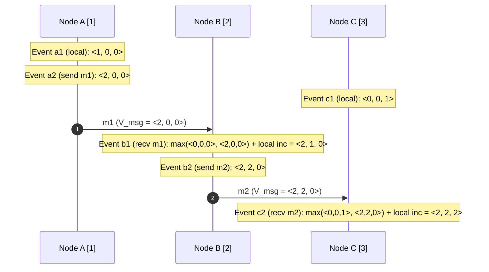

# Vector Clocks

Vector clocks [Mattern 1989, Fidge 1988] generalize scalar logical clocks to provide an exact mathematical isomorphism to the happens-before causal partial order.

---

## 1. Problem Statement and Motivation

Scalar Lamport clocks satisfy the one-way implication:
$$a \to b \implies L(a) < L(b)$$
However, if $L(a) < L(b)$, an observer **cannot determine** whether $a$ causally preceded $b$ ($a \to b$) or whether they were concurrent ($a \parallel b$).

In distributed data stores, collaborative text editors, and optimistic replication systems, detecting concurrency is critical:
- In Amazon Dynamo [DeCandia et al. 2007], concurrent updates to a shopping cart must be preserved as siblings rather than silently overwritten.
- In causal broadcast, a message must be held back until all messages in its causal past have been delivered.

To capture concurrency and causal history precisely, each process must track not just a single scalar, but a **vector of event counters** across all processes in the system.

---

## 2. Mathematical Formalization

Let $\Pi = \{p_1, p_2, \dots, p_n\}$ be a fixed set of $n$ processes.
A vector timestamp $V$ is an $n$-element array of natural numbers:
$$V = \langle v_1, v_2, \dots, v_n \rangle \in \mathbb{N}^n$$
where $V[k]$ represents the number of events known to have occurred at process $p_k$.

### 2.1 Set-Theoretic Representation
For any event $e$, the vector timestamp $V(e)$ represents the set of all events in $e$'s causal past, inclusive of $e$:
$$\text{Past}(e) = \{a \in \mathcal{E} \mid a \to e\} \cup \{e\}$$
The $k$-th component $V(e)[k]$ is precisely the cardinality of events in $\text{Past}(e)$ that occurred at process $p_k$:
$$V(e)[k] = |\{a \in \text{Past}(e) \mid \text{node}(a) = p_k\}|$$

### 2.2 Vector Ordering Rules
For any two vector timestamps $V, V' \in \mathbb{N}^n$:

1. **Equality ($=$)**:
   $$V = V' \iff \forall k \in \{1,\dots,n\}: V[k] = V'[k]$$
2. **Partial Order ($\le$)**:
   $$V \le V' \iff \forall k \in \{1,\dots,n\}: V[k] \le V'[k]$$
3. **Strict Causal Precedence ($<$)**:
   $$V < V' \iff (V \le V') \land (V \ne V')$$
4. **Causal Concurrency ($\parallel$)**:
   $$V \parallel V' \iff (V \not\le V') \land (V' \not\le V)$$

---

## 3. The Isomorphism Theorem

> **Theorem (Causal Isomorphism)**: Vector clocks reflect the happens-before partial order with bidirectional equivalence:
> $$\forall a, b \in \mathcal{E}: \; a \to b \iff V(a) < V(b)$$
> $$\forall a, b \in \mathcal{E}: \; a \parallel b \iff V(a) \parallel V(b)$$

### Proof Sketch
- $(\implies)$ If $a \to b$, every event in $\text{Past}(a)$ must also belong to $\text{Past}(b)$ by transitivity ($\text{Past}(a) \subset \text{Past}(b)$). Because $b \notin \text{Past}(a)$ while $b \in \text{Past}(b)$, at least the component corresponding to $\text{node}(b)$ is strictly larger, while all other components are $\ge$. Thus, $V(a) < V(b)$.
- $(\impliedby)$ If $V(a) < V(b)$, then $\text{Past}(a) \subset \text{Past}(b)$. If $a$ were not in $b$'s causal past, process $\text{node}(a)$ could not have accounted for $a$'s counter in $V(b)$, as counters only advance locally or via explicit message transmission. Thus, $a \in \text{Past}(b) \implies a \to b$. $\blacksquare$

---

## 4. The Vector Clock Algorithm

Each process $p_i \in \Pi$ maintains a local vector $V_i \in \mathbb{N}^n$, initialized to all zeros.

### 4.1 Pseudocode

```text
// Initialization at process p_i
on initialization do
    V_i := [0, 0, ..., 0]  // Vector of size n
end on

// Local execution event at process p_i
on local event e do
    V_i[i] := V_i[i] + 1
    assign timestamp V(e) := copy(V_i)
end on

// Sending message m from process p_i
on request to send message m do
    V_i[i] := V_i[i] + 1
    send (m, V_i) over network
    assign timestamp V(send(m)) := copy(V_i)
end on

// Receiving message (m, V_msg) at process p_i
on receiving (m, V_msg) from network do
    // Element-wise merge of causal histories
    for j := 1 to n do
        V_i[j] := max(V_i[j], V_msg[j])
    end for
    // Increment local event counter
    V_i[i] := V_i[i] + 1
    deliver m to application
    assign timestamp V(recv(m)) := copy(V_i)
end on
```

---

## 5. Worked Example: Step-by-Step Execution Trace

Consider three processes $A$ (index 1), $B$ (index 2), and $C$ (index 3).
Initially: $V_A = \langle 0, 0, 0 \rangle, \; V_B = \langle 0, 0, 0 \rangle, \; V_C = \langle 0, 0, 0 \rangle$.



### Trace Table of Vector Clock States

| Event | Process | Action | Computation Step | Assigned Timestamp $V(e)$ |
| :---: | :---: | :--- | :--- | :---: |
| $a_1$ | A | Local event | $V_A[1] = 0 + 1$ | $\langle 1, 0, 0 \rangle$ |
| $a_2$ | A | Send $m_1$ | $V_A[1] = 1 + 1$ | $\langle 2, 0, 0 \rangle$ |
| $c_1$ | C | Local event | $V_C[3] = 0 + 1$ | $\langle 0, 0, 1 \rangle$ |
| $b_1$ | B | Recv $m_1$ | $\max(V_B, \langle 2, 0, 0 \rangle) = \langle 2, 0, 0 \rangle$; $V_B[2] = 0 + 1$ | $\langle 2, 1, 0 \rangle$ |
| $b_2$ | B | Send $m_2$ | $V_B[2] = 1 + 1$ | $\langle 2, 2, 0 \rangle$ |
| $c_2$ | C | Recv $m_2$ | $\max(V_C, \langle 2, 2, 0 \rangle) = \langle 2, 2, 1 \rangle$; $V_C[3] = 1 + 1$ | $\langle 2, 2, 2 \rangle$ |

### Evaluating Causal Relationships
1. **Comparing $a_2$ and $b_1$**:
   $$V(a_2) = \langle 2, 0, 0 \rangle, \quad V(b_1) = \langle 2, 1, 0 \rangle$$
   $\forall k: V(a_2)[k] \le V(b_1)[k]$, and $0 < 1$. Thus, $V(a_2) < V(b_1) \implies a_2 \to b_1$ (Causal relationship verified).
2. **Comparing $a_2$ and $c_1$**:
   $$V(a_2) = \langle 2, 0, 0 \rangle, \quad V(c_1) = \langle 0, 0, 1 \rangle$$
   - For index 1: $V(a_2)[1] = 2 > V(c_1)[1] = 0$.
   - For index 3: $V(a_2)[3] = 0 < V(c_1)[3] = 1$.
   - Neither vector is $\le$ the other!
   - Thus, $V(a_2) \parallel V(c_1) \implies a_2 \parallel c_1$ (**Concurrency detected without false positives**).

---

## 6. Space Complexity and Scalability Bottlenecks

### 6.1 The $O(n)$ Linear Footprint
A standard vector clock requires $n$ entries. In a system with:
- $n = 5$ cluster nodes: negligible ($5 \times 8\text{ bytes} = 40\text{ bytes}$).
- $n = 100{,}000$ client devices or dynamic actors: **prohibitive**. Every database key and every network message would require hundreds of kilobytes of metadata, exceeding the payload size.

### 6.2 Dotted Version Vectors (DVVs)
To scale optimistic replication without storing unbounded vectors per client, systems use **Dotted Version Vectors (DVVs)** [Preguiça et al. 2010]:
- Server replicas (small fixed set $S$) maintain standard vector clocks.
- Clients attach a lightweight "dot" $(s, c)$ representing their specific update version without maintaining full client vectors.

---

## 7. Comparison: Lamport Clocks vs. Vector Clocks

| Dimension | Lamport Logical Clock | Vector Clock |
| :--- | :--- | :--- |
| **Data Representation** | Single scalar integer ($t \in \mathbb{N}$) | Vector of integers ($V \in \mathbb{N}^n$) |
| **Space Overhead per Message** | $O(1)$ | $O(n)$ where $n = |\Pi|$ |
| **Causal Implication** | $a \to b \implies L(a) < L(b)$ | $a \to b \iff V(a) < V(b)$ |
| **Detects Concurrency?** | **No** ($L(a) < L(b)$ can occur for $a \parallel b$) | **Yes** ($V(a) \parallel V(b) \iff a \parallel b$) |
| **Total Ordering** | Trivial via tie-breaking: $(L(e), \text{nodeId})$ | Requires topological linear extension |
| **Typical Use Cases** | Total order broadcast, mutual exclusion | Multi-version registers, CRDTs, Dynamo siblings |

---

## 8. Revision Questions

1. State the vector clock partial order relation $\le$ and the strict relation $<$.
2. Prove that if $V(a) \parallel V(b)$, then neither $a \to b$ nor $b \to a$ can be true.
3. In a system with 3 nodes, suppose node 1 has vector $\langle 3, 1, 4 \rangle$ and node 2 has vector $\langle 2, 2, 4 \rangle$. Are these states causally ordered or concurrent?
4. Why does an unbounded or dynamically joining process set make classical vector clocks impractical in peer-to-peer or mobile client applications?

---

## 9. Authoritative References

- **[Mattern 1989]** Friedemann Mattern. *Virtual Time and Global States of Distributed Systems*. Workshop on Parallel and Distributed Algorithms, 1989.
- **[Fidge 1988]** Colin J. Fidge. *Timestamps in Message-Passing Systems That Preserve the Partial Ordering*. ACSC, 1988.
- **[Preguiça et al. 2010]** Nuno Preguiça, Carlos Baquero, Paulo Sérgio Almeida, Victor Fonte, and Ricardo Gonçalves. *Dotted Version Vectors: Logical Clocks for Optimistic Replication*. arXiv:1011.5808, 2010.
- **[Kleppmann 2021]** Martin Kleppmann. *Distributed Systems Lecture Notes*, Chapter 4: Logical Time. University of Cambridge, 2021/22.
