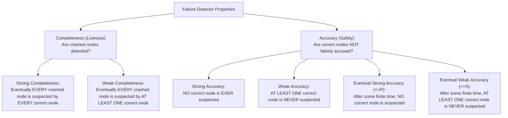
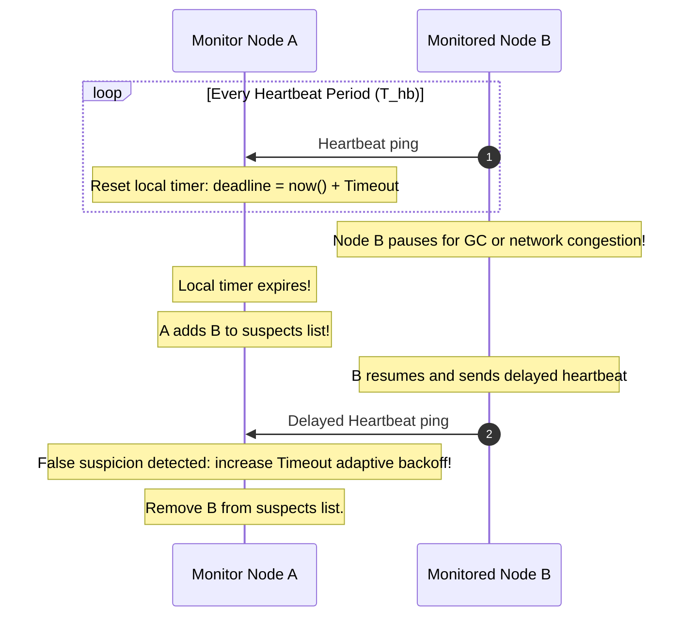

# Failure Detectors and Chandra-Toueg Classes

A **failure detector** is an algorithmic oracle that provides processes with dynamic, potentially imperfect information regarding which nodes have crashed.

---

## 1. Problem Statement and Motivation

In an asynchronous distributed system ($\mathcal{ASYNCH}$), the FLP impossibility theorem proves that deterministic consensus cannot be solved if even a single process can crash. The root cause is indistinguishability: an active node cannot distinguish between a crashed peer and one experiencing extreme message delay or execution pause.

In their seminal 1996 paper, Tushar Chandra and Sam Toueg decoupled timing assumptions from distributed algorithms by introducing **Unreliable Failure Detectors**. Instead of modifying the network model, an algorithm is supplied with an abstract local module $\mathcal{D}_i$ that outputs a list of suspected crashed processes. By characterizing the minimum properties this oracle must satisfy, we can solve consensus in asynchronous systems augmented with failure detectors.

---

## 2. Axiomatic Formalization: Completeness and Accuracy

A failure detector is characterized by two orthogonal properties: **Completeness** (detecting actual crashes) and **Accuracy** (avoiding false accusations of healthy nodes).

### 2.1 Completeness (Liveness Metric)
- **Strong Completeness**: Eventually every process that crashes is permanently suspected by **every correct process**:
  $$\forall p \in \text{Crashed}, \; \forall q \in \text{Correct}, \; \exists t: \; \forall t' \ge t, \; p \in \text{suspects}_q(t')$$
- **Weak Completeness**: Eventually every process that crashes is permanently suspected by **at least one correct process**:
  $$\forall p \in \text{Crashed}, \; \exists q \in \text{Correct}, \; \exists t: \; \forall t' \ge t, \; p \in \text{suspects}_q(t')$$

> **Reduction Theorem**: Any failure detector with Weak Completeness can be transformed into one with Strong Completeness simply by having processes gossip their suspicion lists.

### 2.2 Accuracy (Safety Metric)
- **Strong Accuracy**: No correct process is ever suspected by any process.
- **Weak Accuracy**: There exists at least one correct process that is never suspected by any process.
- **Eventual Strong Accuracy ($\diamondsuit$)**: There is a finite time after which no correct process is ever suspected:
  $$\exists t: \; \forall t' \ge t, \; \forall q \in \text{Correct}, \; \forall p \in \Pi, \; q \notin \text{suspects}_p(t')$$
- **Eventual Weak Accuracy ($\diamondsuit$)**: There is a finite time after which at least one correct process is never suspected by any process.

---

## 3. The Eight Chandra-Toueg Failure Detector Classes

Combining the two dimensions produces the eight classical failure detector classes:

| Completeness | Strong Accuracy | Weak Accuracy | Eventual Strong Accuracy | Eventual Weak Accuracy |
| :--- | :---: | :---: | :---: | :---: |
| **Strong Completeness** | **$\mathcal{P}$** (Perfect) | **$\mathcal{S}$** (Strong) | **$\diamondsuit\mathcal{P}$** (Eventually Perfect) | **$\diamondsuit\mathcal{S}$** (Eventually Strong) |
| **Weak Completeness** | **$\mathcal{Q}$** (Quasi-Perfect) | **$\mathcal{W}$** (Weak) | **$\diamondsuit\mathcal{Q}$** | **$\diamondsuit\mathcal{W}$** (Eventually Weak) |

### 3.1 The Perfect Failure Detector ($\mathcal{P}$)
- **Guarantees**: Strong Completeness + Strong Accuracy.
- **Behavior**: A node is suspected if and only if it has crashed. Zero false positives.
- **Feasibility**: Implementable **only in synchronous systems ($\mathcal{SYNCH}$)** where transmission delay is strictly $\le \Delta$. Impossible in $\mathcal{ASYNCH}$ and $\mathcal{PARTIAL}$.

### 3.2 The Eventually Perfect Failure Detector ($\diamondsuit\mathcal{P}$)
- **Guarantees**: Strong Completeness + Eventual Strong Accuracy.
- **Behavior**: May make mistakes and issue spurious suspicions during turbulent periods (network latency spikes, GC pauses). However, after Global Stabilization Time (GST), all false suspicions cease permanently.
- **Feasibility**: Implementable in **partially synchronous systems ($\mathcal{PARTIAL}$)** using adaptive timeouts.

---

## 4. The Leader Oracle $\Omega$ (The Weakest Failure Detector for Consensus)

In 1996, Chandra, Hadzilacos, and Toueg answered the fundamental question: *What is the absolute minimum information about failures required to solve consensus in an asynchronous system?*

### 4.1 Definition of $\Omega$
The **Leader Oracle $\Omega$** outputs at each process $p_i$ a single process ID:
$$\Omega_i \in \Pi$$
satisfying the property:
$$\exists p^* \in \text{Correct}, \; \exists t: \; \forall t' \ge t, \; \forall p_i \in \text{Correct}, \quad \Omega_i(t') = p^*$$

After some finite but unknown time, **all correct processes agree on the identity of a single, correct leader process $p^*$**.

### 4.2 Equivalence Theorem
> **Theorem (Chandra, Hadzilacos, Toueg 1996)**: $\Omega$ and $\diamondsuit\mathcal{S}$ are formally equivalent. Furthermore, $\Omega$ is the **weakest failure detector** capable of solving Consensus in asynchronous systems with a majority of correct processes ($n > 2f$).

Modern consensus protocols like Paxos and Raft are direct practical implementations of consensus over $\Omega$: they can tolerate erratic leader elections and split votes indefinitely, but guarantee termination once $\Omega$ stabilizes on a single leader.

---

## 5. Practical Implementation: Heartbeats and Adaptive Timeouts

In practice, failure detectors use periodic heartbeats.

### 5.1 Simple Timeout Adaptation
Let $\tau_k$ be the timeout for round $k$. If a heartbeat arrives with latency $d$:
$$\mu_{k+1} = \alpha \mu_k + (1 - \alpha) d \quad (\text{Exponential Moving Average})$$
$$\sigma_{k+1}^2 = \alpha \sigma_k^2 + (1 - \alpha) (d - \mu_{k+1})^2$$
$$\tau_{k+1} = \mu_{k+1} + 4 \sigma_{k+1}$$
By setting $\tau$ four standard deviations above the mean network RTT, the probability of a spurious timeout under Gaussian network delay is $< 0.003\%$.

### 5.2 The $\phi$-Accrual Failure Detector [Hayashibara et al. 2004]
Instead of returning a binary decision (`alive` or `dead`), the $\phi$-Accrual detector outputs a continuous scale of suspicion:
$$\phi = -\log_{10}(P_{\text{later}}(t - t_{\text{last}}))$$
where $P_{\text{later}}(t)$ is the probability that a heartbeat will arrive more than $t$ time units after the previous one, based on historical arrival distributions.
- If $\phi = 1 \implies 10\%$ chance of false suspicion.
- If $\phi = 2 \implies 1\%$ chance of false suspicion.
- If $\phi = 8 \implies 10^{-8}$ chance of false suspicion.
- Applications (such as Apache Cassandra and Akka Cluster) configure a threshold $\Phi_{\text{threshold}}$ (typically $8\text{--}12$) to balance detection latency against false positive rates.

---

## 6. Revision Questions

1. State the difference between Strong Completeness and Weak Completeness, and explain how Weak Completeness is converted to Strong Completeness.
2. Why is the Perfect Failure Detector $\mathcal{P}$ mathematically impossible to construct in an asynchronous network?
3. State the operational guarantee of the Leader Oracle $\Omega$ and explain why it is described as the "weakest failure detector for consensus".
4. How does the $\phi$-Accrual failure detector improve upon static binary timeout detectors in real-world datacenter networks?

---

## 7. Authoritative References

- **[Chandra, Toueg 1996]** Tushar Deepak Chandra and Sam Toueg. *Unreliable Failure Detectors for Reliable Distributed Systems*. Journal of the ACM, 43(2):225–267, 1996.
- **[Chandra, Hadzilacos, Toueg 1996]** Tushar Deepak Chandra, Vassos Hadzilacos, and Sam Toueg. *The Weakest Failure Detector for Solving Consensus*. Journal of the ACM, 43(4):685–722, 1996.
- **[Hayashibara et al. 2004]** Naohiro Hayashibara, Xavier Défago, Rami Yared, and Peter Katritsis. *The $\phi$ Accrual Failure Detector*. SRDS 2004.
- **[Kleppmann 2021]** Martin Kleppmann. *Distributed Systems Lecture Notes*, Section 2.4: Failure Detectors. 2021/22.
