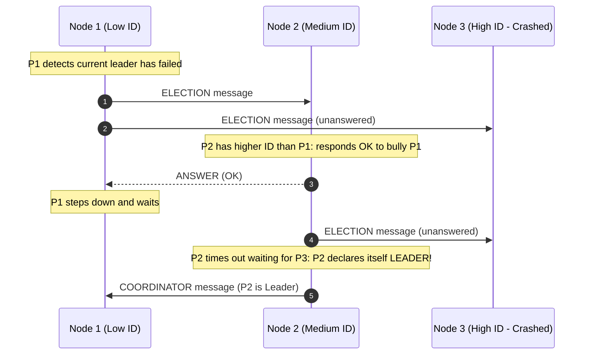
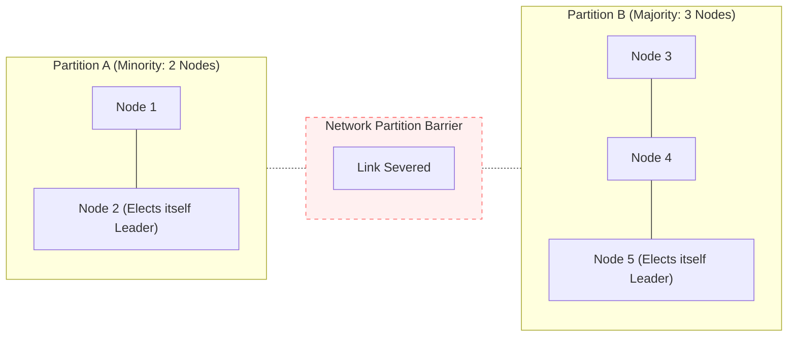

# Leader Election and Fencing

Leader election is the distributed coordination problem of dynamically designating a single non-faulty process from a group $\Pi$ to act as coordinator or sequencer for subsequent operations.

---

## 1. Problem Statement and Formal Specification

Many distributed architectures require a central coordinator to serialize operations (e.g., total order broadcast sequencer, primary-backup database leader, Raft leader). If the active coordinator crashes, the remaining nodes must elect a new coordinator without human intervention.

### Formal Properties
Let $\text{leader}_i \in \Pi \cup \{\bot\}$ denote the leader recognized by process $p_i$ at time $t$.
1. **Safety (Uniqueness / No Split-Brain)**:
   At any point in time within an epoch or term $e$, at most one correct process considers itself the leader:
   $$\forall p_i, p_j \in \Pi: \quad (\text{role}_i = \text{LEADER} \land \text{role}_j = \text{LEADER} \land \text{term}_i = \text{term}_j) \implies i = j$$
2. **Liveness (Termination)**:
   If the current leader crashes or becomes unreachable, then eventually all correct processes elect a new correct process as leader:
   $$\exists p^* \in \text{Correct}, \; \exists t: \; \forall t' \ge t, \; \forall p_i \in \text{Correct}, \quad \text{leader}_i(t') = p^*$$

---

## 2. Classic Election Algorithms

### 2.1 The Bully Algorithm [Garcia-Molina 1982]
Assumes a synchronous system where each process has a unique, totally ordered priority ID $i \in \{1, 2, \dots, n\}$. The process with the highest ID always bullies lower-ranked nodes into submission.



- **Message Complexity**: Worst-case $O(n^2)$ messages when the lowest-ranked process initiates the election.

---

### 2.2 Ring-Based Election Algorithm [Chang & Roberts 1979]
Assumes processes are arranged in a logical unidirectional ring where messages flow in one direction ($p_i \to p_{i+1}$).

```text
// Ring Election at process p_i
on detecting leader failure do
    send (ELECTION, {p_i}) to successor
end on

on receiving (ELECTION, candidate_set) do
    if p_i not in candidate_set then
        send (ELECTION, candidate_set union {p_i}) to successor
    else
        // The message has circumnavigated the entire ring!
        elected := max(candidate_set)
        send (ELECTED, elected) to successor
    end if
end on

on receiving (ELECTED, leader_id) do
    leader := leader_id
    if leader_id != p_i then
        forward (ELECTED, leader_id) to successor
    end if
end on
```
- **Message Complexity**: $O(n \log n)$ average messages, $O(n^2)$ worst-case.

---

## 3. The Split-Brain Hazard and Network Partitions

In asynchronous or partially synchronous networks, the Bully and Ring algorithms are vulnerable to **Split-Brain**:
- Suppose a network partition divides a 5-node cluster into partition $A = \{p_1, p_2\}$ and partition $B = \{p_3, p_4, p_5\}$.
- Partition $A$ suspects $p_5$ has crashed and elects $p_2$.
- Partition $B$ suspects $p_2$ has crashed and elects $p_5$.
- **Disaster**: Both $p_2$ and $p_5$ believe they are the legitimate leader, accepting concurrent conflicting writes and corrupting storage.



---

## 4. Quorum-Based Leader Election (Term / Epoch Dynamics)

Modern fault-tolerant consensus systems (Raft, Paxos, Viewstamped Replication) prevent split-brain by combining **Monotonic Terms (Epochs)** with **Majority Quorums**:

### 4.1 Invariants
1. **Term Monotonicity**: Every election corresponds to an integer term $t \in \mathbb{N}$. A node increments its term counter before requesting votes.
2. **One Vote Per Term**: Each node votes for **at most one candidate** per term.
3. **Majority Quorum Requirement**: A candidate becomes leader if and only if it receives positive votes from a strict majority quorum $Q$:
   $$|Q| \ge \left\lfloor \frac{n}{2} \right\rfloor + 1$$

### 4.2 Safety Proof (At Most One Leader per Term)
> **Theorem**: In any term $t$, there is at most one leader elected.

*Proof*:
1. Suppose by contradiction that two distinct processes $p_1$ and $p_2$ are both elected leader in term $t$.
2. To be elected, $p_1$ must have received votes from a majority quorum $Q_1$, where $|Q_1| > n/2$.
3. Similarly, $p_2$ must have received votes from a majority quorum $Q_2$, where $|Q_2| > n/2$.
4. By the Pigeonhole Principle, $Q_1 \cap Q_2 \ne \emptyset$. Let $p_k \in Q_1 \cap Q_2$.
5. Process $p_k$ must have voted for both $p_1$ and $p_2$ in term $t$.
6. This contradicts Invariant 2 (a node votes at most once per term). Thus, $p_1 = p_2$. $\blacksquare$

---

## 5. Fencing Tokens: Guarding Against Zombie Leaders

Even with quorum elections, a leader can experience a Stop-The-World GC pause or network stall, be replaced by a new leader, and subsequently resume execution **unaware that it was deposed**. This zombie leader may attempt to execute writes against storage.

```mermaid
sequenceDiagram
    autonumber
    participant L1 as Old Leader (Node 1)
    participant Q as Quorum / Cluster
    participant L2 as New Leader (Node 2)
    participant Storage as Shared Storage Engine

    Note over L1: L1 is Leader in Term 1
    Note over L1: L1 experiences a 30s Stop-The-World GC Pause!
    Note over Q: Quorum times out waiting for L1; increments Term to 2
    Q->>L2: Elect L2 Leader in Term 2 (Token = 2)
    L2->>Storage: write(data, Token = 2)
    Note over Storage: Storage records highest token seen: 2. Write OK.
    Storage-->>L2: OK
    
    Note over L1: L1 resumes from GC pause! Still thinks it is Leader!
    L1->>Storage: write(stale_data, Token = 1)
    Note over Storage: FENCING CHECK: Token 1 < Max Token 2!<br/>REJECT STALE WRITE!
    Storage-->>L1: Error: Token Stale
```

### The Fencing Invariant
1. The leader election service assigns an incrementing monotonic number (the **Fencing Token**) to each newly elected leader.
2. Every request to the underlying storage engine must include the leader's current token.
3. The storage engine tracks the highest token it has processed:
   $$\text{If } \text{token}_{\text{req}} < \text{highest\_token}, \quad \text{REJECT REQUEST}.$$

---

## 6. Revision Questions

1. State the safety and liveness conditions of the leader election problem.
2. In the Bully algorithm, what happens if the network suffers an asymmetric partition where node 1 can reach node 2, but node 2 cannot reach node 1?
3. Prove that requiring a majority quorum to elect a leader guarantees at most one leader can be elected per term.
4. Explain how a fencing token prevents a stale leader that resumed from a long GC pause from corrupting shared storage.

---

## 7. Authoritative References

- **[Garcia-Molina 1982]** Hector Garcia-Molina. *Elections in a Distributed Computing System*. IEEE Transactions on Computers, C-31(1):48–59, 1982.
- **[Chang, Roberts 1979]** Ernest Chang and Rosemary Roberts. *An Improved Algorithm for Decentralized Extrema-Finding in Circular Configurations of Processes*. CACM, 22(5):281–283, 1979.
- **[Ongaro, Ousterhout 2014]** Diego Ongaro and John Ousterhout. *In Search of an Understandable Consensus Algorithm*. USENIX ATC 2014.
- **[Kleppmann 2021]** Martin Kleppmann. *Distributed Systems Lecture Notes*, Chapter 6: Consensus and Leader Election. 2021/22.
