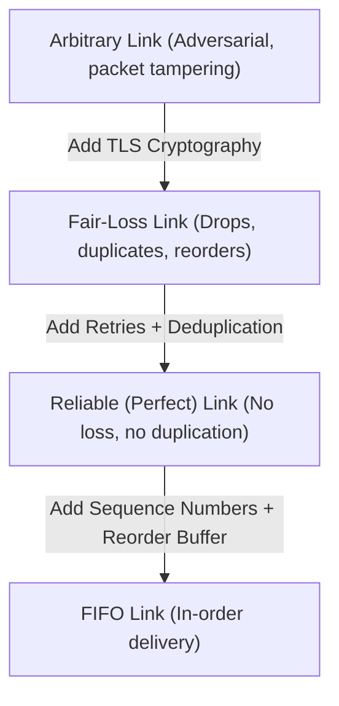

# Message-Passing and Point-to-Point Communication

In distributed systems without shared memory, all coordination is accomplished through **point-to-point message passing**.

---

## 1. Problem Statement and Motivation

Physical networks (Ethernet, Wi-Fi, IP routing) only provide best-effort packet delivery:
- Packets can be corrupted by electrical interference or bit-flips.
- Packets can be dropped due to router buffer exhaustion.
- Packets can be duplicated by network switches or retransmissions.
- Packets can arrive arbitrarily out of order due to dynamic multipath IP routing.

To construct deterministic algorithms, higher-level distributed systems require well-defined communication abstractions: **Reliable Links** and **FIFO Links**.

---

## 2. Channel Abstractions and Formulations

Let $(p, q)$ denote a directed communication link from sender $p$ to receiver $q$.



### 2.1 Fair-Loss Links
- **Fair Loss**: If $p$ sends message $m$ infinitely often to a correct process $q$, then $q$ receives $m$ infinitely often.
- **Finite Duplication**: If $p$ sends $m$ a finite number of times, $m$ cannot be received an infinite number of times.
- **No Creation**: If $q$ receives $m$, then $m$ was sent by $p$.

### 2.2 Reliable (Perfect) Links
- **Validity (No Loss)**: If $p$ and $q$ are correct processes, and $p$ sends $m$ to $q$, then $q$ eventually receives $m$.
- **No Duplication**: No message $m$ is received by $q$ more than once.
- **No Creation**: If $q$ receives $m$, then $m$ was sent by $p$.

### 2.3 FIFO Links
- Satisfies all properties of a Reliable Link.
- **FIFO Delivery Order**: If $p$ sends message $m_1$ before sending message $m_2$ to $q$, then $q$ never delivers $m_2$ before delivering $m_1$.

---

## 3. Algorithm: Implementing a Reliable FIFO Link

The following protocol strengthens an asynchronous, lossy, reordering link into a reliable FIFO link between sender $p$ and receiver $q$.

### 3.1 Pseudocode

```text
// ==================== SENDER p ====================
on initialization do
    sendSeq := 0
    unacked := map()  // Map seq -> msg
    start periodic retransmit_timer
end on

on request to send message m to q do
    unacked[sendSeq] := m
    send (DATA, sendSeq, m) to q
    sendSeq := sendSeq + 1
end on

on timeout of retransmit_timer do
    // Fair-loss link requires infinite retries until ACK
    for each (seq, m) in unacked do
        send (DATA, seq, m) to q
    end for
end on

on receiving (ACK, ackSeq) from q do
    delete unacked[ackSeq]
end on

// ==================== RECEIVER q ====================
on initialization do
    recvSeq := 0
    buffer := map()   // Map seq -> msg
end on

on receiving (DATA, seq, m) from p do
    // Send ACK regardless to stop sender retransmissions
    send (ACK, seq) to p
    
    // Check if message is the next expected in FIFO order
    if seq = recvSeq then
        deliver m to application
        recvSeq := recvSeq + 1
        // Deliver consecutive buffered messages
        while buffer.has_key(recvSeq) do
            deliver buffer[recvSeq] to application
            delete buffer[recvSeq]
            recvSeq := recvSeq + 1
        end while
    else if seq > recvSeq then
        // Future message: buffer it until missing gaps arrive
        buffer[seq] := m
    end if
    // If seq < recvSeq: duplicate old message, ignore delivery
end on
```

---

## 4. Crash-Recovery Hazards in Point-to-Point Links

In a crash-recovery model, relying on in-memory `sendSeq` and `recvSeq` introduces a severe vulnerability:
- If receiver $q$ crashes after delivering message with `seq = 5`, its in-memory `recvSeq` resets to $0$ upon reboot.
- When sender $p$ retransmits message `seq = 2`, the rebooted receiver $q$ treats `seq = 2` as a new message, **delivering a duplicate to the application layer**.

### Solutions in Real Protocols
1. **Persistent Sequence Counter**: Persist `recvSeq` to disk (WAL) before delivering $m$.
2. **Epoch / Connection Incarnation Identifiers (TCP 3-Way Handshake)**: Each connection instance generates a pseudo-random initial sequence number (ISN) and session epoch. Messages from prior incarnations are discarded.

---

## 5. Transport Layer Limitations: TCP in Distributed Systems

While TCP provides reliable in-order byte streams over IP, it introduces specific challenges in distributed computing:

1. **Head-of-Line Blocking**: If packet #3 is dropped while packets #4 and #5 arrive safely, the OS kernel buffers #4 and #5 and refuses to expose them to the application until #3 is retransmitted. This causes latency spikes for independent messages sharing the connection (remedied in HTTP/3 via QUIC).
2. **Silent Connection Drops**: If a network cable is severed without sending a `FIN` or `RST` packet, an idle TCP connection can remain open for hours unless explicit application-level heartbeats (`keepalive`) are enforced.
3. **TCP Timeouts**: TCP retransmission timeouts (RTO) back off exponentially. Under datacenter congestion, a TCP connection can stall for several seconds, simulating a node crash to higher-level consensus layers.

---

## 6. Revision Questions

1. Why does an asynchronous reliable link protocol require unbounded buffer memory at the sender if the receiver is partitioned?
2. What happens to the FIFO guarantee of the algorithm in Section 3 if the receiver reboots and volatile memory is wiped?
3. Contrast network packet deduplication in TCP with application-level RPC request deduplication.
4. Explain how Head-of-Line (HoL) blocking in TCP impacts concurrent request handling in distributed services.

---

## 7. Authoritative References

- **[Cachin, Guerraoui, Rodrigues 2011]** *Introduction to Reliable and Secure Distributed Programming*, Chapter 2: Channels. Springer, 2011.
- **[Kurose, Ross 2021]** James Kurose and Keith Ross. *Computer Networking: A Top-Down Approach* (8th Edition), Chapter 3: Transport Layer. Pearson, 2021.
- **[Kleppmann 2021]** Martin Kleppmann. *Distributed Systems Lecture Notes*, Chapter 1: Network Abstractions. 2021/22.
