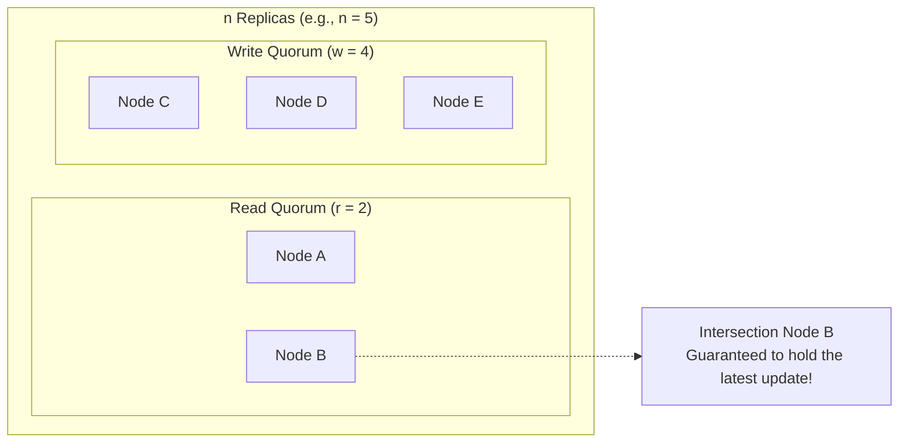
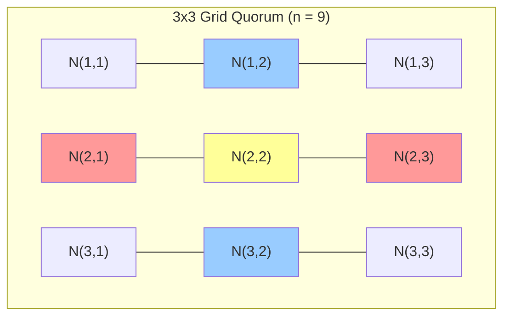
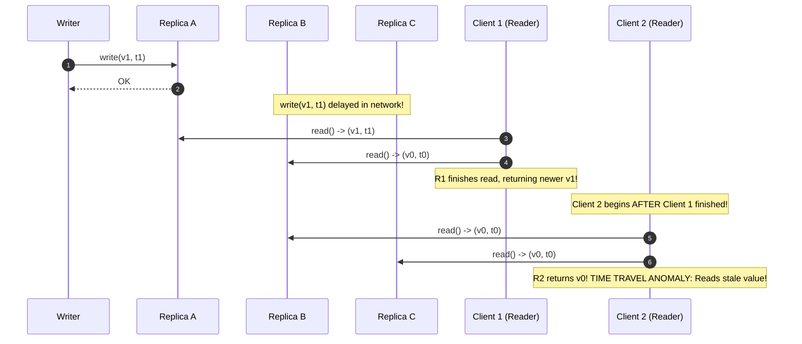

# Quorum Systems and Intersecting Subsets

A **quorum system** is a collection of process subsets where any two subsets non-trivially intersect, enabling decentralized coordination, fault tolerance, and consistent distributed read-write operations without a single point of failure.

---

## 1. Problem Statement and Motivation

In a replicated system of $n$ nodes, we want to read and update shared data while tolerating node crashes and network delays.
- **Naive Full Replication**: Requiring *all* $n$ nodes to acknowledge every write guarantees that every node holds up-to-date data. However, if even **one node crashes**, all writes halt—availability is destroyed ($0$ fault tolerance).
- **Naive Single Leader**: Routing all reads and writes through a designated leader provides easy consistency, but the leader is a **single point of failure (SPOF)**. If the leader crashes, the system becomes unavailable until failover occurs.

**Quorums** solve this dilemma. By requiring operations to contact only a subset of nodes, while mathematically guaranteeing that the read subset and write subset **must share at least one node**, the system preserves consistency while tolerating partial failures.

---

## 2. Mathematical Formalization of Quorum Systems

Let $\Pi = \{p_1, p_2, \dots, p_n\}$ be a universe of $n$ processes.

### 2.1 Formal Definition
A **Quorum System** $\mathcal{Q} \subseteq 2^\Pi$ is a collection of non-empty subsets of $\Pi$ (each subset $Q \in \mathcal{Q}$ called a **quorum**) satisfying the **Intersection Property**:
$$\forall Q_1, Q_2 \in \mathcal{Q}: \quad Q_1 \cap Q_2 \ne \emptyset$$

### 2.2 Majority Quorum Systems
The most canonical quorum system is the **Majority Quorum System** $\mathcal{Q}_{\text{maj}}$, defined as all subsets of $\Pi$ containing strictly more than half the nodes:
$$\mathcal{Q}_{\text{maj}} = \left\{ Q \subseteq \Pi \;\middle|\; |Q| \ge \left\lfloor \frac{n}{2} \right\rfloor + 1 \right\}$$

#### Proof of Majority Intersection
Let $Q_1, Q_2 \in \mathcal{Q}_{\text{maj}}$. By the Pigeonhole Principle:
$$|Q_1 \cup Q_2| = |Q_1| + |Q_2| - |Q_1 \cap Q_2|$$
Because $Q_1 \cup Q_2 \subseteq \Pi$, we have $|Q_1 \cup Q_2| \le n$. Thus:
$$|Q_1 \cap Q_2| = |Q_1| + |Q_2| - |Q_1 \cup Q_2| \ge \left(\left\lfloor \frac{n}{2} \right\rfloor + 1\right) + \left(\left\lfloor \frac{n}{2} \right\rfloor + 1\right) - n \ge 1$$
Therefore, $Q_1 \cap Q_2 \ne \emptyset$. Any two majority quorums share at least one process. $\blacksquare$

---

## 3. Read and Write Quorum Systems (Gifford 1979)

In asymmetric workloads (e.g., read-heavy databases), requiring majorities for both reads and writes is suboptimal. We can configure distinct **write quorums** $\mathcal{Q}_w$ and **read quorums** $\mathcal{Q}_r$.

### 3.1 The Read-Write Quorum Invariant
Let $w$ denote the size of a write quorum, and $r$ denote the size of a read quorum over $n$ replicas. To guarantee that every read quorum observes at least one replica that participated in the most recent write quorum:

$$r + w > n$$

### 3.2 Sizing and Fault Tolerance Trade-offs
- **Write Availability**: A write operation can complete as long as no more than $n - w$ replicas have failed.
- **Read Availability**: A read operation can complete as long as no more than $n - r$ replicas have failed.

| Configuration ($n = 5$) | Read Size ($r$) | Write Size ($w$) | Read Fault Tolerance ($n - r$) | Write Fault Tolerance ($n - w$) | Workload Profile |
| :---: | :---: | :---: | :---: | :---: | :--- |
| **Symmetric Majority** | 3 | 3 | 2 nodes | 2 nodes | Balanced read/write |
| **Read-Heavy** | 2 | 4 | **3 nodes** | 1 node | High read throughput |
| **Write-Heavy** | 4 | 2 | 1 node | **3 nodes** | Logging, ingestion |
| **Full Replication** | 1 | 5 | **4 nodes** | 0 nodes | Extreme read speed, zero write tolerance |

---

## 4. Probabilistic Availability Analysis

Assume each replica fails independently with probability $p$.
What is the probability that a system of $n$ replicas cannot form a majority quorum?

For a majority quorum with odd $n$:
$$P(\text{Cluster Failure}) = \sum_{k = \frac{n+1}{2}}^{n} \binom{n}{k} p^k (1 - p)^{n - k}$$

### Numerical Example ($p = 0.01$ or $1\%$ node unreliability):
- For $n = 1$: $P(\text{Unavailability}) = 0.01$ (99% availability, "two nines").
- For $n = 3$: $\ge 2$ nodes fail:
  $$P(\ge 2) = \binom{3}{2}(0.01)^2(0.99) + \binom{3}{3}(0.01)^3 \approx 3 \times 10^{-4} \implies 99.97\% \text{ availability}.$$
- For $n = 5$: $\ge 3$ nodes fail:
  $$P(\ge 3) = \binom{5}{3}(0.01)^3(0.99)^2 \approx 10^{-5} \implies 99.999\% \text{ availability ("five nines")}.$$

Replication across quorums transforms commodity unreliability into enterprise-grade availability.

---

## 5. Non-Majority Quorum Constructions

Beyond simple counting majorities, several non-majority quorum topologies offer lower message load or asymmetric failure profiles [Whittaker et al. 2021]:

### 5.1 Grid (Matrix) Quorums
Arrange $n = m \times m$ nodes in a $\sqrt{n} \times \sqrt{n}$ square grid.
- **Write Quorum**: An entire column plus one element from each column (size $2\sqrt{n} - 1$).
- **Read Quorum**: An entire row (size $\sqrt{n}$).
- **Intersection**: Any row and any column intersect in exactly one element.
- **Message Complexity**: Reduces quorum message overhead from $O(n)$ down to $O(\sqrt{n})$.

*Read Quorum = Row 2 (red). Write Quorum = Column 2 (blue). Intersection = N(2,2) (yellow).*

---

## 6. Byzantine Quorum Systems (Malkhi & Reiter 1998)

In a Byzantine failure model, faulty nodes do not simply crash—they can lie, return stale data, or equivocate.

### 6.1 The Byzantine Intersection Invariant
If up to $f$ nodes out of $n$ can be Byzantine:
1. Any two quorums $Q_1$ and $Q_2$ must intersect in **at least $2f + 1$ nodes**:
   $$|Q_1 \cap Q_2| \ge 2f + 1$$
2. **Why $2f + 1$?**
   - Out of the intersection $Q_1 \cap Q_2$, up to $f$ nodes may be Byzantine traitors returning malicious or stale values.
   - The remaining nodes in the intersection must contain at least $f + 1$ honest nodes so that the honest nodes form a strict majority within the intersection, allowing the reader to take a majority vote over conflicting responses.
3. Combining this with the requirement that a quorum must be formed from non-faulty nodes ($n - f \ge |Q|$), we arrive at the fundamental Byzantine quorum bound:
   $$n \ge 3f + 1, \quad |Q| \ge 2f + 1$$

---

## 7. The Quorum Staleness Hazard

Does satisfying $r + w > n$ guarantee that a client will read linearizable (up-to-date) data?

> **CAUTION**: Satisfying $r + w > n$ guarantees only **Read-After-Write Consistency for sequential operations**. It does **NOT** guarantee Linearizability for concurrent reads!

### The Non-Linearizable Quorum Execution Trace
Consider $n = 3$ replicas ($A, B, C$) with majority quorums $r = 2, w = 2$.
1. Variable $x$ is initially $v_0$ with timestamp $t_0$ on all replicas.
2. Writer begins $\text{write}(x = v_1, t_1)$. The message reaches $A$ quickly, but is delayed in transit to $B$ and $C$.
3. Client 1 performs a read with quorum $\{A, B\}$. $A$ returns $(v_1, t_1)$, $B$ returns $(v_0, t_0)$. Client 1 picks $v_1$ and completes its read.
4. **Client 2 starts a read AFTER Client 1 completed**, querying quorum $\{B, C\}$.
5. Neither $B$ nor $C$ has received $v_1$ yet! Both return $(v_0, t_0)$. Client 2 returns $v_0$.

This violates Linearizability ($v_0$ is returned after a read observing $v_1$ already completed in real time).
To eliminate this anomaly, quorums must execute a **Read Write-Back Phase**—the defining mechanism of the **ABD Algorithm**.

---

## 8. Common Misconceptions

- **"Quorums require an odd number of nodes"**: An even number of nodes works (e.g., $n = 4$ with majority $3$). However, $n=4$ tolerates only $4 - 3 = 1$ failure, the same as $n=3$, while requiring more network messages. Thus, odd sizes ($3, 5, 7$) maximize efficiency per fault-tolerance threshold.
- **"Quorum overlap guarantees real-time linearizability"**: As proven above, without read write-back, quorum reads can go backward in time.
- **"All quorums must be majorities"**: As demonstrated by Gifford quorums and Grid quorums, any system satisfying pairwise non-empty intersection is a mathematically valid quorum system.

---

## 9. Revision Questions

1. Formally prove that in a majority quorum system of $n$ nodes, any two quorums have a non-empty intersection.
2. If $n = 7$ and write quorums are configured to $w = 5$, what is the minimum read quorum size $r$ needed to guarantee read-after-write consistency? How many node failures can be tolerated during reads?
3. Draw a sequence diagram showing why reading from a majority quorum without read write-back can result in a stale read after a newer read has completed.
4. Why do Byzantine quorum systems require an intersection size of at least $2f+1$ instead of $1$?

---

## 10. Authoritative References

- **[Gifford 1979]** David K. Gifford. *Weighted Voting for Replicated Data*. 7th ACM SOSP, pp. 150–162, 1979.
- **[Malkhi, Reiter 1998]** Dahlia Malkhi and Michael Reiter. *Byzantine Quorum Systems*. Distributed Computing, 11(4):203–213, 1998.
- **[Whittaker et al. 2021]** Michael Whittaker et al. *Read-Write Quorum Systems Made Practical*. PaPoC 2021.
- **[Kleppmann 2021]** Martin Kleppmann. *Distributed Systems Lecture Notes*, Section 5.2: Quorums. University of Cambridge, 2021/22.
