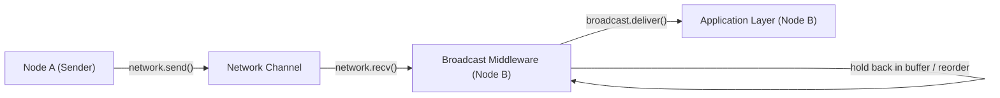
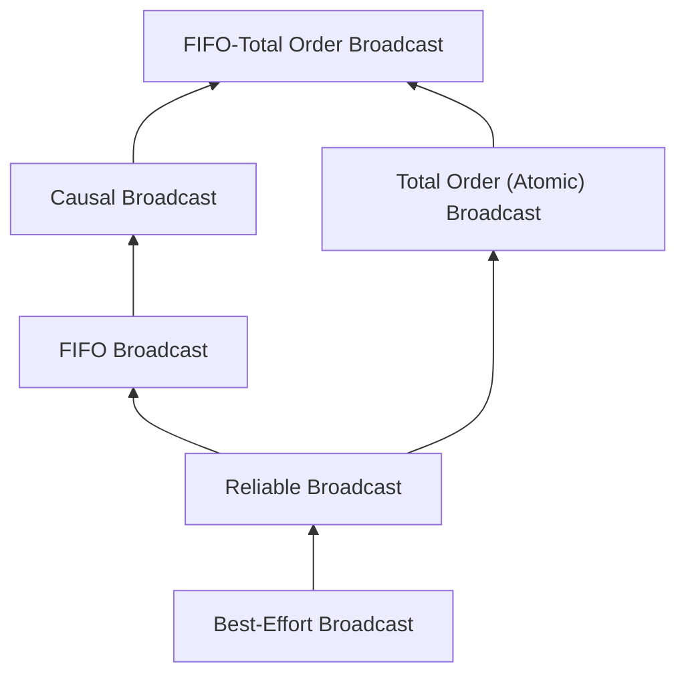

# Reliable, FIFO, Causal, and Total Order Broadcast

Broadcast (multicast) protocols deliver a single message from one sender to a group of recipient processes $\Pi$, providing defined guarantees regarding reliability and delivery order.

---

## 1. Problem Statement and Motivation

In a point-to-point network, a sender can transmit a message to a single receiver. When a node wishes to disseminate an update to an entire cluster:
- If the sender transmits point-to-point messages to each peer and crashes halfway through, some nodes receive the update while others never do, causing permanent state divergence.
- Even if all messages eventually arrive, network delays may cause different nodes to process updates in conflicting orders.

Broadcast abstractions establish a layered hierarchy to solve both dissemination reliability and delivery ordering.

---

## 2. Terminology: Sending, Receiving, and Delivering

Broadcast middleware introduces a strict distinction between receiving a packet from the network and delivering it to the application:



1. **Broadcast Request**: The application requests the middleware to broadcast message $m$.
2. **Network Send / Receive**: The transport layer transmits packets over point-to-point links.
3. **Delivery (`deliver(m)`)**: The broadcast middleware passes the validated and correctly ordered message to the application layer. Messages may be held back in a local buffer until ordering prerequisites are satisfied.

---

## 3. The Broadcast Hierarchy

Broadcast models form a strict hierarchy of increasing strength:



### 3.1 Best-Effort Broadcast (BEB)
- **Validity**: If a correct process broadcasts $m$, every correct process eventually delivers $m$.
- *Weakness*: If the sender crashes while broadcasting, some processes may deliver $m$ while others do not.

### 3.2 Reliable Broadcast (RB)
- **Validity**: If a correct process broadcasts $m$, all correct processes eventually deliver $m$.
- **No Duplication**: No message is delivered more than once.
- **No Creation**: No message is delivered unless it was previously broadcast.
- **Agreement (Uniformity)**: If *any* process delivers $m$, then **all correct processes eventually deliver $m$**, even if the sender crashed immediately after dispatching the first packet.

### 3.3 FIFO Broadcast
- Satisfies all properties of Reliable Broadcast.
- **FIFO Order**: If process $p$ broadcasts $m_1$ before broadcasting $m_2$, then no process delivers $m_2$ before $m_1$.
- *Note*: Messages from *different* senders can be delivered in arbitrary, conflicting orders across different nodes.

### 3.4 Causal Broadcast
- Satisfies all properties of Reliable Broadcast.
- **Causal Order**: If the broadcast of $m_1$ causally preceded the broadcast of $m_2$ ($\text{broadcast}(m_1) \to \text{broadcast}(m_2)$), then no process delivers $m_2$ before $m_1$.
- *Note*: Concurrent messages ($m_1 \parallel m_2$) may be delivered in different orders by different processes.

### 3.5 Total Order Broadcast (Atomic Broadcast)
- Satisfies all properties of Reliable Broadcast.
- **Total Order**: If message $m_1$ is delivered before $m_2$ on one process, then $m_1$ is delivered before $m_2$ on **all processes** that deliver both messages.
- *Crucial difference*: Total order broadcast guarantees that all nodes agree on the exact same sequence of delivered messages.

### 3.6 FIFO-Total Order Broadcast
Combines FIFO ordering and Total Order. Every message from the same sender is delivered in send order, and all processes deliver all messages in the exact same sequence.

---

## 4. Broadcast Algorithms and Pseudocode

### 4.1 Eager Reliable Broadcast
To guarantee Agreement despite sender crashes, the first time any process receives a message, it re-broadcasts it to all other processes.

```text
// State at process p_i
on initialization do
    delivered := {}
end on

on request to broadcast m do
    for each p_j in Pi do
        send (DATA, p_i, m) to p_j
    end for
end on

on receiving (DATA, sender, m) from p_k do
    if m not in delivered then
        delivered := delivered union {m}
        deliver m to application
        // Eagerly forward to everyone else to survive crashes
        for each p_j in Pi \ {p_i, p_k} do
            send (DATA, sender, m) to p_j
        end for
    end if
end on
```
- **Message Complexity**: $O(n^2)$ messages per broadcast in a cluster of $n$ nodes.

---

### 4.2 FIFO Broadcast Algorithm
Each process tags its outgoing messages with a local sequence number. Receivers buffer out-of-order messages until missing gaps are filled.

```text
// State at process p_i
on initialization do
    sendSeq := 0
    delivered := [0, 0, ..., 0]  // Size n array: count of delivered msgs per sender
    buffer := {}
end on

on request to broadcast m do
    reliable_broadcast (p_i, sendSeq, m)
    sendSeq := sendSeq + 1
end on

on reliable_deliver (sender, seq, m) do
    buffer := buffer union {(sender, seq, m)}
    // Deliver consecutive in-order messages from this sender
    while exists (sender, seq, m) in buffer such that seq = delivered[sender] do
        deliver m to application
        buffer := buffer \ {(sender, seq, m)}
        delivered[sender] := delivered[sender] + 1
    end while
end on
```

---

### 4.3 Causal Broadcast Algorithm
To enforce causal order, each message carries a vector of causal dependencies `deps` representing the messages delivered locally prior to the broadcast.

```text
// State at process p_i
on initialization do
    sendSeq := 0
    delivered := [0, 0, ..., 0]  // Size n vector: msgs delivered from each process
    buffer := {}
end on

on request to broadcast m do
    deps := copy(delivered)
    deps[i] := sendSeq           // Must follow my own previous message
    reliable_broadcast (p_i, deps, m)
    sendSeq := sendSeq + 1
end on

on reliable_deliver (sender, deps, m) do
    buffer := buffer union {(sender, deps, m)}
    // Check if all causally preceding messages have been delivered locally
    while exists (sender, deps, m) in buffer such that (deps <= delivered) do
        deliver m to application
        buffer := buffer \ {(sender, deps, m)}
        delivered[sender] := delivered[sender] + 1
    end while
end on
```

---

## 5. Correctness Proofs of Model Relationships

### 5.1 Proof: Causal Broadcast $\implies$ FIFO Broadcast
> **Theorem**: Every valid causal broadcast protocol is also a valid FIFO broadcast protocol.

*Proof*:
1. Let $m_1$ and $m_2$ be two messages broadcast by the same process $p_i$ such that $m_1$ was broadcast before $m_2$.
2. By local program order of the happens-before relation:
   $$\text{broadcast}(m_1) \to \text{broadcast}(m_2)$$
3. By the definition of Causal Broadcast, if $\text{broadcast}(m_1) \to \text{broadcast}(m_2)$, no process may deliver $m_2$ before $m_1$.
4. Thus, all processes deliver $m_1$ before $m_2$, which satisfies the definition of FIFO Broadcast. $\blacksquare$

### 5.2 Proof: FIFO-Total Order Broadcast $\implies$ Causal Broadcast
> **Theorem**: Every valid FIFO-total order broadcast protocol is also a valid causal broadcast protocol.

*Proof*:
1. Suppose $\text{broadcast}(m_1) \to \text{broadcast}(m_2)$.
2. By definition of $\to$, there is a chain of FIFO message steps connecting $m_1$ to $m_2$.
3. Since total order broadcast forces all nodes to deliver messages in the exact same sequence, and FIFO ordering ensures that $m_1$ cannot be delivered after $m_2$ at the sender, no node can deliver $m_2$ before $m_1$ without violating the global total order agreement. Thus, causal order is preserved. $\blacksquare$

---

## 6. The Equivalence of Total Order Broadcast and Consensus

> **Theorem (Chandra and Toueg 1996)**: Total Order Broadcast and Consensus are formally equivalent in systems with crash-stop or crash-recovery failures.
> - An algorithm for Consensus can implement Total Order Broadcast.
> - An algorithm for Total Order Broadcast can implement Consensus.

### Direct Reductions
1. **Total Order Broadcast $\implies$ Consensus**:
   Each process $p_i$ with proposal $v_i$ broadcasts $\text{TO-broadcast}(p_i, v_i)$. The value contained in the **first message delivered** by total order broadcast is decided as the consensus value. Because total order broadcast delivers messages in identical order everywhere, all processes decide the same first message.
2. **Consensus $\implies$ Total Order Broadcast**:
   To deliver a stream of messages $m_1, m_2, \dots$, processes execute a sequence of consensus instances $1, 2, 3, \dots$. Instance $k$ decides the $k$-th message to be delivered globally.

### Profound Consequence
Because Total Order Broadcast is equivalent to Consensus, the **FLP Impossibility Theorem applies directly**:
$$\text{Total Order Broadcast cannot be solved deterministically in an asynchronous system } (\mathcal{ASYNCH}) \text{ with crash failures.}$$
It strictly requires **Partial Synchrony ($\mathcal{PARTIAL}$)**.

---

## 7. Comparison Matrix

| Broadcast Type | Ordering Guarantees | Can Sender Deliver Immediately? | Requires Consensus? | Synchrony Assumption |
| :--- | :--- | :---: | :---: | :--- |
| **Reliable** | No ordering guarantees | ✔️ (Yes) | ❌ | Asynchronous ($\mathcal{ASYNCH}$) |
| **FIFO** | Per-sender FIFO order | ✔️ (Yes) | ❌ | Asynchronous ($\mathcal{ASYNCH}$) |
| **Causal** | Happens-before order | ✔️ (Yes) | ❌ | Asynchronous ($\mathcal{ASYNCH}$) |
| **Total Order** | Identical order on all nodes | ❌ **No** (Must coordinate) | ✔️ **Yes** | Partially Synchronous ($\mathcal{PARTIAL}$) |
| **FIFO-Total** | Total order + per-sender FIFO | ❌ **No** | ✔️ **Yes** | Partially Synchronous ($\mathcal{PARTIAL}$) |

---

## 8. Revision Questions

1. Explain the difference between receiving a message from the network and delivering it to the application in broadcast middleware.
2. Why can a process immediately deliver a message to itself in FIFO and Causal broadcast, but cannot do so in Total Order broadcast?
3. In the Causal Broadcast algorithm, explain why the condition `deps <= delivered` prevents causal violations.
4. Prove that Total Order Broadcast is formally equivalent to Consensus.

---

## 9. Authoritative References

- **[Chandra, Toueg 1996]** Tushar Deepak Chandra and Sam Toueg. *Unreliable Failure Detectors for Reliable Distributed Systems*. JACM 43(2), 1996.
- **[Hadzilacos, Toueg 1994]** Vassos Hadzilacos and Sam Toueg. *A Modular Approach to Fault-Tolerant Broadcast and Consensus*. Technical Report, Cornell University, 1994.
- **[Kleppmann 2021]** Martin Kleppmann. *Distributed Systems Lecture Notes*, Chapter 4: Broadcast Protocols. University of Cambridge, 2021/22.
- **[Cachin, Guerraoui, Rodrigues 2011]** *Introduction to Reliable and Secure Distributed Programming*, Chapter 3: Broadcast Abstractions. Springer, 2011.
