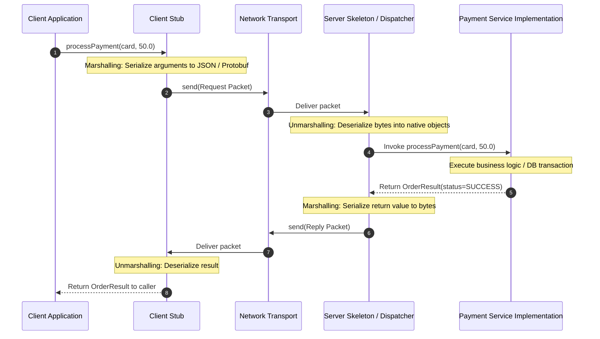
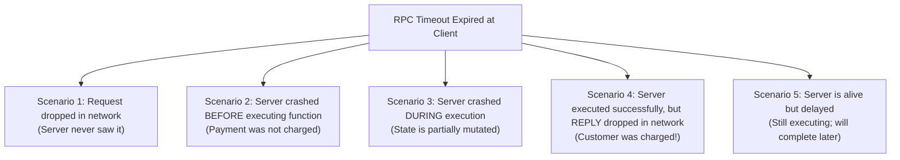

# Remote Procedure Calls (RPC) and Failure Semantics

Remote Procedure Call (RPC), introduced by Birrell and Nelson [1984], is an architectural abstraction designed to make a remote service invocation appear syntactically identical to a local procedural function call.

---

## 1. Problem Statement and The Myth of Location Transparency

In local programming:
```java
// Local function call: executes synchronously, in-memory, zero partial failure
OrderResult res = paymentService.processPayment(cart, 50.0);
```
RPC frameworks attempt to provide **Location Transparency**—hiding whether the callee executes on the same CPU core or across a global network.

In their seminal critique *A Note on Distributed Computing*, Waldo, Wyant, Wollrath, and Kendall [1994] demonstrated that **location transparency is an unachievable and dangerous abstraction**. Local calls and remote calls differ fundamentally in four intractable dimensions:

| Dimension | Local Function Call | Remote Procedure Call (RPC) |
| :--- | :--- | :--- |
| **Latency** | $1\text{--}10\text{ nanoseconds}$ (register/L1 cache). | $0.5\text{--}200\text{ milliseconds}$ ($10^5\text{ to }10^7 \times$ slower). |
| **Memory Architecture** | Shared memory address space. Direct pointer passing. | Disjoint memory spaces. Arguments must be serialized (marshalled) to bytes. |
| **Partial Failure** | Fate-sharing: Either the thread executes or the OS process dies entirely. | Partial failure: The server may execute the call, but the reply packet is lost in the network. |
| **Concurrency & Non-Determinism**| Thread scheduling controlled by local kernel. | Unpredictable packet interleaving, independent clock skews, and silent server halts. |

---

## 2. Architecture and Execution Flow



---

## 3. The Five Failure States of an RPC

When a client calls `processPayment()` and experiences a timeout after 5 seconds, what actually happened?



> **The Fundamental Dilemma**: To the client, all five scenarios produce the **exact same observable outcome**: `TimeoutException`. The client cannot tell whether retrying the request will process the payment safely or charge the customer a second time.

---

## 4. Delivery Semantics

Distributed systems classify RPC invocations into three semantic guarantees:

### 4.1 At-Least-Once Semantics
- **Mechanism**: The client stub repeatedly retransmits the request until an explicit acknowledgment or response is received from the server.
- **Outcome**: The function is guaranteed to execute at least once, but may execute multiple times if acknowledgments are delayed or lost.
- **Safety**: Safe **only if the remote function is idempotent** ($f(x) = f(f(x))$), such as reading a record or updating a key with an explicit version guard.

### 4.2 At-Most-Once Semantics
- **Mechanism**: The client does not retry upon timeout (or the server implements a deduplication table based on unique client request IDs).
- **Outcome**: The function executes either zero times or once, but never more than once.
- **Limitation**: The client may receive an error when the function actually executed, or the operation may never execute if the request was dropped.

### 4.3 Exactly-Once Semantics (Effectively-Once)
- **Mechanism**: At-least-once retries combined with server-side **idempotency keys** and **transactional deduplication logs**:
  1. Client assigns a globally unique `requestId = UUIDv4` to the call.
  2. Server begins a database transaction:
     ```sql
     INSERT INTO idempotency_log (req_id, status) VALUES ('req-123', 'IN_PROGRESS');
     ```
  3. If duplicate `req_id` is detected, the server returns the previously cached response without re-executing the business logic.
- **Theoretical Note**: True "exactly-once execution" across independent network boundaries is impossible (Two Generals Problem); what is achieved is **at-least-once transmission with exactly-once execution side effects**.

---

## 5. Modern RPC Implementations: gRPC and Protocol Buffers

Modern RPC frameworks (e.g., gRPC, Apache Thrift) address location transparency pitfalls by exposing explicit network semantics:
- **Interface Definition Language (IDL)**: Defines schemas independently of language runtimes.
- **Binary Serialization (Protocol Buffers)**: Compact variable-length integer encoding avoiding text parsing overhead.
- **Explicit Deadlines / Context Propagation**: Every RPC call requires a deadline parameter. When the deadline expires, both client and downstream services cancel execution.
- **Streaming Primitives**: Support for bidirectional streaming channels rather than blocking request-reply pairs.

---

## 6. Revision Questions

1. State Waldo's four fundamental differences between local and remote computing.
2. If an RPC client times out after sending a transfer request, explain why naively retransmitting the request can violate financial consistency.
3. Formally distinguish between At-Least-Once, At-Most-Once, and Exactly-Once RPC semantics.
4. How do Idempotency Keys allow an At-Least-Once transport layer to achieve Exactly-Once application-level side effects?

---

## 7. Authoritative References

- **[Birrell, Nelson 1984]** Andrew D. Birrell and Bruce Jay Nelson. *Implementing Remote Procedure Calls*. ACM TOCS, 2(1):39–59, 1984.
- **[Waldo et al. 1994]** Jim Waldo, Geoff Wyant, Ann Wollrath, and Sam Kendall. *A Note on Distributed Computing*. Sun Microsystems Technical Report TR-94-29, 1994.
- **[Kleppmann 2021]** Martin Kleppmann. *Distributed Systems Lecture Notes*, Section 1.3: Remote Procedure Calls. 2021/22.
