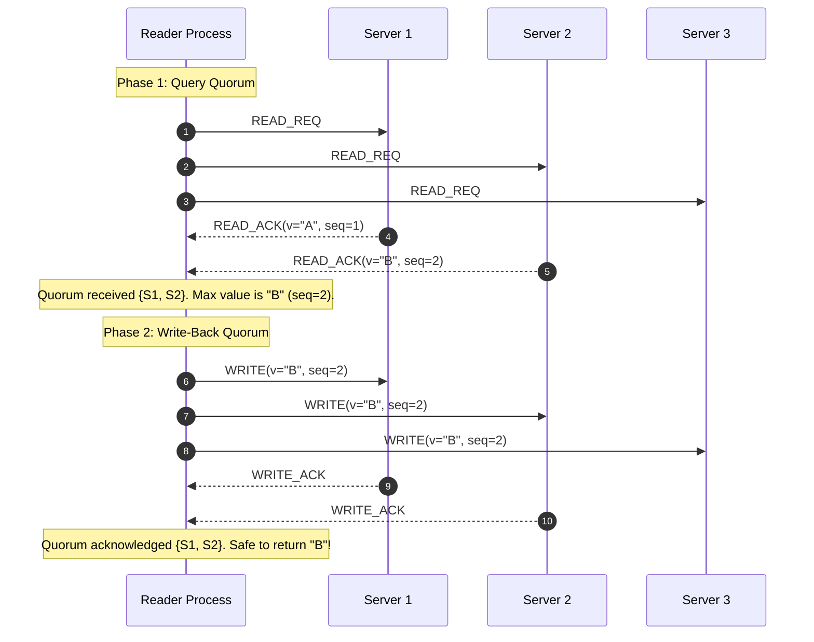
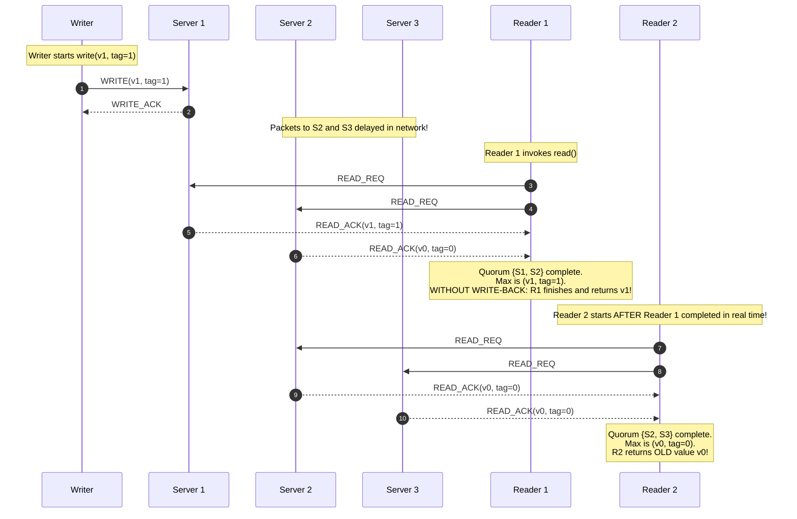

# The ABD Algorithm: Emulating Atomic Registers

The **ABD algorithm**, published by Hagit Attiya, Amotz Bar-Noy, and Danny Dolev in 1995, is a seminal distributed protocol that emulates a linearizable (atomic) read-write shared register over an asynchronous message-passing network subject to crash-stop failures.

---

## 1. Problem Statement and Motivation

In an asynchronous distributed system without physical clocks or centralized sequencers, processes need to read and update shared variables reliably.
- Quorum intersection ($r + w > n$) guarantees that a reader will overlap with at least one node holding the latest write.
- However, as proven in [Quorum Systems](./../02-communication-and-coordination/quorums.md), a naive quorum read can violate linearizability: if a write is only partially propagated across a quorum, reader $R_1$ may see the new value, while reader $R_2$ (starting *after* $R_1$ finishes) queries a different subset and observes the older value—a **stale read inversion**.

The ABD algorithm solves this problem completely by introducing an active **read write-back phase**, guaranteeing **linearizable register emulation** in fully asynchronous networks without requiring consensus.

---

## 2. System Model and Assumptions

- **Processes**: A set of client processes (readers $\mathcal{R}$, writers $\mathcal{W}$) and a set of $n$ replica servers $\mathcal{S} = \{s_1, s_2, \dots, s_n\}$.
- **Timing**: Fully **Asynchronous ($\mathcal{ASYNCH}$)**. Message transmission latencies and process step speeds are finite but arbitrarily large. No physical clocks or timers are used for correctness.
- **Failures**: **Crash-Stop**. Up to $f$ replica servers may experience unannounced crash-stop failures, provided that faulty nodes constitute strictly less than half the cluster:
  $$f < \frac{n}{2} \iff n \ge 2f + 1$$
- **Network Channels**: Point-to-point **Reliable Links** (or fair-loss links with infinite retries). Messages may be arbitrarily delayed and reordered.
- **Quorums**: Operations access **Majority Quorums** of size:
  $$|Q| = \left\lfloor \frac{n}{2} \right\rfloor + 1$$
  Every pair of quorums $Q_1, Q_2$ intersects in at least one replica: $Q_1 \cap Q_2 \ne \emptyset$.

---

## 3. Atomic Shared-Register Semantics

The ABD algorithm emulates an **Atomic Register** [Lamport 1986, Herlihy & Wing 1990]:
1. **Linearizability**: There exists a global sequence of linearization points $t_{\text{linear}}(op) \in [\text{inv}(op), \text{resp}(op)]$ such that every `read()` returns the value written by the most recent `write()` in this serialization.
2. **Monotonicity (No Flicker)**: If operation $op_1$ completes in real time before operation $op_2$ begins ($op_1 \prec_H op_2$), then $op_2$ cannot observe a register state older than the state established by $op_1$.
3. **Wait-Freedom (Liveness)**: Every non-faulty reader and writer completes its operation in a finite number of communication rounds, regardless of the relative execution speeds of other processes.

---

## 4. Variant 1: Single-Writer, Multi-Reader (SWMR) ABD

In the SWMR model, exactly one designated process $w \in \Pi$ performs writes, while any process can perform reads.

### 4.1 Timestamp Generation and Ordering
Because there is only one writer:
- The writer maintains a simple monotonically increasing integer sequence number `seq` $\in \mathbb{N}$, initialized to $0$.
- Each write tags value $v$ with incremented `seq`.
- Timestamps are totally ordered by standard integer comparison ($<$).

### 4.2 Protocol Phases
- **Write Operation (1 Round-Trip)**:
  The writer increments `seq`, broadcasts `(WRITE, v, seq)` to all replicas, and waits for acknowledgments from a majority quorum $Q_w$.
- **Read Operation (2 Round-Trips)**:
  1. **Phase 1 (Query)**: The reader broadcasts `READ_REQ` to all replicas and waits for `(READ_ACK, v, seq)` from a majority quorum $Q_1$. The reader selects the value $v_{\max}$ associated with the largest sequence number $seq_{\max}$.
  2. **Phase 2 (Write-Back)**: The reader broadcasts `(WRITE, v_max, seq_max)` to all replicas and waits for acknowledgments from a majority quorum $Q_2$. Once acknowledged, it returns $v_{\max}$ to the application.



### 4.3 SWMR ABD Pseudocode

```text
// ==========================================
// SWMR REPLICA SERVER s_j
// ==========================================
state on server s_j:
    val := v_0       // Initial register value
    tag := 0         // Sequence number

on receiving (READ_REQ, req_id) from reader do
    send (READ_ACK, req_id, val, tag) to reader
end on

on receiving (WRITE, req_id, new_val, new_tag) from client do
    if new_tag > tag then
        val := new_val
        tag := new_tag
    end if
    send (WRITE_ACK, req_id) to client
end on

// ==========================================
// SWMR SINGLE WRITER w
// ==========================================
state on writer w:
    local_seq := 0

function write(v):
    local_seq := local_seq + 1
    req_id := new_uuid()
    
    // Broadcast write to all servers
    for each s in Servers do
        send (WRITE, req_id, v, local_seq) to s
    end for
    
    // Await majority quorum acknowledgments
    wait until received (WRITE_ACK, req_id) from quorum Q_w (|Q_w| >= floor(n/2) + 1)
    return OK

// ==========================================
// SWMR READER r
// ==========================================
function read():
    req_id := new_uuid()
    
    // --------------------------------------
    // PHASE 1: Query Quorum
    // --------------------------------------
    for each s in Servers do
        send (READ_REQ, req_id) to s
    end for
    wait until received (READ_ACK, req_id, v_s, tag_s) from quorum Q_1 (|Q_1| >= floor(n/2) + 1)
    
    // Select value with maximum sequence tag
    (v_max, tag_max) := highest_tag_pair(responses from Q_1)
    
    // --------------------------------------
    // PHASE 2: Write-Back Quorum
    // --------------------------------------
    wb_id := new_uuid()
    for each s in Servers do
        send (WRITE, wb_id, v_max, tag_max) to s
    end for
    wait until received (WRITE_ACK, wb_id) from quorum Q_2 (|Q_2| >= floor(n/2) + 1)
    
    return v_max
```

---

## 5. Why Read Write-Back is Strictly Necessary

To understand why Phase 2 cannot be omitted, we examine what happens if a naive reader returns $v_{\max}$ immediately after Phase 1 without write-back.

### Counterexample Trace: Stale Read Inversion
Consider $n = 3$ servers ($S_1, S_2, S_3$), with majority quorums of size $2$. Initially, $x = v_0$ with $\text{tag} = 0$.



### Analysis of Correctness Violation
1. In real physical time, $R_1$ finished before $R_2$ began ($R_1 \prec_H R_2$).
2. $R_1$ observed the new value $v_1$.
3. $R_2$ observed the obsolete value $v_0$.
4. This violates linearizability: the register traveled backward in time.

### How Write-Back Eliminates the Bug
With Phase 2 enforced:
- Before $R_1$ completes, it broadcasts `WRITE(v1, tag=1)` to all servers and waits for a majority quorum $Q_2$.
- $Q_2$ must contain at least 2 servers (e.g., $S_1$ and $S_2$).
- Now, when $R_2$ queries *any* majority quorum (e.g., $\{S_2, S_3\}$), the intersection $Q_2 \cap Q_{R_2}$ contains at least one server that received $R_1$'s write-back (in this case, $S_2$).
- Server $S_2$ returns $(v_1, 1)$. Reader $R_2$ is guaranteed to observe $\text{tag} \ge 1$ and will never return $v_0$.

---

## 6. Variant 2: Multi-Writer, Multi-Reader (MWMR) ABD

When multiple writers exist, two independent writers could concurrently generate the exact same integer sequence number, causing state corruption.

### 6.1 Timestamp Generation and Lexicographic Ordering
In MWMR ABD, a timestamp is defined as a tuple of an integer counter and the unique process ID of the writer:
$$\text{tag} = \langle ts, \text{pid} \rangle \in \mathbb{N} \times \Pi$$

#### Lexicographic Total Order ($<$)
$$\langle ts_1, pid_1 \rangle < \langle ts_2, pid_2 \rangle \iff (ts_1 < ts_2) \lor (ts_1 = ts_2 \land pid_1 < pid_2)$$
This guarantees that all timestamps are distinct and globally totally ordered.

### 6.2 Protocol Architecture: 2 Round-Trips for Writers AND Readers
Because a writer does not know what sequence numbers other concurrent writers have chosen, **a writer must also execute a query phase first**!
1. **Writer Phase 1 (Query)**: The writer queries a majority quorum to discover the highest existing timestamp $\langle ts_{\max}, pid_{\max} \rangle$.
2. **Writer Phase 2 (Write)**: The writer generates a new timestamp $\langle ts_{\max} + 1, \text{my\_id} \rangle$, broadcasts `(WRITE, v, new_tag)` to all replicas, and awaits acknowledgments from a majority quorum.
3. **Reader Phase 1 (Query)**: The reader queries a majority quorum to find the highest timestamped pair $(v, \text{tag})_{\max}$.
4. **Reader Phase 2 (Write-Back)**: The reader writes back $(v_{\max}, \text{tag}_{\max})$ to a majority quorum before returning.

### 6.3 MWMR ABD Pseudocode

```text
// ==========================================
// MWMR REPLICA SERVER s_j
// ==========================================
state on server s_j:
    val := v_0
    tag := <0, 0>   // <counter, pid>

on receiving (QUERY_REQ, req_id) from client do
    send (QUERY_ACK, req_id, val, tag) to client
end on

on receiving (WRITE_REQ, req_id, new_val, new_tag) from client do
    if new_tag > tag then
        val := new_val
        tag := new_tag
    end if
    send (WRITE_ACK, req_id) to client
end on

// ==========================================
// MWMR WRITER w_i (Process ID = i)
// ==========================================
function write(v):
    q_id := new_uuid()
    
    // --------------------------------------
    // PHASE 1: Discover highest timestamp
    // --------------------------------------
    for each s in Servers do
        send (QUERY_REQ, q_id) to s
    end for
    wait until received (QUERY_ACK, q_id, _, tag_s) from quorum Q_1 (|Q_1| >= floor(n/2) + 1)
    
    max_ts := max({ tag_s.ts for each response in Q_1 })
    new_tag := <max_ts + 1, i>   // Incorporate writer process ID
    
    // --------------------------------------
    // PHASE 2: Replicate update to quorum
    // --------------------------------------
    w_id := new_uuid()
    for each s in Servers do
        send (WRITE_REQ, w_id, v, new_tag) to s
    end for
    wait until received (WRITE_ACK, w_id) from quorum Q_2 (|Q_2| >= floor(n/2) + 1)
    
    return OK

// ==========================================
// MWMR READER r
// ==========================================
function read():
    q_id := new_uuid()
    
    // --------------------------------------
    // PHASE 1: Query Quorum
    // --------------------------------------
    for each s in Servers do
        send (QUERY_REQ, q_id) to s
    end for
    wait until received (QUERY_ACK, q_id, v_s, tag_s) from quorum Q_1 (|Q_1| >= floor(n/2) + 1)
    
    (v_max, tag_max) := pair_with_highest_tag(responses from Q_1)
    
    // --------------------------------------
    // PHASE 2: Write-Back Quorum
    // --------------------------------------
    wb_id := new_uuid()
    for each s in Servers do
        send (WRITE_REQ, wb_id, v_max, tag_max) to s
    end for
    wait until received (WRITE_ACK, wb_id) from quorum Q_2 (|Q_2| >= floor(n/2) + 1)
    
    return v_max
```

---

## 7. Safety and Liveness Proof Sketches

### 7.1 Safety (Linearizability Invariant)
> **Lemma**: If an operation $op_1$ (read or write) completes before operation $op_2$ (read or write) begins ($op_1 \prec_H op_2$), then the timestamp associated with $op_2$ is strictly greater than or equal to the timestamp associated with $op_1$:
> $$\text{tag}(op_1) \le \text{tag}(op_2)$$
> (with strict inequality if $op_2$ is a write).

*Proof*:
1. Before $op_1$ completes, its value and tag $\text{tag}(op_1)$ are written to a majority quorum $Q_{\text{ack}}$ (in Phase 2 of write or Phase 2 of read).
2. When $op_2$ begins, it queries a majority quorum $Q_{\text{query}}$ in Phase 1.
3. By the quorum intersection property, $Q_{\text{ack}} \cap Q_{\text{query}} \ne \emptyset$. Let server $s^* \in Q_{\text{ack}} \cap Q_{\text{query}}$.
4. Server $s^*$ holds tag $\ge \text{tag}(op_1)$ because server tags are monotonically non-decreasing.
5. In Phase 1 of $op_2$, the client receives $s^*$'s response. Thus, $op_2$ selects a tag $\ge \text{tag}(op_1)$. If $op_2$ is a write, it chooses $ts > \text{tag}(op_1).ts$, ensuring $\text{tag}(op_1) < \text{tag}(op_2)$. $\blacksquare$

### 7.2 Liveness (Wait-Freedom)
> **Theorem**: Under the assumption $f < n/2$, every read and write operation terminates in a finite number of steps.

*Proof*: A client waits only for responses from a majority quorum $\lfloor n/2 \rfloor + 1$. Because at most $f \le \lfloor (n-1)/2 \rfloor$ servers can crash, there are at least $n - f \ge \lfloor n/2 \rfloor + 1$ correct servers that never halt. In an asynchronous network with reliable links, messages sent to correct servers are eventually delivered and acknowledged. Therefore, no wait condition can block permanently. The protocol is wait-free. $\blacksquare$

---

## 8. Complexity Characterization

| Metric | SWMR Variant | MWMR Variant |
| :--- | :---: | :---: |
| **Write Communication Rounds** | **1 RTT** (Write Phase) | **2 RTT** (Query + Write Phase) |
| **Read Communication Rounds** | **2 RTT** (Query + Write-Back) | **2 RTT** (Query + Write-Back) |
| **Write Message Complexity** | $2n$ messages | $4n$ messages |
| **Read Message Complexity** | $4n$ messages | $4n$ messages |
| **Server Storage Overhead** | Single value + scalar tag | Single value + composite tag $\langle ts, pid \rangle$ |
| **Crash Fault Tolerance** | $f < n/2$ | $f < n/2$ |
| **Consensus Dependency** | **None** (Asynchronous) | **None** (Asynchronous) |

---

## 9. Limitations and Boundary Conditions

1. **Blind Writes Only**: The ABD register supports only blind unconditional writes (`set(x, v)`). It **cannot support conditional atomic operations** such as `Compare-And-Swap (CAS)` or `Fetch-And-Add`. Supporting `CAS` requires Consensus, which is impossible in asynchronous crash-stop systems (FLP theorem).
2. **Read Latency**: Every read incurs 2 full network round-trips because write-back must complete before the read returns. (Optimizations exist where write-back is skipped if all quorum responses return identical timestamps, but worst-case remains 2 RTT).
3. **Crash-Recovery Constraints**: In crash-recovery environments, servers must persist their `(val, tag)` to disk (fsync) before responding to `WRITE_REQ` to prevent state regression upon reboot.

---

## 10. Revision Questions

1. Why does the SWMR variant require only 1 round-trip for writes, whereas the MWMR variant requires 2 round-trips?
2. Draw a complete message sequence diagram illustrating the stale read inversion anomaly that occurs if the read write-back phase is omitted.
3. In MWMR ABD, how is the lexicographic tie-breaking rule defined if two writers generate the exact same integer counter?
4. Prove that ABD satisfies wait-freedom (liveness) as long as $f < n/2$.
5. Can the ABD algorithm be extended to implement a linearizable distributed queue or atomic lock? Explain why or why not using Herlihy's consensus hierarchy.

---

## 11. Authoritative References

- **[Attiya, Bar-Noy, Dolev 1995]** Hagit Attiya, Amotz Bar-Noy, and Danny Dolev. *Sharing Memory Robustly in Message-Passing Systems*. Journal of the ACM, 42(1):124–142, January 1995.
- **[Lynch, Shvartsman 1997]** Nancy A. Lynch and Alex A. Shvartsman. *Robust Emulation of Shared Memory Using Dynamic Quorum-Acknowledged Broadcasts*. IEEE FTCS, 1997.
- **[Cachin, Guerraoui, Rodrigues 2011]** *Introduction to Reliable and Secure Distributed Programming*, Chapter 4: Distributed Shared Memory. Springer, 2011.
- **[Kleppmann 2021]** Martin Kleppmann. *Distributed Systems Lecture Notes*, Chapter 7: Replica Consistency (ABD Algorithm). University of Cambridge, 2021/22.
