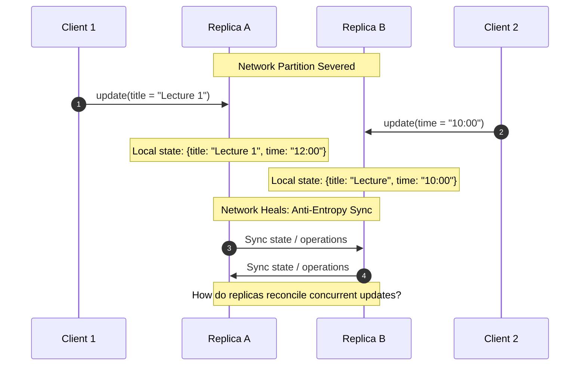
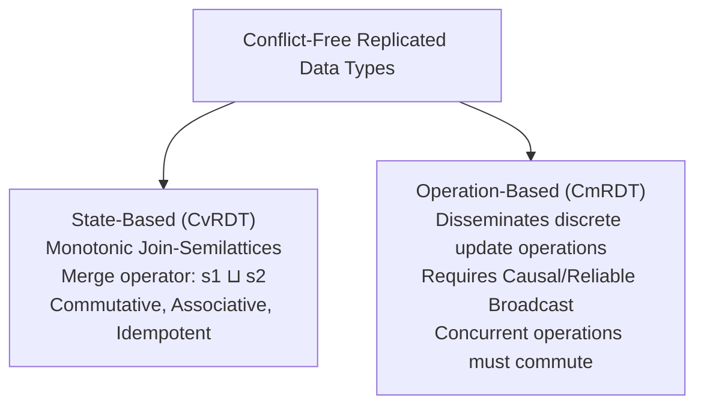
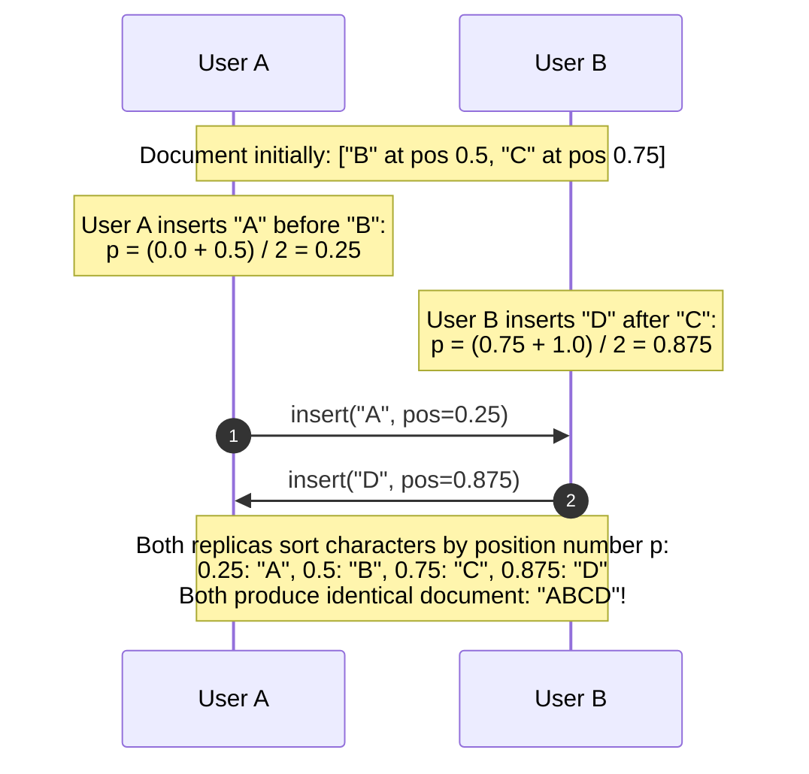

# Eventual Consistency and CRDTs

Eventual consistency is an optimistic replication model designed for high availability and offline operation, where replicas process writes locally and converge to identical state without synchronous coordination.

---

## 1. Problem Statement and Motivation

The CAP theorem proves that in an asynchronous network subject to partitions, a system cannot provide both Linearizability ($C$) and Availability ($A$).
- Strong consistency models (Linearizability, Paxos/Raft) require synchronous communication with a quorum for every update.
- If a mobile phone enters an airplane, a network cable is severed, or a datacenter is isolated, a linearizable system **must reject writes**.
- For collaborative software (Google Docs, Figma, Apple Notes, git), users demand the ability to read and edit data while offline or disconnected.

**Eventual Consistency** permits replicas to execute reads and writes immediately against local storage, synchronizing asynchronously in the background.

---

## 2. Formal Definitions: Weak vs. Strong Eventual Consistency

### 2.1 Classical Eventual Consistency [Vogels 2009]
> *"If no new updates are made to a given data item, eventually all accesses to that item will return the last updated value."*

#### Theoretical Critique
As Martin Kleppmann [2021] observes, this definition is weak:
- What if updates never cease? (The premise *"if no new updates are made"* is never satisfied).
- It provides no guarantee against anomalous intermediate states or divergent branches.

### 2.2 Strong Eventual Consistency (SEC) [Shapiro et al. 2011]
Strong Eventual Consistency solves these ambiguities by requiring two mathematical conditions:
1. **Eventual Delivery**: Every update executed on one correct replica is eventually delivered to all correct replicas.
2. **Strong Convergence**: Any two replicas that have delivered the **same set of updates are in the identical state**, regardless of the order in which those updates were delivered:
   $$\text{Delivered}(R_A) = \text{Delivered}(R_B) \implies \text{State}(R_A) = \text{State}(R_B)$$

SEC eliminates the need for complex, non-deterministic conflict resolution routines or consensus-based aborts.

---

## 3. Conflict Resolution Strategies

When two clients submit concurrent updates to the same record on disconnected replicas ($u_1 \parallel u_2$):

### 3.1 Last-Writer-Wins (LWW)
- **Mechanism**: Tag every update with a physical or Lamport timestamp. The update with the highest timestamp is preserved; the older update is silently discarded.
- **Flaw**: **Silent Data Loss**. If Client 1 edits `title` and Client 2 edits `time`, LWW will overwrite one client's entire edit, discarding valid work.

### 3.2 Multi-Value Registers (Dynamo Siblings)
- **Mechanism**: Use vector clocks. If two updates have incomparable vector timestamps ($V_1 \parallel V_2$), the storage engine preserves **both versions as conflicts (siblings)**.
- **Resolution**: The next reader receives the set of all sibling values and must merge them (e.g., merging shopping cart items) before writing back the reconciled state.

---

## 4. Conflict-Free Replicated Data Types (CRDTs)

A **CRDT** is an abstract data type (counter, set, map, register, sequence) that guarantees Strong Eventual Consistency mathematically without requiring consensus [Shapiro et al. 2011].

CRDTs are categorized into two dual mathematical models:

---

### 4.1 State-Based CRDTs (CvRDTs)

Replicas periodically send their entire local state to peers. When a replica receives remote state $S_{\text{remote}}$, it computes a merged state using a **Join Operator** ($\sqcup$):
$$S_{\text{new}} = S_{\text{local}} \sqcup S_{\text{remote}}$$

#### The Join-Semilattice Requirements
For the state space $\mathcal{S}$ and merge operator $\sqcup$ to guarantee SEC, $(\mathcal{S}, \sqcup)$ must form a **join-semilattice**:
1. **Commutativity**: $\forall x, y \in \mathcal{S}: \quad x \sqcup y = y \sqcup x$ (Order of sync does not matter).
2. **Associativity**: $\forall x, y, z \in \mathcal{S}: \quad (x \sqcup y) \sqcup z = x \sqcup (y \sqcup z)$ (Grouping does not matter).
3. **Idempotence**: $\forall x \in \mathcal{S}: \quad x \sqcup x = x$ (Duplicate syncs and retries cause no harm).

Because $\sqcup$ is idempotent, commutative, and associative, state-based CRDTs can execute over **unreliable, best-effort network channels with packet loss, reordering, and arbitrary duplication**.

---

### 4.2 Operation-Based CRDTs (CmRDTs)

Instead of transmitting full state, a replica broadcasts the operation itself:
$$\text{broadcast}(\text{op}, \text{params})$$

#### Requirements
1. **Underlying Transport**: Requires **Reliable Causal Broadcast** (to guarantee that an object creation is delivered before its deletion or update).
2. **Commutativity of Concurrent Operations**: For any two concurrent operations $o_1 \parallel o_2$:
   $$o_1(o_2(S)) = o_2(o_1(S))$$

---

## 5. Concrete CRDT Examples

### 5.1 Grow-Only Set (G-Set)
- **State**: Set $S \subseteq \mathcal{U}$, initially $\emptyset$.
- **Operation $\text{add}(e)$**: $S := S \cup \{e\}$.
- **Merge Operator**: $S_1 \sqcup S_2 = S_1 \cup S_2$.
- *Proof*: Set union $\cup$ is commutative, associative, and idempotent.

### 5.2 Two-Phase Set (2P-Set)
Supports both additions and deletions using **Tombstones**:
- **State**: Two disjoint G-Sets $\langle A, R \rangle$ (Add-set $A$, Remove-set/Tombstones $R$).
- **Operation $\text{add}(e)$**: $A := A \cup \{e\}$.
- **Operation $\text{remove}(e)$**: Require $e \in A$; $R := R \cup \{e\}$.
- **Read Operation $\text{lookup}(e)$**: Returns $\text{true} \iff e \in A \land e \notin R$.
- **Merge**: $\langle A_1, R_1 \rangle \sqcup \langle A_2, R_2 \rangle = \langle A_1 \cup A_2, R_1 \cup R_2 \rangle$.
- *Limitation*: Once an element is placed in $R$, it can never be re-added (tombstone is permanent).

### 5.3 Collaborative Text Editing CRDT: Fractional Indexing

In collaborative text documents, users insert characters concurrently. Using array indices fails because insertions shift surrounding offsets.
Text CRDTs (e.g., LSEQ, Logoot, RGA) assign each character a **globally unique fractional position** $p \in (0, 1) \subset \mathbb{Q}$.

If two users insert concurrently between the same two characters, ties are broken deterministically by client process ID:
$$\langle p_1, \text{client}_1 \rangle < \langle p_2, \text{client}_2 \rangle \iff (p_1 < p_2) \lor (p_1 = p_2 \land \text{client}_1 < \text{client}_2)$$

---

## 6. Comparison: Linearizability vs. Strong Eventual Consistency

| Dimension | Linearizability | Strong Eventual Consistency (CRDTs) |
| :--- | :--- | :--- |
| **Availability under Partition** | **Unavailable** on minority side (CP). | **100% Available** on all partitions (AP). |
| **Operation Latency** | Network RTT to quorum ($1\text{--}100\text{ ms}$). | **Local zero-latency** ($< 1\text{ \mu s}$); sync is async. |
| **Offline Operation** | Impossible. | **Supported** indefinitely. |
| **Data Freshness** | Always returns most recent value. | May return stale historical data until sync. |
| **Supported Operations** | Any deterministic logic, CAS, queues. | Commutative operations, semilattices. |
| **Typical Systems** | etcd, ZooKeeper, Google Spanner | Google Docs, Apple Notes, Figma, Riak |

---

## 7. Revision Questions

1. State the difference between Vogels' definition of Eventual Consistency and Shapiro's Strong Eventual Consistency (SEC).
2. What three mathematical properties must the merge operator $\sqcup$ of a state-based CRDT satisfy?
3. Explain why the Last-Writer-Wins (LWW) conflict resolution policy can cause silent data loss during concurrent edits.
4. How does fractional positioning enable collaborative text editing without an operational transformation leader?

---

## 8. Authoritative References

- **[Vogels 2009]** Werner Vogels. *Eventually Consistent*. Communications of the ACM, 52(1):40–44, 2009.
- **[Shapiro et al. 2011]** Marc Shapiro, Nuno Preguiça, Carlos Baquero, and Marek Zawirski. *Conflict-Free Replicated Data Types*. SSS 2011, LNCS 6976.
- **[DeCandia et al. 2007]** Giuseppe DeCandia et al. *Dynamo: Amazon’s Highly Available Key-Value Store*. ACM SOSP, 2007.
- **[Kleppmann 2021]** Martin Kleppmann. *Distributed Systems Lecture Notes*, Chapter 7 & 8: Eventual Consistency and CRDTs. 2021/22.
