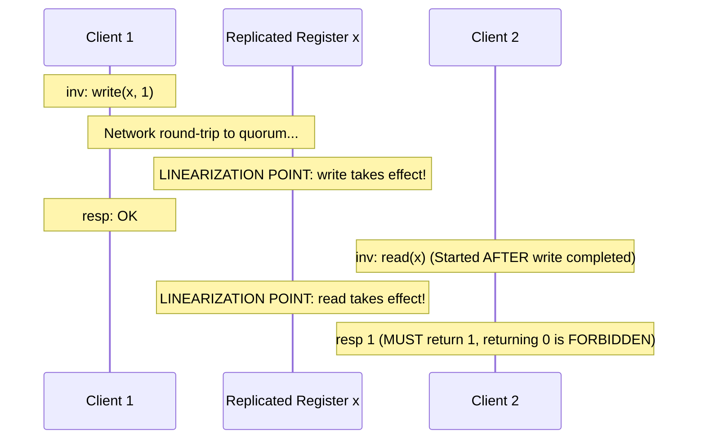

# Linearizability

Linearizability [Herlihy and Wing 1990] is the strongest standard consistency model for concurrent, replicated objects. It guarantees that all operations appear to execute instantaneously at a specific serialization point in real physical time.

---

## 1. Problem Statement and Motivation

When data is replicated across multiple machines, operations take non-zero time to complete over a network.
- Two read operations from different clients may overlap with an in-progress write operation.
- Without a strict consistency contract, client $A$ might observe a newly committed value, while client $B$ reading moments later from a different replica observes stale data.
- Such anomalies break software abstractions, producing bugs in distributed locking, leader leases, and balance transfers.

Linearizability provides the illusion of a **single, centralized, fault-tolerant copy of the data item**, even though it is physically replicated across multiple unreliable machines.

---

## 2. Formal Mathematical Definition (Herlihy & Wing 1990)

### 2.1 Concurrent Histories
An execution of a concurrent system is modeled as a **history** $H$, which is a sequence of operation invocation and response events:
- $\text{inv}(op)$: e.g., $\text{client } c_1 \text{ invokes } \text{write}(x, 5)$
- $\text{resp}(op)$: e.g., $\text{client } c_1 \text{ receives } \text{OK}$

An operation $op$ in $H$ is defined by its invocation and matching response:
$$op = (\text{inv}(op), \text{resp}(op))$$
An operation is **complete** if both its invocation and response appear in $H$.

### 2.2 Real-Time Precedence Relation ($\prec_H$)
For any two operations $op_1, op_2 \in H$, we say $op_1$ **precedes** $op_2$ in real time (written $op_1 \prec_H op_2$) if the response of $op_1$ occurs before the invocation of $op_2$ in $H$:
$$op_1 \prec_H op_2 \iff \text{resp}(op_1) <_{\text{time}} \text{inv}(op_2)$$

If neither $op_1 \prec_H op_2$ nor $op_2 \prec_H op_1$, the operations are **concurrent** ($op_1 \parallel_H op_2$).

### 2.3 Sequential Specification
Each object has a **sequential specification** defining valid sequential behaviors. For example, a sequential register requires that every `read()` returns the value written by the most recent preceding `write()`.

### 2.4 The Linearizability Criterion
A concurrent history $H$ is **linearizable** if it can be extended to a sequential history $S$ by appending responses to zero or more pending invocations and discarding others, such that:
1. **Sequential Correctness**: $S$ is a legally valid execution according to the sequential specification of the objects.
2. **Real-Time Precedence Preservation**: For all operations $op_1, op_2 \in H$:
   $$op_1 \prec_H op_2 \implies op_1 \prec_S op_2$$

---

## 3. The Linearization Point

Every linearizable operation appears to take effect instantaneously at a discrete instant in time called its **linearization point** $t_{\text{linear}}$:
$$\text{inv}(op) \le t_{\text{linear}}(op) \le \text{resp}(op)$$



Because Client 2's read started after Client 1's write finished in real time ($op_1 \prec_H op_2$), its linearization point must occur after $op_1$'s linearization point. Therefore, it **must observe $1$**.

---

## 4. Composability: The Local Property of Linearizability

A consistency model is **composable (or local)** if a system composed of multiple independent linearizable objects is itself globally linearizable.

> **Theorem (Herlihy and Wing 1990)**: A concurrent history $H$ is linearizable if and only if, for every individual object $x$, the sub-history $H|x$ restricted to operations on $x$ is linearizable:
> $$H \text{ is linearizable} \iff \forall x \in \text{Objects}, \; H|x \text{ is linearizable}$$

### Practical Significance
Engineers can build, verify, and reason about linearizable registers, queues, or distributed maps completely independently. When integrated into a larger distributed architecture, global correctness is guaranteed automatically.

*(Crucial Contrast: **Sequential Consistency is NOT composable**. Two independently sequentially consistent components can produce an execution history that is globally invalid!)*

---

## 5. Linearizability vs. Serializability

These two foundational terms are frequently confused in literature and industry:

| Dimension | Linearizability [Herlihy & Wing 1990] | Serializability [Papa 1979] |
| :--- | :--- | :--- |
| **Domain** | **Single operations** on individual objects (or registers). | **Multi-operation transactions** across multiple records. |
| **Real-Time Constraint** | **Strictly enforced**: If $op_1$ completes before $op_2$ begins, $op_1$ must precede $op_2$. | **None**: Transactions must be equivalent to *some* serial order, which may reorder transactions arbitrarily. |
| **Composability** | **Yes** (Local property). | **No** (Requires global serial ordering). |
| **Concurrency Metric**| Recency / Freshness guarantee (eliminates stale reads). | Isolation guarantee (eliminates race conditions and dirty reads). |

### Strict Serializability (One-Copy Serializability)
The gold standard in distributed database transactions: **Serializability + Linearizability**.
- Transactions execute with serializable isolation.
- If transaction $T_1$ commits in real time before transaction $T_2$ begins, $T_1$ must be ordered before $T_2$ in the serial commit sequence (achieved in Google Spanner via TrueTime commit wait).

---

## 6. Worked Trace Analysis: Linearizable vs. Non-Linearizable

### 6.1 A Non-Linearizable Execution Trace (The Stale Inversion Anomaly)

Consider a shared register $x$, initially $0$.
Four operations execute:
- $W_1$: $\text{write}(x, 1)$, $\text{inv} = 10, \; \text{resp} = 50$
- $R_1$: $\text{read}(x) \to 1$, $\text{inv} = 20, \; \text{resp} = 30$
- $R_2$: $\text{read}(x) \to 0$, $\text{inv} = 35, \; \text{resp} = 45$

```mermaid
gantt
    title Non-Linearizable Execution History
    dateFormat X
    axisFormat %s
    section Write
    W1 write(1) : 10, 50
    section Reader 1
    R1 read returns 1 : 20, 30
    section Reader 2
    R2 read returns 0 : 35, 45
```



#### Why is this execution NOT linearizable?
1. Notice that $R_1$ returns $1$. According to the sequential specification of a register, $R_1$ can only return $1$ if $W_1$ has already taken effect. Therefore, in any valid sequential linearization $S$:
   $$W_1 \prec_S R_1$$
2. Notice the real-time precedence between $R_1$ and $R_2$:
   $$\text{resp}(R_1) = 30 < \text{inv}(R_2) = 35 \implies R_1 \prec_H R_2$$
   By the real-time condition of linearizability, $S$ must preserve this order:
   $$R_1 \prec_S R_2$$
3. Combining (1) and (2) by transitivity:
   $$W_1 \prec_S R_1 \prec_S R_2$$
4. In any sequential history where $W_1$ precedes $R_2$ and no other write exists, $R_2$ **must return $1$**.
5. However, $R_2$ returned $0$!
6. Contradiction. No valid sequential order $S$ exists that respects both real-time precedence and sequential register semantics. **The execution is provably non-linearizable**. $\blacksquare$

---

## 7. Implementing Linearizable Operations

### 7.1 Linearizable Read/Write (ABD Algorithm)
Read/write registers can achieve linearizability in asynchronous systems with crash failures ($f < n/2$) without requiring consensus, using the **ABD algorithm** (two-phase quorum query and write-back).

### 7.2 Linearizable Compare-And-Swap (CAS)
Can an atomic `CAS(x, expected, new)` operation be implemented using pure ABD quorum registers?
- **Herlihy's Consensus Hierarchy [1991]**: Shared registers have consensus number **1** (cannot solve consensus among 2 processes). In contrast, `CAS` has consensus number $\infty$.
- **Theorem**: Implementing a linearizable `CAS` in a distributed system **is equivalent to Consensus**, requiring Total Order Broadcast or Paxos/Raft:

```text
// Linearizable CAS via Total Order Broadcast
on request to perform CAS(x, oldVal, newVal) do
    total_order_broadcast (CAS, x, oldVal, newVal, my_id)
    wait until deliver(CAS, x, oldVal, newVal, my_id)
end on

on total_order_deliver (CAS, x, oldVal, newVal, client_id) do
    if state[x] = oldVal then
        state[x] := newVal
        if client_id = my_id then return (SUCCESS, newVal)
    else
        if client_id = my_id then return (FAILURE, state[x])
    end if
end on
```

---

## 8. Revision Questions

1. Formally define the real-time precedence relation $\prec_H$ over a concurrent execution history.
2. Explain the "Local Property" (composability) of linearizability and contrast it with sequential consistency.
3. Why does an execution where Reader 1 observes value $v_1$ and Reader 2 (starting after Reader 1 completes) observes value $v_0$ violate linearizability?
4. Why can linearizable `get()` and `set()` be solved in an asynchronous network (via ABD), while linearizable `CAS()` cannot?

---

## 9. Authoritative References

- **[Herlihy, Wing 1990]** Maurice P. Herlihy and Jeannette M. Wing. *Linearizability: A Correctness Condition for Concurrent Objects*. ACM TOPLAS, 12(3):463–492, 1990.
- **[Herlihy 1991]** Maurice Herlihy. *Wait-Free Synchronization*. ACM TOPLAS, 13(1):124–149, 1991.
- **[Papadimitriou 1979]** Christos H. Papadimitriou. *The Serializability of Concurrent Database Updates*. JACM, 26(4):631–653, 1979.
- **[Kleppmann 2021]** Martin Kleppmann. *Distributed Systems Lecture Notes*, Section 7.2: Linearizability. University of Cambridge, 2021/22.
