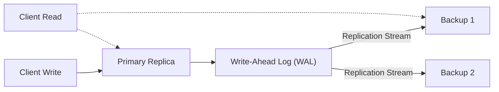
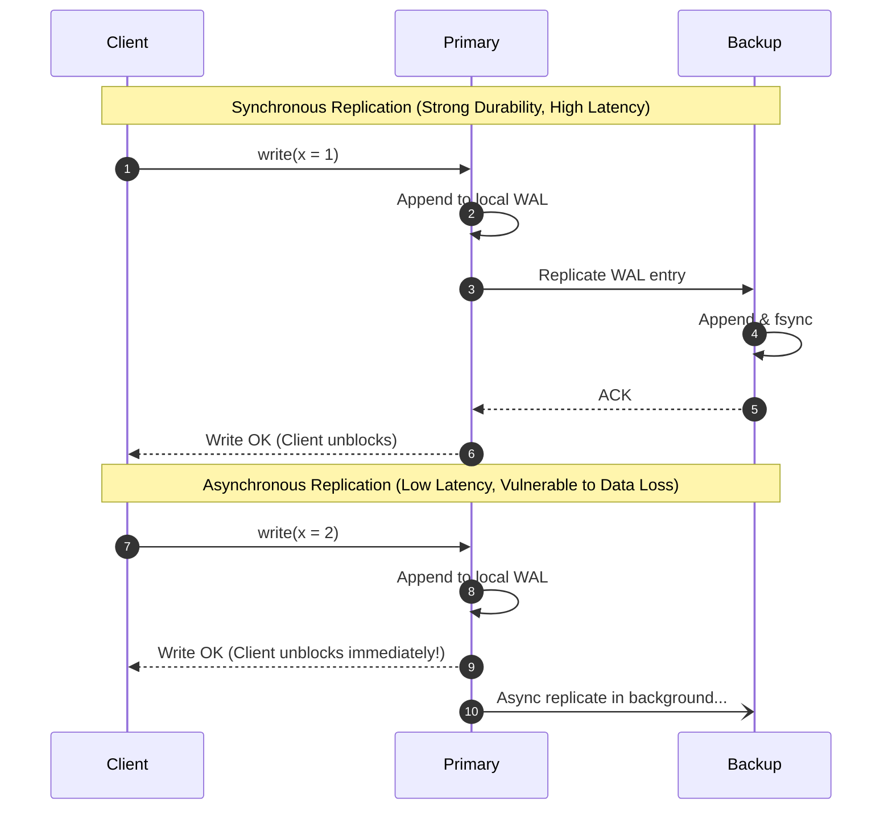
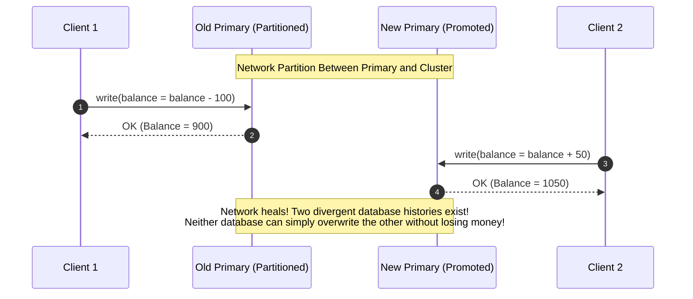
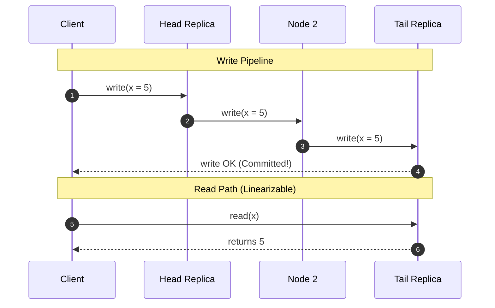

# Primary-Backup Replication and Failover

Primary-backup (leader-follower) replication is the most widespread replication architecture in commercial database engines, designating a single primary node to serialize writes while followers maintain redundant replicas.

---

## 1. Problem Statement and Architecture

In a primary-backup system:
- **Write Path**: Clients submit all write operations exclusively to the **Primary** replica.
- **Serialization**: The primary executes the transaction, assigns a monotonic sequence number (or WAL log offset), and streams data changes to **Backup (Follower)** replicas.
- **Read Path**: Reads can either be served by the primary (for linearizable freshness) or offloaded to backups (for horizontal read scaling at the cost of eventual consistency).

---

## 2. Replication Modes: Synchronous vs. Asynchronous

The timing of when the primary acknowledges a write to the client dictates the durability and latency trade-offs:

### 2.1 Trade-off Comparison

| Mode | Durability Guarantee | Write Latency | Behavior on Primary Crash |
| :--- | :--- | :--- | :--- |
| **Synchronous** | Zero data loss ($\text{RPO} = 0$). | High: bounded by network RTT to backup + disk fsync. | A promoted backup has all committed data. |
| **Asynchronous** | Risk of data loss ($\text{RPO} > 0$). | Low: returns as soon as primary writes locally. | Promoted backup may lose recent acknowledged transactions. |
| **Semi-Synchronous** | Tolerates 1 backup crash. | Moderate: waits for at least 1 of $k$ backups to ACK. | Protects against single-node crashes. |

---

## 3. Failover and the Split-Brain Hazard

When the primary crashes or becomes unreachable, the cluster must promote a backup to become the new primary.

### 3.1 The Split-Brain Catastrophe
Suppose a network partition isolates the Primary from the rest of the cluster:
1. The backups suspect the Primary has crashed and promote Backup 1 to be the **New Primary**.
2. However, the **Old Primary is still alive** and connected to a subset of clients.
3. Both nodes accept concurrent writes independently, generating divergent, irreconcilable database histories.

---

## 4. Remediation: Quorums and Fencing Tokens

To guarantee that failover is safe in asynchronous environments:
1. **Automated Promotion via Quorums**: A backup can only promote itself if it receives votes from a strict majority quorum ($> n/2$). An isolated old primary in a minority partition will fail to contact a majority and must step down.
2. **Fencing Tokens**: Every newly promoted primary receives a monotonic epoch number. As described in [Leader Election and Fencing](./../02-communication-and-coordination/leader-election.md), shared storage rejects writes from older epochs.
3. **STONITH ("Shoot The Other Node In The Head")**: In enterprise clustering, when a backup promotes itself, it instructs a networked power distribution unit (PDU) or IPMI interface to physically cut power to the old primary before accepting traffic.

---

## 5. Chain Replication (van Renesse & Schneider 2004)

**Chain Replication** organizes $n$ replicas in a linear pipeline:
$$\text{Head} \to \text{Node}_2 \to \text{Node}_3 \to \dots \to \text{Tail}$$

### Guarantees
- **Linearizability**: All writes are ordered by the Head and committed when they reach the Tail. All reads are served exclusively by the Tail. Because reads and commits pass through the Tail, the system trivially guarantees Linearizability.
- **Throughput**: Pipelines write bandwidth across nodes efficiently.

---

## 6. Revision Questions

1. Explain the difference between synchronous and asynchronous primary-backup replication regarding RPO and write latency.
2. Draw a sequence diagram illustrating how a network partition creates a split-brain scenario with two active primaries.
3. Why does Chain Replication achieve linearizability by routing all reads to the Tail replica?
4. How do fencing tokens prevent a partitioned old primary from corrupting persistent storage after a failover?

---

## 7. Authoritative References

- **[van Renesse, Schneider 2004]** Robbert van Renesse and Fred B. Schneider. *Chain Replication for Supporting High Throughput and Availability*. 6th USENIX OSDI, 2004.
- **[Kleppmann 2021]** Martin Kleppmann. *Distributed Systems Lecture Notes*, Chapter 5 & 6. University of Cambridge, 2021/22.
- **[Gray, Lamport 2006]** Jim Gray and Leslie Lamport. *Consensus on Transaction Commit*. ACM TODS, 31(1):133–160, 2006.
