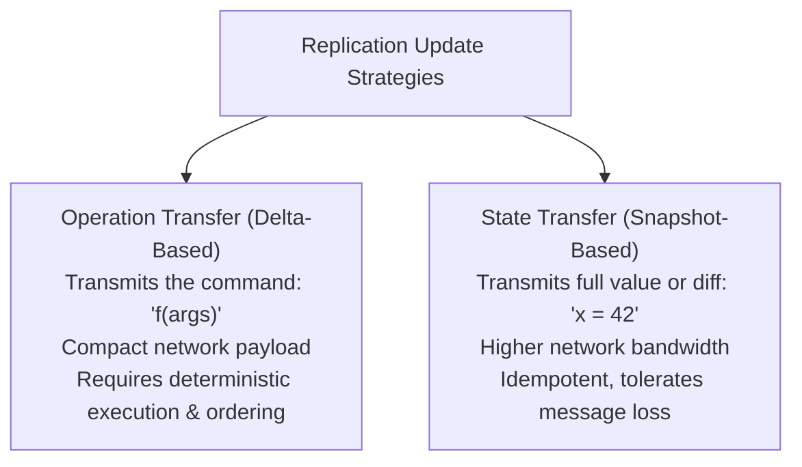
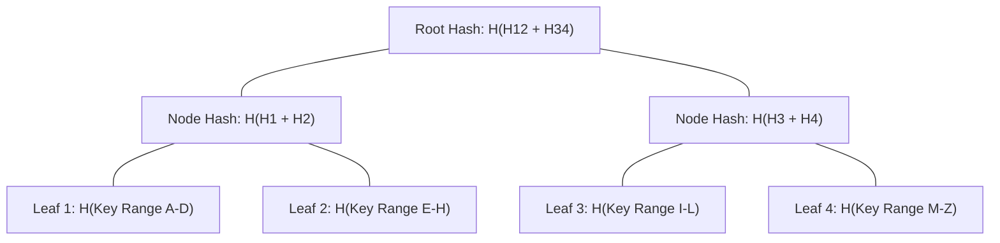
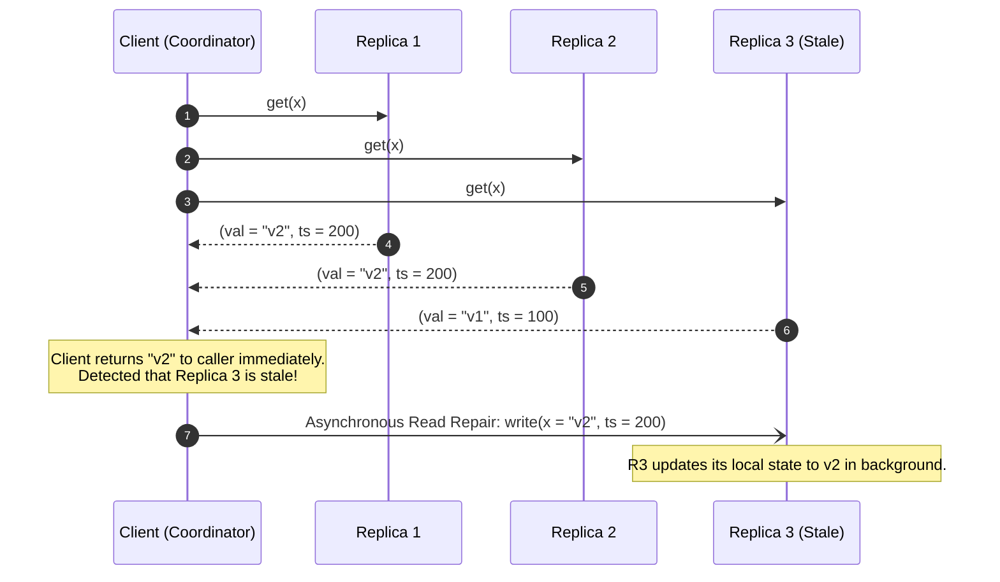

# Replication Fundamentals: Anti-Entropy, Merkle Trees, and Read Repair

Replication maintains copies of identical data items across multiple independent computing nodes to provide fault tolerance, high availability, and geographic locality.

---

## 1. Problem Statement and Motivation

If data resides on a single physical machine, any hardware fault (disk crash, power outage, memory corruption) results in permanent data loss or service unavailability.
Replicating data across nodes introduces the core dilemma of distributed computing: **how to keep multiple copies in sync despite network latency, concurrent writes, and node crashes**.

---

## 2. State Transfer vs. Operation Transfer

Replicas can propagate mutations using two fundamental paradigms:

| Dimension | Operation Transfer | State Transfer |
| :--- | :--- | :--- |
| **Payload Size** | Minimal ($O(1)$ command parameters). | Larger ($O(\text{record size})$). |
| **Idempotence** | Often non-idempotent (e.g., `balance = balance + 10`). | Naturally idempotent (e.g., `balance = 110`). |
| **Ordering Sensitivity** | Highly sensitive to delivery order. | Less sensitive if timestamped (LWW). |
| **Crash Recovery** | Replays log of all historical operations. | Copies the latest base snapshot directly. |

---

## 3. The Tombstone Mechanism for Distributed Deletions

In a single-node database, deleting a key removes its entry from storage.
In a replicated, eventually consistent system, **simply deleting a record from local storage causes it to reappear**!

### The Resurrected Record Bug
1. Node $A$ and Node $B$ hold key $x = \text{"Alice"}$.
2. A client sends `delete(x)` to Node $A$. Node $A$ physically deletes $x$ from disk.
3. Later, Node $A$ and Node $B$ execute anti-entropy synchronization.
4. Node $B$ informs Node $A$: *"I have record $x = \text{'Alice'}$; you don't have it."*
5. Node $A$ assumes it missed a newly created record and copies $x$ back from $B$.
6. **Result**: The deleted record is resurrected!

### Solution: Tombstones
A **tombstone** is a special deletion marker stored alongside a logical timestamp:
$$\text{record}(x) = \langle \text{val}: \text{NULL}, \; \text{deleted}: \text{TRUE}, \; \text{timestamp}: t_{\text{del}} \rangle$$
During anti-entropy reconciliation:
- If Node $B$ has $x = \text{"Alice"}$ with timestamp $t_1$, and Node $A$ has tombstone with timestamp $t_{\text{del}} > t_1$, Node $B$ applies the tombstone and marks $x$ as deleted.
- **Tombstone Garbage Collection**: Tombstones cannot be discarded immediately. They must be retained for a duration exceeding the maximum allowed network partition or replica downtime (e.g., Cassandra's `gc_grace_seconds`, typically 10 days).

---

## 4. Background Reconciliation: Anti-Entropy and Merkle Trees

**Anti-entropy** is a continuous background protocol where replicas compare their datasets to discover and reconcile missing or divergent records [Demers et al. 1987].

### The Naive Bottleneck
Comparing two datasets of 100 million records by sending all key-hash pairs across the network exhausts WAN bandwidth.

### Merkle Trees (Hash Trees) [Dynamo 2007]
A **Merkle Tree** is a hierarchical binary tree of cryptographic hashes that enables two replicas to identify divergent data ranges in $O(\log K)$ network exchanges:

#### Protocol Execution
1. Replicas $A$ and $B$ exchange only their **Root Hashes**.
2. If $\text{Root}_A = \text{Root}_B$, both datasets are identical. Reconciliation terminates immediately ($O(1)$ exchange).
3. If $\text{Root}_A \ne \text{Root}_B$, the nodes exchange child hashes $H_{12}$ and $H_{34}$.
4. If $H_{12}$ matches but $H_{34}$ differs, the nodes know that key ranges A–H are identical, and only traverse down into the sub-tree under $H_{34}$.
5. Replicas traverse downward until they isolate the exact leaf keys that differ, transmitting only those specific records.

---

## 5. Read Repair

In quorum-based leaderless systems (Amazon Dynamo, Apache Cassandra), **Read Repair** enlists the read path to heal stale replicas opportunistically.

Read repair automatically accelerates convergence for frequently accessed data items without waiting for background anti-entropy passes.

---

## 6. Revision Questions

1. Explain the difference between state transfer and operation transfer in replication.
2. What is the "resurrected record" bug, and how do tombstones solve it?
3. How does a Merkle tree allow two replicas with 10 million keys to discover which 3 keys are out of sync using minimal network bandwidth?
4. Contrast Read Repair with background Anti-Entropy regarding when and how data divergence is resolved.

---

## 7. Authoritative References

- **[Demers et al. 1987]** Alan Demers et al. *Epidemic Algorithms for Replicated Database Maintenance*. 6th ACM PODC, 1987.
- **[DeCandia et al. 2007]** Giuseppe DeCandia et al. *Dynamo: Amazon’s Highly Available Key-Value Store*. ACM SOSP, 2007.
- **[Kleppmann 2021]** Martin Kleppmann. *Distributed Systems Lecture Notes*, Section 5.1–5.2: Manipulating Remote State. 2021/22.
