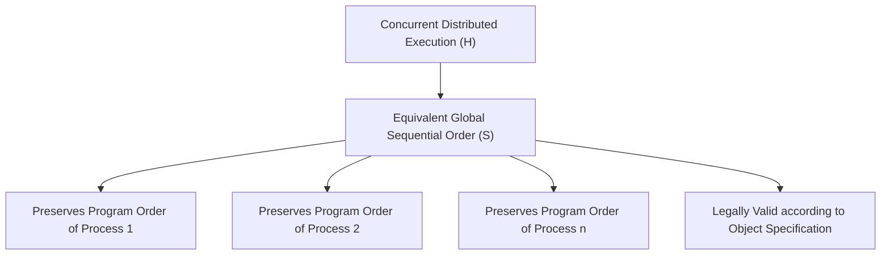
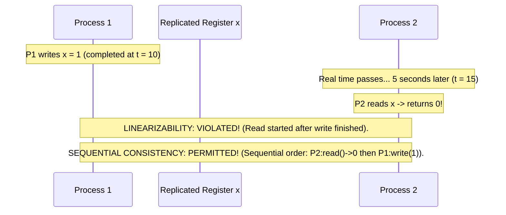
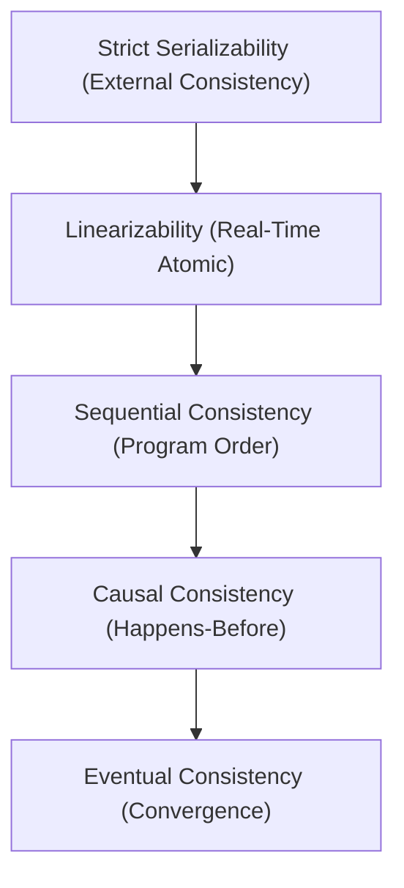

# Sequential Consistency

Sequential consistency [Lamport 1979] is a landmark consistency model that requires all processes to observe operations occurring in some valid sequential interleaving that preserves the program order of each individual process.

---

## 1. Problem Statement and Motivation

In multiprocessor computers and distributed shared memory, waiting for every read and write to complete globally in real physical time (Linearizability) imposes substantial synchronization latency.
- Can we design a consistency model that permits operations to take effect outside of global real-time constraints, while still guaranteeing that **all nodes see the exact same sequential progression of events**?
- Leslie Lamport formulated Sequential Consistency to define the correctness of shared memory multiprocessors without referencing a global physical clock.

---

## 2. Formal Mathematical Definition (Lamport 1979)

> **Definition**: A concurrent execution history $H$ is **sequentially consistent** if there exists a sequential history $S$ such that:
> 1. $S$ is equivalent to $H$ (contains the same operations with identical arguments and return values).
> 2. $S$ is a legally valid execution according to the sequential specification of each object.
> 3. For each individual process $p_i$, the operations of $p_i$ appear in $S$ in the **program order** specified by $p_i$:
>    $$\forall op_1, op_2 \in H \text{ executed by } p_i: \quad (op_1 <_{\text{prog}} op_2) \implies (op_1 \prec_S op_2)$$

---

## 3. Sequential Consistency vs. Linearizability

The defining difference lies in **real-time precedence**:

$$\begin{aligned}
\text{Linearizability} &\implies \text{Preserves Program Order } + \mathbf{Preserves\ Real\text{-}Time\ Precedence\ (\prec_H)} \\
\text{Sequential Consistency} &\implies \text{Preserves Program Order } (\text{Ignores Real-Time Precedence})
\end{aligned}$$

In the diagram above:
- Under **Linearizability**, this execution is illegal.
- Under **Sequential Consistency**, this execution is completely valid! We can simply linearize $P_2$'s read *before* $P_1$'s write in the global sequence $S = \langle \text{read}() \to 0, \; \text{write}(1) \rangle$, because neither process had a local program-order dependency between the two calls.

---

## 4. The Non-Composability of Sequential Consistency

The single most significant theoretical difference between Linearizability and Sequential Consistency is that **Sequential Consistency is NOT a local (composable) property**.

### Proof by Counterexample
Consider two distinct shared registers, $x$ and $y$, initially $0$.
Two processes execute the following programs:
- **Process 1**:
  $$\text{write}(x, 1); \quad \text{read}(y) \to 0$$
- **Process 2**:
  $$\text{write}(y, 1); \quad \text{read}(x) \to 0$$

#### Step 1: Sub-history on $x$ ($H|x$) is Sequentially Consistent
Operations on $x$: $\text{write}(x, 1)$ by $P_1$, and $\text{read}(x) \to 0$ by $P_2$.
Valid sequential order for $x$: $S_x = \langle P_2: \text{read}(x) \to 0, \; P_1: \text{write}(x, 1) \rangle$.
This preserves program order for both processes with respect to $x$.

#### Step 2: Sub-history on $y$ ($H|y$) is Sequentially Consistent
Operations on $y$: $\text{write}(y, 1)$ by $P_2$, and $\text{read}(y) \to 0$ by $P_1$.
Valid sequential order for $y$: $S_y = \langle P_1: \text{read}(y) \to 0, \; P_2: \text{write}(y, 1) \rangle$.
This preserves program order for both processes with respect to $y$.

#### Step 3: Global History $H$ is NOT Sequentially Consistent
To form a single global sequence $S$:
1. $P_1$'s program order requires: $P_1:\text{write}(x, 1) \prec_S P_1:\text{read}(y) \to 0$.
2. Because $P_1:\text{read}(y)$ returns $0$, it must appear before $P_2:\text{write}(y, 1)$. Thus:
   $$P_1:\text{write}(x, 1) \prec_S P_1:\text{read}(y) \prec_S P_2:\text{write}(y, 1)$$
3. $P_2$'s program order requires: $P_2:\text{write}(y, 1) \prec_S P_2:\text{read}(x) \to 0$.
4. Because $P_2:\text{read}(x)$ returns $0$, it must appear before $P_1:\text{write}(x, 1)$. Thus:
   $$P_2:\text{write}(y, 1) \prec_S P_2:\text{read}(x) \prec_S P_1:\text{write}(x, 1)$$
5. Combining (2) and (4) produces a causal cycle:
   $$P_1:\text{write}(x, 1) \prec_S P_2:\text{write}(y, 1) \prec_S P_1:\text{write}(x, 1)$$

Contradiction. No global sequential order $S$ exists!
Even though the sub-histories for $x$ and $y$ are individually sequentially consistent, their composition is **not**. $\blacksquare$

---

## 5. Consistency Hierarchy Summary

| Model | Preserves Real-Time Precedence? | Composable (Local)? | Requires Coordination? |
| :--- | :---: | :---: | :---: |
| **Linearizability** | **Yes** | **Yes** | Yes (Quorum / TOB) |
| **Sequential Consistency** | **No** | **No** | Yes (Global Sequence) |
| **Causal Consistency** | **No** | **Yes** | No (Local write, async gossip) |
| **Eventual Consistency** | **No** | **Yes** | No (Local read/write) |

---

## 6. Revision Questions

1. State Lamport's formal definition of Sequential Consistency.
2. In what fundamental way does Sequential Consistency differ from Linearizability?
3. Using two processes and two registers $x$ and $y$, reproduce the formal proof that Sequential Consistency is not composable.
4. Can an asynchronous distributed system implement Sequential Consistency without coordinating through a total order sequencer?

---

## 7. Authoritative References

- **[Lamport 1979]** Leslie Lamport. *How to Make a Multiprocessor Computer That Correctly Executes Multiprocess Programs*. IEEE Transactions on Computers, C-28(9):690–691, 1979.
- **[Herlihy, Wing 1990]** Maurice P. Herlihy and Jeannette M. Wing. *Linearizability: A Correctness Condition for Concurrent Objects*. ACM TOPLAS, 12(3):463–492, 1990.
- **[Attiya, Welch 2004]** Hagit Attiya and Jennifer Welch. *Distributed Computing: Fundamentals, Simulations, and Advanced Topics*, Chapter 9. 2004.
