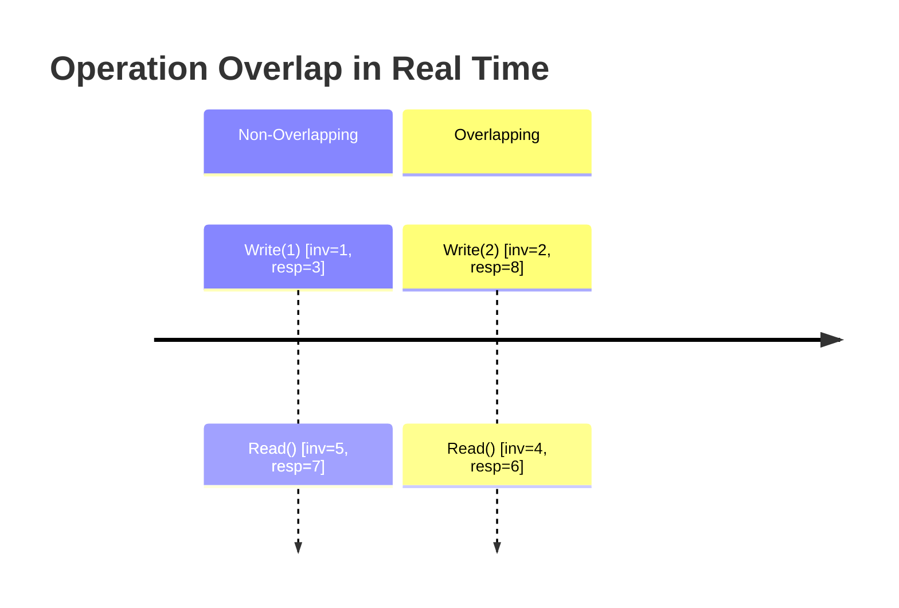
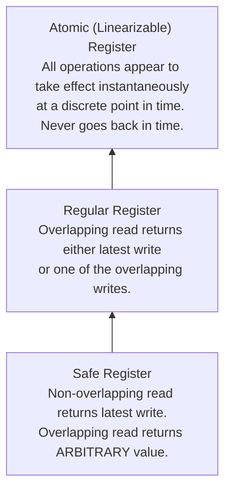

# Shared Registers: Safe, Regular, and Atomic

A **shared register** is the foundational distributed storage abstraction: a variable accessed concurrently by multiple processes via read and write operations.

---

## 1. Problem Statement and Motivation

In a single-threaded program, memory is trivial: a read returns the value written by the most recent write.
In a distributed system, reads and writes are not instantaneous—they take time to execute across network channels. When multiple processes issue concurrent read and write operations to replicated storage, what values is a read allowed to return?

In 1986, Leslie Lamport formalized the **Register Hierarchy**, classifying concurrent registers into three distinct correctness classes: **Safe**, **Regular**, and **Atomic (Linearizable)** registers.

---

## 2. Formal Model of Register Executions

Let a register $R$ hold values from a domain $\mathcal{V}$, with an initial value $v_0$.
Operations on $R$ are of two types:
- **Write Operation**: $\text{write}(v)$, where $v \in \mathcal{V}$.
- **Read Operation**: $\text{read}() \to v$, returning a value $v \in \mathcal{V}$.

### 2.1 Operation Intervals and Precedence
Every operation $op$ executed by process $p_i$ is characterized by two physical time events:
- $\text{inv}(op)$: The invocation event (start of operation).
- $\text{resp}(op)$: The response event (completion of operation).

Let time interval $I(op) = [\text{inv}(op), \text{resp}(op)]$.

We define a strict **precedence order** ($\prec$) over non-overlapping operations:
$$op_1 \prec op_2 \iff \text{resp}(op_1) < \text{inv}(op_2)$$
Operation $op_1$ completely finished in real time before operation $op_2$ began.

Two operations $op_1$ and $op_2$ are **overlapping (concurrent)** if neither precedes the other:
$$op_1 \parallel op_2 \iff I(op_1) \cap I(op_2) \ne \emptyset$$



### 2.2 Process Concurrency Models
Registers are categorized by their supported concurrency:
- **SWSR**: Single-Writer, Single-Reader.
- **SWMR**: Single-Writer, Multi-Reader.
- **MWMR**: Multi-Writer, Multi-Reader.

---

## 3. The Lamport Register Hierarchy (Lamport 1986)



---

### 3.1 Safe Register

#### Definition
A register is **safe** if:
1. A read operation that **does not overlap** with any write operation returns the value written by the most recent preceding write operation (or $v_0$ if no write precedes it).
2. A read operation that **overlaps with a write operation** may return **any arbitrary value** from the domain $\mathcal{V}$.

#### Implication
If a safe boolean register stores $\{0, 1\}$, a read overlapping with a write of $1$ can return $0$ or $1$. But if the domain is a 64-bit integer, an overlapping read could return a corrupted, garbage integer! Safe registers are the weakest meaningful abstraction.

---

### 3.2 Regular Register

#### Definition
A register is **regular** if:
1. It is safe (non-overlapping reads return the most recent write).
2. A read operation that **overlaps with one or more writes** returns **either**:
   - The value written by the most recent non-overlapping write preceding the read, OR:
   - A value currently being written by one of the overlapping writes.

#### Implication
A regular register guarantees that reads never return arbitrary garbage. An overlapping read always returns a "valid" value that was recently or currently written.

#### The Regular Register Flaw: Flicker (Non-Monotonicity)
A regular register allows a reader to read a *newer* value, and a subsequent reader (or the same reader) to read an *older* value!

```mermaid
sequenceDiagram
    autonumber
    participant W as Writer
    participant R1 as Reader 1
    participant R2 as Reader 2

    Note over W: write(x = 1) starts
    Note over R1: read() overlaps write(1); returns NEW value 1!
    Note over R1: R1 finishes read()
    
    Note over R2: R2 begins read AFTER R1 finished!
    Note over R2: R2 overlaps write(1); returns OLD value 0!
    Note over W: write(x = 1) finishes
```

In the diagram above, both Read 1 and Read 2 overlap with Write(1). Under regular semantics:
- Read 1 is permitted to return the overlapping value $1$.
- Read 2 is permitted to return the preceding value $0$.
Even though Read 2 started *after* Read 1 completed, Read 2 returned an *older* value than Read 1! This non-monotonic "flickering" is forbidden in Atomic registers.

---

### 3.3 Atomic (Linearizable) Register

#### Definition
A register is **atomic** (or **linearizable**) if every execution history can be linearized: there exists a strict total order $\prec_L$ over all completed operations (plus a subset of uncompleted operations) such that:
1. $\prec_L$ respects the real-time precedence order:
   $$op_1 \prec op_2 \implies op_1 \prec_L op_2$$
2. Every read operation returns the value written by the most recent write preceding it in $\prec_L$.

#### Equivalence
An atomic register behaves as if the register resides in a single, centralized physical memory cell where each read and write executes instantaneously at some point in time (the **linearization point**) during its execution interval.

---

## 4. Formal Comparison of Register Behaviors

Consider an execution where variable $x$ is initially $0$, and a writer executes $\text{write}(1)$.
Two sequential reads $R_1$ and $R_2$ overlap with the write, where $R_1 \prec R_2$:

| Outcome $(R_1 \text{ returns}, R_2 \text{ returns})$ | Valid in Safe? | Valid in Regular? | Valid in Atomic? | Explanation |
| :---: | :---: | :---: | :---: | :--- |
| $(0, 0)$ | ✔️ | ✔️ | ✔️ | Both linearize before the write. |
| $(0, 1)$ | ✔️ | ✔️ | ✔️ | $R_1$ linearizes before write; $R_2$ linearizes after write. |
| $(1, 1)$ | ✔️ | ✔️ | ✔️ | Both linearize after the write. |
| **$(1, 0)$** | ✔️ | ✔️ | ❌ **FORBIDDEN** | **Flicker**: $R_1$ saw $1$, but subsequent $R_2$ went backward in time to $0$. |
| $(42, 0)$ | ✔️ | ❌ **FORBIDDEN** | ❌ **FORBIDDEN** | Safe allows arbitrary garbage value 42; Regular and Atomic forbid it. |

---

## 5. Construction: How to Build Atomic Registers

Can we construct an Atomic Register in an asynchronous message-passing system where nodes can crash?
- Lamport [1986] showed how to construct atomic registers from safe registers on a single machine using complex hardware transformations.
- In distributed message-passing networks with crash-stop failures ($f < n/2$), **Attiya, Bar-Noy, and Dolev (ABD 1995)** proved that atomic registers can be constructed over majority quorums using the **ABD Algorithm**.

---

## 6. Revision Questions

1. State the formal difference between a safe register and a regular register.
2. Construct an execution trace showing how a regular register allows a reader to observe a new value, and a subsequent reader to observe an older value.
3. Why does an atomic register forbid the "flicker" anomaly $(1, 0)$?
4. What is the relationship between an Atomic Register and Linearizability?

---

## 7. Authoritative References

- **[Lamport 1986]** Leslie Lamport. *On Interprocess Communication. Part I: Basic Formalisms; Part II: Algorithms*. Distributed Computing, 1(2):77–101, 1986.
- **[Herlihy, Wing 1990]** Maurice P. Herlihy and Jeannette M. Wing. *Linearizability: A Correctness Condition for Concurrent Objects*. ACM TOPLAS, 12(3):463–492, 1990.
- **[Attiya, Welch 2004]** Hagit Attiya and Jennifer Welch. *Distributed Computing*, Chapter 10: Shared Memory. 2004.
- **[Cachin, Guerraoui, Rodrigues 2011]** *Introduction to Reliable and Secure Distributed Programming*, Chapter 4: Shared Memory. Springer, 2011.
