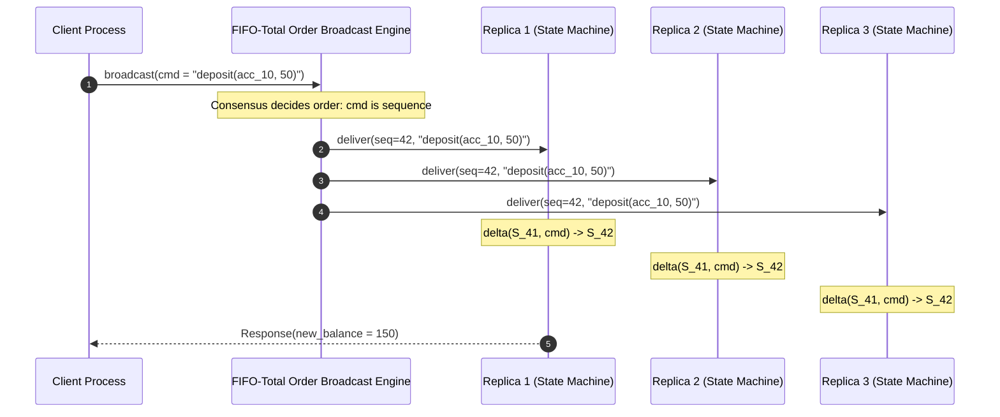
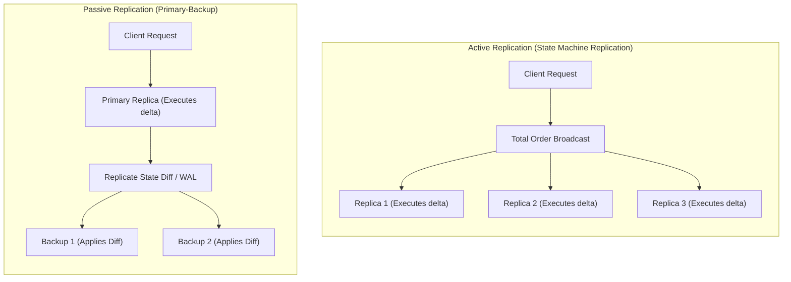

# State Machine Replication (SMR)

State Machine Replication (SMR) [Lamport 1984, Schneider 1990] is the foundational theoretical paradigm for building fault-tolerant, strongly consistent distributed services.

---

## 1. Problem Statement and Motivation

A single server hosting a state machine will inevitably fail due to hardware faults, OS crashes, or maintenance reboots.
To make the service fault-tolerant, we want to run multiple identical copies (replicas) of the server across independent machines. However:
- If replicas receive concurrent requests in different orders, their internal states will diverge permanently.
- If one replica crashes and restarts, it must be able to catch up to the exact state of its peers.

SMR solves this by reducing the problem of distributed consistency to a single abstraction: **ensuring that all replicas process the exact same sequence of deterministic state transitions**.

---

## 2. Formal Definition of a Deterministic State Machine

A state machine $\mathcal{M}$ is a formal tuple:
$$\mathcal{M} = \langle \mathcal{S}, s_0, \mathcal{I}, \mathcal{O}, \delta, \lambda \rangle$$
where:
- $\mathcal{S}$ is the set of possible system states.
- $s_0 \in \mathcal{S}$ is the designated initial state.
- $\mathcal{I}$ is the set of input commands (client requests).
- $\mathcal{O}$ is the set of output responses returned to clients.
- $\delta: \mathcal{S} \times \mathcal{I} \to \mathcal{S}$ is the **transition function**, mapping the current state and an input command to the next state.
- $\lambda: \mathcal{S} \times \mathcal{I} \to \mathcal{O}$ is the **output function**, computing the client response.

### The Absolute Requirement of Determinism
$$\forall s \in \mathcal{S}, \forall i \in \mathcal{I}: \quad \delta(s, i) \text{ and } \lambda(s, i) \text{ must produce the exact same output on all replicas.}$$

#### Forbidden Non-Deterministic Primitives
If the state transition function depends on any of the following, replicas will diverge:
- Physical system time (e.g., `gettimeofday()`, `System.currentTimeMillis()`).
- Hardware random number generators (`rand()`, `/dev/urandom`).
- Process ID or memory address references (pointers).
- Unsynchronized multithreaded concurrency.

> **Resolution Rule**: All non-deterministic values must be evaluated **once by a coordinator or consensus proposal** and passed as explicit, immutable fields inside input command $i$.

---

## 3. The Core Architecture: SMR via Total Order Broadcast

State Machine Replication is constructed by coupling deterministic state machines with **FIFO-Total Order Broadcast**:



### Algorithm Specification

```text
// Initialization on replica r_j
on initialization do
    state := s_0
    commit_index := 0
end on

// Handling client command
on receiving client_request(cmd) do
    send cmd via FIFO-Total Order Broadcast
end on

// Delivering committed command from Total Order Broadcast
on total_order_deliver(seq, cmd) do
    // Enforce sequential transition
    assert seq = commit_index + 1
    
    // Execute deterministic transition
    new_state := delta(state, cmd)
    response  := lambda(state, cmd)
    
    state := new_state
    commit_index := seq
    
    if is_original_handler_for(cmd) then
        send client_response(response) to client
    end if
end on
```

---

## 4. Active vs. Passive Replication

SMR can be implemented in two distinct topological patterns:



| Dimension | Active Replication (Pure SMR) | Passive Replication (Primary-Backup) |
| :--- | :--- | :--- |
| **Execution** | Every replica independently executes the command code $\delta(s, i)$. | Only the Primary executes $\delta(s, i)$; backups apply raw state deltas. |
| **Determinism** | Code execution must be **strictly 100% deterministic**. | Non-deterministic code can execute on the Primary, as only the final output state is replicated. |
| **Failover Overhead** | **Zero delay**: All backups are completely active and up-to-date. | Non-zero: Backups must promote a new Primary and replay the log. |
| **Network Bandwidth** | Low (only input command $i$ is transmitted). | High (state diffs, modified database pages, WAL records). |
| **Byzantine Resilience**| Can be extended to tolerate Byzantine faults (PBFT). | Ineffective against Byzantine faults on the Primary. |

---

## 5. Read-Only Operations in SMR

A naive implementation routes all operations (including read-only queries) through Total Order Broadcast. While correct, this creates a major throughput bottleneck.

Can a replica serve a read request locally without logging it to consensus?

### The Stale Read Hazard
If replica $R_1$ is partitioned or delayed, a client reading locally from $R_1$ will observe stale state, violating linearizability.

### Solutions in Modern SMR Systems
1. **Quorum Read Verification (ReadIndex in Raft)**:
   The leader receives a read request. Before answering, it exchanges heartbeat messages with a majority quorum to verify it has not been deposed by a new leader.
2. **Leader Leases**:
   The leader acquires a bounded physical time lease from replicas. As long as local physical time $t < t_{\text{lease\_start}} + \text{duration} - \Delta_{\text{skew}}$, the leader serves reads locally from memory.

---

## 6. Revision Questions

1. Formally define a deterministic state machine and explain why unseeded random numbers or wall-clock timestamps violate SMR correctness.
2. Explain how FIFO-Total Order Broadcast ensures that active replicas never diverge.
3. Compare the bandwidth and CPU trade-offs between Active and Passive replication.
4. Why does serving a read request directly from a follower replica in SMR risk violating linearizability? How does the ReadIndex protocol resolve this?

---

## 7. Authoritative References

- **[Lamport 1984]** Leslie Lamport. *Using Time Instead of Timeout for Fault-Tolerant Distributed Systems*. ACM TOPLAS, 6(2):254–280, 1984.
- **[Schneider 1990]** Fred B. Schneider. *Implementing Fault-Tolerant Services Using the State Machine Approach: A Tutorial*. ACM Computing Surveys, 22(4):299–319, 1990.
- **[Ongaro, Ousterhout 2014]** Diego Ongaro and John Ousterhout. *In Search of an Understandable Consensus Algorithm*. USENIX ATC 2014.
- **[Kleppmann 2021]** Martin Kleppmann. *Distributed Systems Lecture Notes*, Section 5.3: State Machine Replication. 2021/22.
