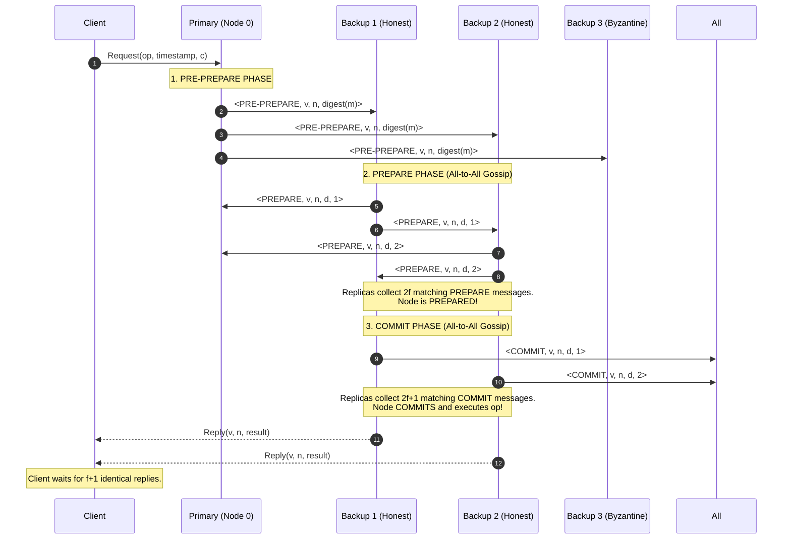

# Byzantine Fault Tolerance and PBFT

Byzantine Fault Tolerance (BFT) addresses distributed systems where faulty nodes may deviate arbitrarily from their assigned protocol, exhibiting non-deterministic bugs, malicious equivocation, or coordinated adversarial collusion.

---

## 1. Problem Statement and Motivation

Standard consensus algorithms (Paxos, Raft) operate in benign crash-stop or crash-recovery models: nodes may fail by halting, but they are assumed to never lie or send contradictory messages.

In adversarial settings—such as cross-organizational financial networks, decentralized public blockchains, or aerospace control systems—nodes cannot be blindly trusted:
- A malicious primary can send proposal $A$ to one half of the cluster and proposal $B$ to the other half (**equivocation**).
- Compromised nodes can collude to force invalid state transitions or censor client transactions.

Byzantine Fault Tolerance guarantees safety and liveness despite active subversion, provided the number of malicious nodes remains strictly bounded.

---

## 2. Theoretical Lower Bounds: Why $3f + 1$?

> **Theorem (Lamport, Shostak, Pease 1982)**: In an unauthenticated asynchronous or partially synchronous system, no consensus protocol can tolerate $f$ Byzantine nodes unless the total number of nodes $n$ satisfies:
> $$n \ge 3f + 1$$
> Faulty nodes must constitute **strictly fewer than one-third of the total population** ($f < n/3$).

### The Intuition of Quorum Overlap under Byzantine Faults
In a cluster of $n$ nodes where up to $f$ nodes are Byzantine:
1. **Liveness Constraint**: Up to $f$ Byzantine nodes may simply crash or refuse to communicate. Therefore, any quorum $Q$ must not require more than $n - f$ responses to make progress:
   $$|Q| \le n - f$$
2. **Safety Constraint**: Suppose two quorums $Q_1$ and $Q_2$ are contacted. To guarantee that honest nodes agree on the same value, the intersection $Q_1 \cap Q_2$ must contain a majority of honest nodes:
   $$|Q_1 \cap Q_2| \ge f + 1$$
3. By set theory:
   $$|Q_1 \cap Q_2| = |Q_1| + |Q_2| - |Q_1 \cup Q_2| \ge (n - f) + (n - f) - n = n - 2f$$
4. Equating the intersection size:
   $$n - 2f \ge f + 1 \implies n \ge 3f + 1$$
5. Substituting $n = 3f + 1$ into quorum size $|Q| = n - f$:
   $$|Q| = (3f + 1) - f = 2f + 1$$

Thus, in a BFT system of $3f + 1$ nodes, **every quorum must consist of at least $2f + 1$ nodes** (a two-thirds supermajority).

---

## 3. Practical Byzantine Fault Tolerance (PBFT)

Invented by Miguel Castro and Barbara Liskov [1999, 2002], PBFT was the first algorithm to demonstrate that Byzantine consensus could execute with polynomial time complexity in asynchronous networks with partial synchrony.

### 3.1 Views and Roles
- Execution is structured into **Views** (similar to Raft terms).
- In view $v$, one designated node is the **Primary** ($p = v \bmod n$), and the remaining $n-1$ nodes are **Backups**.
- Nodes authenticate all messages using cryptographic digital signatures or symmetric Message Authentication Codes (MACs).

---

## 4. The Three-Phase PBFT Protocol

PBFT sequences operations across three consecutive phases: **Pre-Prepare**, **Prepare**, and **Commit**.

---

### Phase 1: Pre-Prepare
1. Client sends request $m = \langle \text{REQUEST}, op, t, c \rangle$ to the primary.
2. The primary assigns a monotonically increasing sequence number $n$ to $m$.
3. The primary multicasts a $\langle \text{PRE-PREPARE}, v, n, d \rangle_{\sigma_p}$ message to all backups (where $d = \text{digest}(m)$ and $\sigma_p$ is primary's signature).
- *Purpose*: Imposes a proposed ordering sequence on requests within view $v$.

### Phase 2: Prepare
1. A backup accepts a Pre-Prepare if the signature is valid, $v$ matches its current view, and it has not accepted another Pre-Prepare for the same $v$ and $n$ with a different digest.
2. The backup multicasts $\langle \text{PREPARE}, v, n, d, i \rangle_{\sigma_i}$ to all peers.
3. **Prepared Invariant**: A replica becomes **prepared** when it holds:
   - The original request $m$.
   - A valid Pre-Prepare for $m$ in view $v$, sequence $n$.
   - $2f$ valid Prepare messages from distinct nodes matching the Pre-Prepare.
- *Purpose*: Ensures all honest nodes agree on the total order of requests within view $v$. Non-faulty nodes can prove the primary did not equivocate.

### Phase 3: Commit
1. Once a replica is prepared, it multicasts $\langle \text{COMMIT}, v, n, d, i \rangle_{\sigma_i}$ to all peers.
2. **Committed Invariant**: A replica **commits** the request when it collects $2f + 1$ valid Commit messages from distinct nodes matching sequence $n$ and digest $d$.
3. The replica executes $op$ against its local state machine and returns a signed `REPLY` to the client.
4. **Client Decision**: The client waits for $f + 1$ matching replies from distinct replicas. Because at most $f$ replicas are Byzantine, $f + 1$ identical replies guarantee that at least one honest replica executed the operation.

---

## 5. View Changes: Deposing a Byzantine Primary

If a primary stalls, equivocates, or drops packets, honest nodes initiate a **View Change** to advance the view to $v + 1$:
1. A node times out waiting for a request to commit, transitions to view $v+1$, and multicasts $\langle \text{VIEW-CHANGE}, v+1, \mathcal{P} \rangle_{\sigma_i}$, where $\mathcal{P}$ contains proofs of all requests prepared by node $i$.
2. The new primary ($p' = (v + 1) \bmod n$) collects $2f + 1$ valid View-Change messages.
3. The new primary constructs a **New-View** message containing a consolidated set of all previously prepared requests, ensuring that **no committed transaction can ever be lost across view changes**.

---

## 6. Modern BFT Evolutions: Tendermint and HotStuff

While PBFT proved polynomial feasibility, its all-to-all Prepare and Commit phases incur **$O(n^2)$ communication complexity per request**, and its View Change protocol requires **$O(n^3)$ messages**, limiting PBFT clusters to $\approx 10\text{--}20$ nodes.

| Protocol | Year | Normal Path Message Complexity | View Change Complexity | Quorum Type | Innovation |
| :--- | :---: | :---: | :---: | :---: | :--- |
| **PBFT** | 1999 | $O(n^2)$ | $O(n^3)$ | $2f+1$ | First practical BFT state machine replication |
| **Tendermint** | 2016 | $O(n^2)$ | $O(n^2)$ | $2/3$ Voting Power | Proof-of-Stake, blockchain state machine |
| **HotStuff** | 2019 | **$O(n)$** | **$O(n)$** | Threshold Signatures | 3-phase pipelined chain, linear view changes |

---

## 7. Revision Questions

1. State the $3f + 1$ lower bound for unauthenticated Byzantine fault tolerance and derive why the quorum size must be $2f + 1$.
2. In PBFT, what does a replica verify before transitioning from the Pre-Prepare phase to the Prepare phase?
3. Why does the client wait for $f + 1$ identical replies rather than just 1 reply in PBFT?
4. Contrast the failure handling of Raft (crash-recovery) with PBFT (Byzantine) when a leader transmits conflicting entries to different peers.

---

## 8. Authoritative References

- **[Lamport, Shostak, Pease 1982]** Leslie Lamport, Robert Shostak, and Marshall Pease. *The Byzantine Generals Problem*. ACM TOPLAS, 4(3):382–401, 1982.
- **[Castro, Liskov 2002]** Miguel Castro and Barbara Liskov. *Practical Byzantine Fault Tolerance and Proactive Recovery*. ACM TOCS, 20(4):398–461, 2002.
- **[Yin et al. 2019]** Maofan Yin, Dahlia Malkhi, Michael K. Reiter, Guy Golan Gueta, and Ittai Abraham. *HotStuff: BFT Consensus with Linearity and Responsiveness*. ACM PODC, 2019.
- **[Kleppmann 2021]** Martin Kleppmann. *Distributed Systems Lecture Notes*, Section 2.2: The Byzantine Generals Problem. 2021/22.
