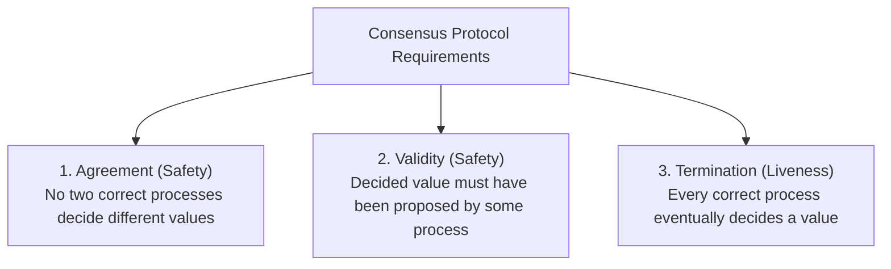

# The Consensus Problem

Consensus is the core foundational problem in fault-tolerant distributed systems: enabling a group of distributed processes to agree on a single data value or decision, despite message delays, network partitions, and node failures.

---

## 1. Problem Statement and Motivation

In a distributed environment, processes must repeatedly agree on critical shared decisions:
- Which transaction commit or abort decision to finalize in a distributed database.
- Which node is the legitimate primary leader after a failover.
- What order of mutations to append to a replicated state machine log.

If processes reach contradictory decisions (split-brain), system state permanently diverges. Consensus algorithms guarantee that all non-faulty nodes reach identical, irrevocable decisions.

---

## 2. Formal Specification of Consensus

Let $\Pi = \{p_1, p_2, \dots, p_n\}$ be a set of processes.
Each process $p_i$ begins with an **input proposal value** $v_i \in \mathcal{V}$.
Processes execute a protocol and transition to a terminal state by **deciding a value** $d_i \in \mathcal{V}$.

A correct consensus protocol must satisfy three fundamental properties:

### 2.1 Agreement (Safety)
> **Uniform Agreement**: No two processes (whether correct or faulty) decide different values:
> $$\forall p_i, p_j \in \Pi: \quad (\text{decided}_i = d_1 \land \text{decided}_j = d_2) \implies d_1 = d_2$$
> *(Non-uniform agreement restricts this guarantee strictly to correct processes).*

### 2.2 Validity / Integrity (Safety)
> If a process decides value $d$, then $d$ must have been proposed by at least one process in $\Pi$:
> $$\forall p_i \in \Pi: \quad \text{decided}_i = d \implies \exists p_j \in \Pi: \text{proposed}_j = d$$
> *(Eliminates trivial protocols where all nodes decide a hardcoded constant $0$ regardless of inputs).*

### 2.3 Termination (Liveness)
> Every correct process eventually decides a value:
> $$\forall p_i \in \text{Correct}: \quad \lozenge (\text{decided}_i \ne \bot)$$
> *(Eliminates trivial protocols where nodes never make a decision).*

### 2.4 Irrevocability (Safety)
> Once a process decides a value $d$, its decision is final and permanent: it cannot alter its decision in any future step.

---

## 3. System Models and Feasibility Boundaries

The solvability of consensus depends entirely on the system's timing and failure assumptions:

| System Model | Failure Assumption | Consensus Feasible? | Solvability Mechanism |
| :--- | :--- | :---: | :--- |
| **Synchronous ($\mathcal{SYNCH}$)** | Crash-Stop ($f < n$) | **Yes** | Solvable in exactly $f + 1$ rounds. |
| **Synchronous ($\mathcal{SYNCH}$)** | Byzantine ($f < n/3$) | **Yes** | Solvable via oral messages or signatures ($f+1$ rounds). |
| **Asynchronous ($\mathcal{ASYNCH}$)** | Crash-Stop ($f \ge 1$) | **NO** | **FLP Impossibility Theorem (1985)**. |
| **Partially Synchronous ($\mathcal{PARTIAL}$)** | Crash-Recovery ($f < n/2$) | **Yes** | **Paxos, Raft, Viewstamped Replication** (via $\diamondsuit\mathcal{P}$ / $\Omega$). |
| **Partially Synchronous ($\mathcal{PARTIAL}$)** | Byzantine ($f < n/3$) | **Yes** | **PBFT, Tendermint, HotStuff**. |

---

## 4. Formal Equivalence to Total Order Broadcast

Consensus and Total Order Broadcast are dual formulations of the same computational power [Chandra and Toueg 1996]:

$$\text{Consensus} \iff \text{Total Order Broadcast}$$

- Any algorithm implementing Total Order Broadcast can solve Consensus.
- Any algorithm solving Consensus can implement Total Order Broadcast by running an infinite sequence of consensus instances $\text{Instance}_1, \text{Instance}_2, \dots$ to sequence log slots.

---

## 5. Herlihy's Consensus Numbers

In concurrent shared-memory systems, Maurice Herlihy [1991] proved that synchronization primitives can be ranked by their **Consensus Number**—the maximum number of concurrent processes for which the primitive can solve wait-free consensus:

| Consensus Number | Primitives | Theoretical Significance |
| :---: | :--- | :--- |
| **1** | Read/Write Shared Registers | Cannot solve consensus for even 2 processes! (ABD registers cannot implement CAS). |
| **2** | Test-And-Set, Swap, FIFO Queues | Solves consensus for 2 processes, but fails for 3 or more. |
| **$2k - 2$** | $k$-Assignment | Bounded consensus. |
| **$\infty$** | **Compare-And-Swap (CAS)**, Load-Linked/Store-Conditional | Universal primitives: can solve consensus for any arbitrary number of processes. |

---

## 6. Revision Questions

1. State the three classical correctness properties of the consensus problem (Agreement, Validity, Termination).
2. Why is Validity strictly necessary in the definition of consensus?
3. What is the difference between Uniform Agreement and Non-Uniform Agreement?
4. Using Herlihy's consensus hierarchy, explain why an ABD atomic register cannot be used to implement a distributed compare-and-swap (CAS) lock.

---

## 7. Authoritative References

- **[Fischer, Lynch, Paterson 1985]** Michael J. Fischer, Nancy A. Lynch, and Michael S. Paterson. *Impossibility of Distributed Consensus with One Faulty Process*. JACM, 32(2):374–382, 1985.
- **[Chandra, Toueg 1996]** Tushar Deepak Chandra and Sam Toueg. *Unreliable Failure Detectors for Reliable Distributed Systems*. JACM, 43(2):225–267, 1996.
- **[Herlihy 1991]** Maurice Herlihy. *Wait-Free Synchronization*. ACM TOPLAS, 13(1):124–149, 1991.
- **[Kleppmann 2021]** Martin Kleppmann. *Distributed Systems Lecture Notes*, Chapter 6: Consensus. University of Cambridge, 2021/22.
