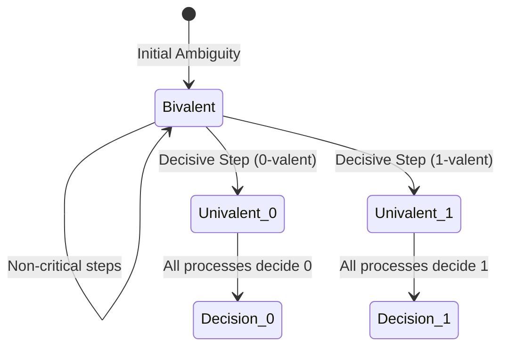
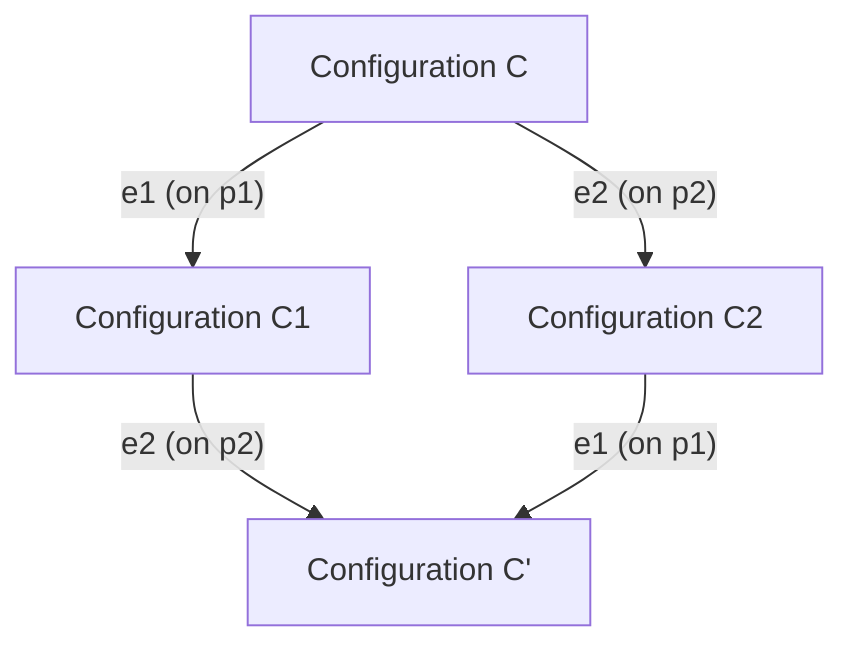

# The FLP Impossibility Theorem

The **FLP Impossibility Theorem** [Fischer, Lynch, and Paterson 1985] is the cornerstone result of theoretical distributed systems, establishing that deterministic consensus cannot be guaranteed in an asynchronous network subject to crash failures.

---

## 1. The Theorem Statement

> **Theorem (Fischer, Lynch, Paterson 1985)**: In an asynchronous message-passing system ($\mathcal{ASYNCH}$), no deterministic consensus protocol can guarantee both Safety and Liveness in the presence of even a single unannounced crash-stop process failure ($f \ge 1$).

### The Three Critical Premises
The impossibility holds strictly when all three conditions are present:
1. **Asynchronous System**: Message delays and process execution speeds are finite but unbounded.
2. **Deterministic Algorithm**: Process state transitions are deterministic functions of incoming messages and local state.
3. **Guaranteed Termination (Liveness)**: The protocol must terminate on *every* valid execution run.

---

## 2. Formal Proof Architecture

The FLP proof operates by analyzing the state space of **global configurations** and proving that an adversarial network scheduler can trap the protocol in an endless **bivalent state** where a final decision can never be reached.

### 2.1 Configurations, Events, and Steps
- **Configuration ($C$)**: A snapshot of the global state: the internal state of all processes plus the multiset of messages in transit in the network.
- **Event ($e = (p, m)$)**: The receipt of message $m$ by process $p$ (or an internal step if $m = \emptyset$).
- **Transition Step**: Applying event $e$ to configuration $C$ transitions the system to a new configuration $C' = e(C)$.

### 2.2 The Concept of Valency

Every reachable configuration $C$ has a set of possible decision outcomes $\mathcal{V}(C) \subseteq \{0, 1\}$:
- **0-valent Configuration**: $\mathcal{V}(C) = \{0\}$. Every reachable terminal configuration from $C$ decides $0$.
- **1-valent Configuration**: $\mathcal{V}(C) = \{1\}$. Every reachable terminal configuration from $C$ decides $1$.
- **Univalent Configuration**: Either 0-valent or 1-valent. The outcome is fixed and irreversible.
- **Bivalent Configuration**: $\mathcal{V}(C) = \{0, 1\}$. It is still possible to reach a decision of $0$, and it is still possible to reach a decision of $1$. The system has not committed to a decision.

---

## 3. The Three Foundational Lemmas

### Lemma 1: Commutativity of Independent Steps (The Diamond Property)
Let $e_1 = (p_1, m_1)$ and $e_2 = (p_2, m_2)$ be two events occurring at **different processes** ($p_1 \ne p_2$).
If $e_1$ and $e_2$ can both be applied to configuration $C$, then the order in which they are applied does not matter:
$$e_1(e_2(C)) = e_2(e_1(C))$$

*Proof*: Because $p_1$ and $p_2$ maintain disjoint local states and independent communication channels, $e_1$ only mutates $p_1$'s state, while $e_2$ only mutates $p_2$'s state. The operations commute. $\blacksquare$

---

### Lemma 2: Existence of an Initial Bivalent Configuration
> **Lemma**: Any consensus protocol that satisfies Validity must have at least one initial configuration that is bivalent.

*Proof by Contradiction*:
1. Suppose every initial configuration is univalent.
2. Consider an initial configuration where all processes propose $0$. By the Validity property, this configuration must be 0-valent.
3. Consider an initial configuration where all processes propose $1$. By Validity, this configuration must be 1-valent.
4. We can construct a chain of initial configurations $C^{(0)}, C^{(1)}, \dots, C^{(n)}$, where configuration $C^{(k)}$ differs from $C^{(k-1)}$ only in the proposal of a single process $p_k$.
5. Somewhere along this chain, there must exist two adjacent initial configurations $C_0$ and $C_1$ such that $C_0$ is 0-valent and $C_1$ is 1-valent, differing only in the initial value of process $p_i$.
6. Suppose process $p_i$ crashes immediately before executing any step ($f=1$).
7. Because $p_i$ is crashed, the remaining $n-1$ processes cannot determine whether the initial state was $C_0$ or $C_1$.
8. The execution of the remaining processes from $C_0$ and $C_1$ must be identical ($\text{trace} \sim$).
9. Therefore, they must reach the exact same decision value in both runs.
10. This contradicts that $C_0$ is 0-valent and $C_1$ is 1-valent.
11. Hence, there **must exist at least one initial configuration that is bivalent**. $\blacksquare$

---

### Lemma 3: Preservation of Bivalence (The Critical Step)
> **Lemma**: Let $C$ be a bivalent configuration, and let $e = (p, m)$ be an event applicable to $C$. Then there exists a configuration $C'$ reachable from $C$ without applying $e$ such that $e(C')$ is **still bivalent**.

*Proof Sketch*:
1. By contradiction: Suppose that for all configurations reachable from $C$, applying $e$ immediately forces the configuration to become univalent (either 0-valent or 1-valent).
2. Because $C$ is bivalent, both a 0-valent and a 1-valent configuration are reachable.
3. Therefore, there must exist an adjacent pair of configurations $D_0, D_1$ reachable from $C$ where $D_1 = e'(D_0)$ such that:
   - $e(D_0)$ is 0-valent.
   - $e(D_1) = e(e'(D_0))$ is 1-valent.
4. We analyze the process target of $e'$:
   - **Case A ($e'$ occurs on a different process than $e$)**:
     By Lemma 1 (Commutativity), $e(e'(D_0)) = e'(e(D_0))$.
     Since $e(D_0)$ is 0-valent, applying $e'$ to it must remain 0-valent.
     However, $e(e'(D_0))$ was assumed to be 1-valent. Contradiction ($0 = 1$).
   - **Case B ($e'$ occurs on the same process as $e$)**:
     Consider an execution where that process crashes. The remaining processes must reach a decision without that node. By analyzing finite runs where the crashed node cannot communicate, a contradiction is similarly derived across the valency boundaries.
5. Therefore, bivalence can **always be preserved**. $\blacksquare$

---

## 4. The Impossibility Conclusion

An adversarial network scheduler can examine the algorithm's state at each bivalent configuration and choose to deliver the specific message that keeps the configuration bivalent.
- Because an asynchronous network allows arbitrary packet delays, the adversary can delay any packet indefinitely without violating the system model.
- Thus, the adversary can force the protocol into an **infinite non-terminating execution loop** where no node can ever decide.
- Therefore, no deterministic consensus protocol can guarantee termination on all asynchronous executions.

---

## 5. Circumventing FLP in Practice

FLP does **not** mean consensus is unusable in practice. It means we cannot have deterministic consensus in pure asynchrony.

Modern distributed systems bypass FLP through two primary techniques:

### 5.1 Partial Synchrony and Failure Detectors
Systems like Paxos, Raft, and Viewstamped Replication assume **Partial Synchrony ($\mathcal{PARTIAL}$)**:
- **Safety is absolute**: Even if the network remains asynchronous forever, split-brain never occurs and bad decisions are never made.
- **Liveness relies on stabilization**: Once the network stabilizes (post-GST) and timeouts exceed true network latency, leader election succeeds and the protocol terminates rapidly.

### 5.2 Randomized Consensus
Randomized algorithms (e.g., Ben-Or 1983, Algorand) replace deterministic choices with local coin-flips:
- An adversarial scheduler can force worst-case delays, but cannot predict coin flips.
- The protocol terminates with **probability 1** in expected polynomial rounds.

---

## 6. Revision Questions

1. State the three necessary conditions under which the FLP impossibility theorem holds.
2. Formally define a bivalent configuration versus a univalent configuration.
3. State Lemma 1 (Commutativity) and explain why it requires two events occurring on different processes.
4. How do Raft and Paxos navigate the FLP result while guaranteeing that split-brain never happens?

---

## 7. Authoritative References

- **[Fischer, Lynch, Paterson 1985]** Michael J. Fischer, Nancy A. Lynch, and Michael S. Paterson. *Impossibility of Distributed Consensus with One Faulty Process*. Journal of the ACM, 32(2):374–382, April 1985.
- **[Ben-Or 1983]** Michael Ben-Or. *Another Advantage of Free Choice: Completely Asynchronous Agreement Protocols*. 2nd ACM PODC, pp. 27–30, 1983.
- **[Kleppmann 2021]** Martin Kleppmann. *Distributed Systems Lecture Notes*, Section 6.1: Consensus System Models. 2021/22.
