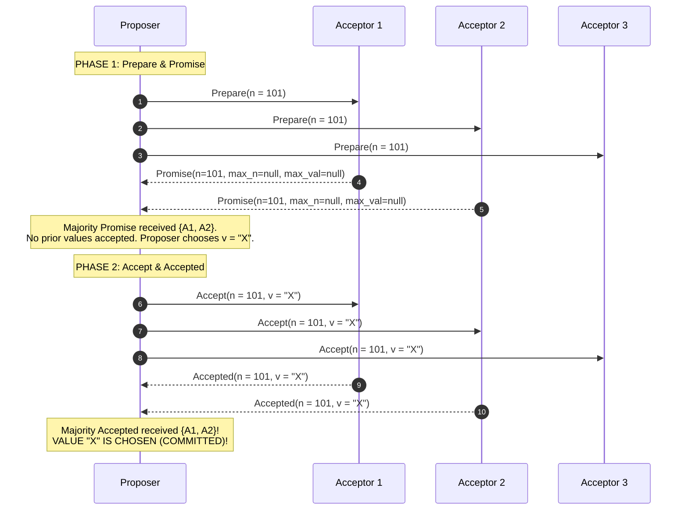
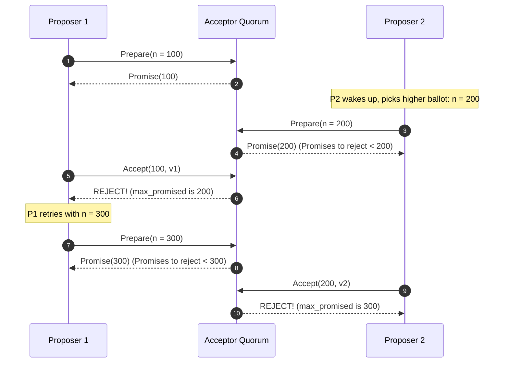

# The Paxos Consensus Protocol

Paxos, invented by Leslie Lamport [1998, 2001], is the foundational consensus protocol for state machine replication in fault-tolerant distributed systems.

---

## 1. Problem Statement and Motivation

In an asynchronous network with crash-recovery nodes, how can a cluster of $n$ machines agree on a sequence of decisions without split-brain, even if nodes crash, leaders stall, and network packets are delayed or duplicated?

Single-decree Paxos solves agreement on a **single value**. Multi-Paxos generalizes this to sequence an **infinite replicated log** (Total Order Broadcast).

---

## 2. Roles and Quorums in Single-Decree Paxos

Paxos separates process duties into three logical roles (often co-located on the same physical nodes):
1. **Proposers**: Advocate client values by initiating proposal rounds.
2. **Acceptors**: Form the memory and voting core of the protocol. Store accepted values on disk and grant promises.
3. **Learners**: Observe when an agreement has been reached and apply the chosen value.

### Quorum Requirement
For a cluster of $n$ acceptors, any decision requires agreement from a **Majority Quorum** $Q$:
$$|Q| \ge \left\lfloor \frac{n}{2} \right\rfloor + 1$$
Any two quorums $Q_1, Q_2$ intersect in at least one acceptor: $Q_1 \cap Q_2 \ne \emptyset$.

---

## 3. Proposal Numbers (Ballots)

To resolve conflicts between multiple concurrent proposers, every proposal is tagged with a globally unique, monotonically increasing **Proposal Number (Ballot)**:
$$n = \langle \text{round}, \text{proposerId} \rangle \in \mathbb{N} \times \Pi$$

Ordered lexicographically:
$$\langle r_1, p_1 \rangle < \langle r_2, p_2 \rangle \iff (r_1 < r_2) \lor (r_1 = r_2 \land p_1 < p_2)$$

---

## 4. Single-Decree Paxos Protocol Specification

The protocol executes in two phases:



---

### 4.1 Phase 1: Prepare and Promise
1. **Phase 1a (Prepare)**:
   A proposer chooses a new proposal number $n$ (greater than any number it has previously seen) and sends `Prepare(n)` to a majority of acceptors.
2. **Phase 1b (Promise)**:
   An acceptor receives `Prepare(n)`. Let $\text{max\_promised}$ be the highest proposal number it has ever observed.
   - If $n > \text{max\_promised}$:
     - Update $\text{max\_promised} := n$.
     - Persist $\text{max\_promised}$ to disk.
     - Return `Promise(n, max_accepted_n, max_accepted_val)`, echoing the highest proposal number it has already accepted (if any) and its associated value.
     - Acceptor promises **never to accept any future proposals numbered less than $n$**.
   - If $n \le \text{max\_promised}$: Reject or ignore the request.

---

### 4.2 Phase 2: Accept and Accepted
1. **Phase 2a (Accept Request)**:
   If the proposer receives promises from a majority quorum of acceptors:
   - **Value Selection Rule**:
     - If any acceptor returned a previously accepted value in its promise, the proposer **MUST choose the value corresponding to the highest proposal number $\text{max\_accepted\_n}$ among all promises**.
     - Only if no acceptor has ever accepted a value is the proposer free to propose its own desired client value $v$.
   - The proposer sends `Accept(n, chosen_val)` to a majority of acceptors.
2. **Phase 2b (Accepted)**:
   An acceptor receives `Accept(n, v)`.
   - If $n \ge \text{max\_promised}$:
     - Update $\text{max\_promised} := n$.
     - Update $\text{max\_accepted\_n} := n$.
     - Update $\text{max\_accepted\_val} := v$.
     - Persist to disk and send `Accepted(n, v)` to the proposer and all learners.
   - If $n < \text{max\_promised}$: Reject the accept request.

---

## 5. Correctness Proof: Invariant $P2^C$

Lamport [2001] proved Paxos safety by establishing invariant $P2^C$:

> **Invariant $P2^C$**: For any proposal number $n$ and value $v$, if a proposal $(n, v)$ is issued by a proposer, then there is a majority quorum $Q$ such that either:
> 1. No acceptor in $Q$ has accepted any proposal numbered less than $n$, OR:
> 2. $v$ is the value of the highest-numbered proposal among all proposals numbered less than $n$ accepted by the acceptors in $Q$.

### Proof Sketch of Agreement
1. Suppose value $v$ is chosen at proposal number $n$ (meaning a majority quorum $Q_1$ accepted $(n, v)$).
2. Consider any subsequent proposal number $m > n$ issued by another proposer.
3. To issue proposal $m$, that proposer must receive promises from a majority quorum $Q_2$.
4. By the Pigeonhole Principle, $Q_1 \cap Q_2 \ne \emptyset$. Let acceptor $a^* \in Q_1 \cap Q_2$.
5. Acceptor $a^*$ accepted $(n, v)$, so it returns $(n, v)$ in its promise to the proposer of $m$.
6. By the Value Selection Rule, the proposer of $m$ must adopt $v$ as its proposal value!
7. By induction, every proposal numbered $m > n$ must propose the exact same value $v$.
8. Therefore, no competing value can ever be chosen. **Uniform Agreement is preserved unconditionally**. $\blacksquare$

---

## 6. Livelock Hazard: Dueling Proposers

While Paxos guarantees Safety under pure asynchrony, it can suffer from a liveness hazard known as **Dueling Proposers**:



Both proposers continually preempt each other's Phase 1 before Phase 2 can complete, causing infinite livelock (an explicit demonstration of the FLP theorem).

### Remedy: Randomized Backoff & Stable Leader Election
Proposers use randomized exponential backoff delays before retrying, or the cluster designates a single stable leader (Multi-Paxos).

---

## 7. Multi-Paxos: Continuous Replicated Log

Single-decree Paxos agrees on only one slot. **Multi-Paxos** sequences an infinite log of slots:

```text
Log Slot:    [ 1 ]         [ 2 ]         [ 3 ]         [ 4 ]
Command:   deposit($10)  withdraw($5)  deposit($20)   ...
```

### The Phase 1 Optimization (Steady-State 1-RTT Writes)
1. When a leader is elected, it executes **Phase 1 once for all future log slots** ($[\text{first\_uncommitted}, \infty)$).
2. For all subsequent client proposals during this leader's term, **Phase 1 is completely skipped**!
3. The leader directly executes **Phase 2 (Accept $\to$ Accepted)** for each log slot:
   $$\text{Client Request} \xrightarrow{\text{Accept}} \text{Quorum} \xrightarrow{\text{Accepted}} \text{Commit (1 Network RTT)}$$

---

## 8. Revision Questions

1. State the responsibilities of Proposers, Acceptors, and Learners in Paxos.
2. In Phase 2a, why is a proposer forbidden from proposing its own client value if an acceptor returns a previously accepted value in Phase 1b?
3. Reproduce the proof that Invariant $P2^C$ prevents conflicting values from being chosen in higher ballot rounds.
4. How does Multi-Paxos eliminate Phase 1 communication round-trips during normal steady-state execution?

---

## 9. Authoritative References

- **[Lamport 1998]** Leslie Lamport. *The Part-Time Parliament*. ACM Transactions on Computer Systems (TOCS), 16(2):133–169, 1998.
- **[Lamport 2001]** Leslie Lamport. *Paxos Made Simple*. ACM SIGACT News, 32(4):18–25, 2001.
- **[Howard, Mortier 2020]** Heidi Howard and Richard Mortier. *Paxos vs Raft: Have We Reached Consensus on Distributed Consensus?* PaPoC 2020.
- **[Kleppmann 2021]** Martin Kleppmann. *Distributed Systems Lecture Notes*, Chapter 6: Consensus. University of Cambridge, 2021/22.
