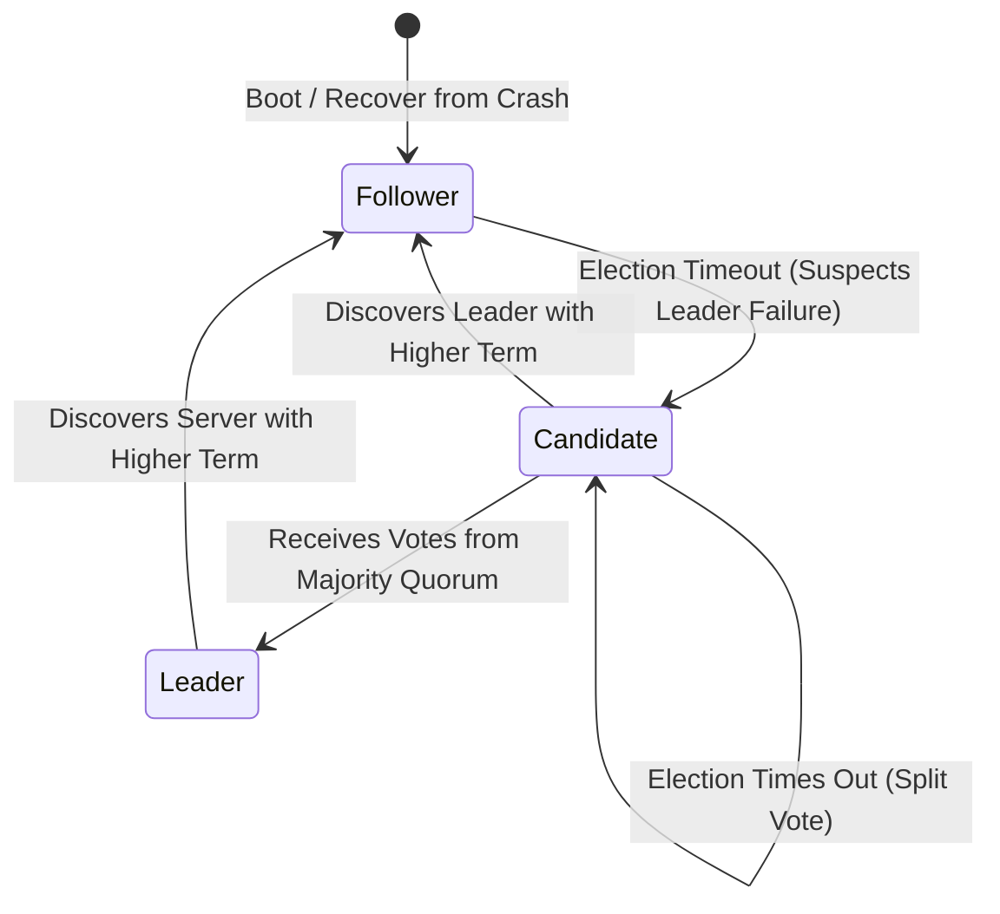
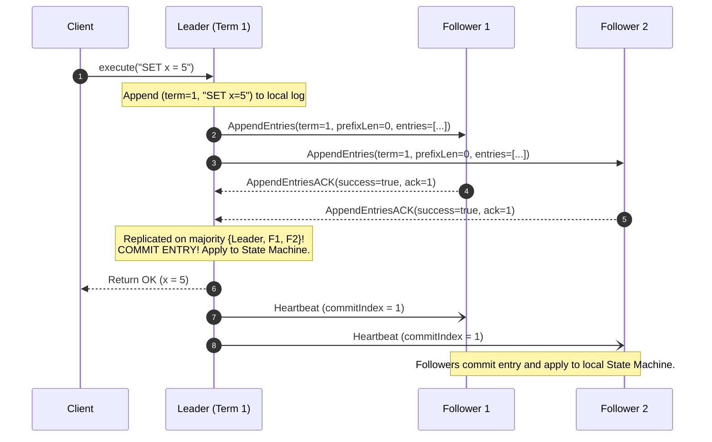

# The Raft Consensus Protocol

Raft [Ongaro and Ousterhout 2014] is a consensus algorithm designed for state machine replication that emphasizes formal understandability, explicit state decomposition, and operational safety.

---

## 1. Problem Statement and Motivation

While Multi-Paxos is mathematically sound, its monolithic structure, reliance on symmetric peer voting, and sparse literature on edge cases (e.g., log compaction, membership changes) make it notoriously difficult to implement correctly.

Raft decomposes the consensus problem into three independent, cleanly isolated subproblems:
1. **Leader Election**: Selecting a single coordinator when the existing leader fails.
2. **Log Replication**: The leader accepts client commands, appends them to its log, and forces followers' logs to match its own.
3. **Safety**: Ensuring that if any server applies a log entry at a given index to its state machine, no other server will ever apply a different log entry for that index.

---

## 2. Server Roles and State Transitions

At any time, each server resides in exactly one of three states:



1. **Follower**: Passive. Only responds to incoming RPCs from candidates and leaders. If no communication is received within a randomized election timeout, it transitions to Candidate.
2. **Candidate**: Increments term, votes for itself, and actively solicits votes via `RequestVote` RPCs.
3. **Leader**: Handles all client requests, coordinates log replication via `AppendEntries` RPCs, and periodically transmits empty heartbeats.

---

## 3. Server State Variables

### 3.1 Persistent State (Must be written to stable storage / WAL before responding to RPCs)
- `currentTerm`: Latest term server has seen (monotonically increasing integer, starts at $0$).
- `votedFor`: Candidate process ID that received this server's vote in `currentTerm` (or `null`).
- `log[]`: Array of log entries. Each entry contains `msg` (state machine command) and `term` (term when entry was received by leader).
- `commitIndex`: Index of highest log entry known to be committed.

### 3.2 Volatile State (Re-initialized in RAM upon crash/reboot)
- `currentRole`: `FOLLOWER`, `CANDIDATE`, or `LEADER`.
- `currentLeader`: Process ID of current leader (or `null`).
- `votesReceived`: Set of node IDs that voted for this candidate in current term.
- `sentLength[]` (Leader only): Next log index to send to each follower (initialized to `log.length`).
- `ackedLength[]` (Leader only): Highest log index known to be replicated on each follower.

---

## 4. Leader Election and the Log Completeness Invariant

### 4.1 Randomized Election Timeouts
To prevent **split votes** (where multiple followers become candidates concurrently and split the majority vote evenly), election timeouts are randomized across an interval (typically $150\text{--}300\text{ ms}$). Usually, only one server times out first, wins the election, and sends heartbeats before others time out.

### 4.2 The Log Completeness Check (`logOk`)
Not all candidates are eligible to become leader! To prevent an out-of-date candidate from overwriting committed entries:

> **The Leader Completeness Invariant**: A voter $V$ grants a vote to candidate $C$ only if candidate $C$'s log is **at least as up-to-date as voter $V$'s own log**.

#### Formal Up-to-Date Test (`logOk`)
Let candidate last log entry have term $c_{\text{lastTerm}}$ and length $c_{\text{logLen}}$.
Let voter last log entry have term $v_{\text{lastTerm}}$ and length $v_{\text{logLen}}$.

$$\text{logOk} \iff (c_{\text{lastTerm}} > v_{\text{lastTerm}}) \lor (c_{\text{lastTerm}} = v_{\text{lastTerm}} \land c_{\text{logLen}} \ge v_{\text{logLen}})$$

1. If the two logs end in different terms, the log with the higher term is more up-to-date.
2. If both logs end in the same term, whichever log is longer is more up-to-date.

---

## 5. Log Replication and Prefix Consistency

A leader appends client commands to its local log and replicates them via `AppendEntries` RPCs.



### The Log Matching Property
Raft enforces two structural log invariants:
1. If two entries in different logs have the same index and term, they store the same command.
2. If two entries in different logs have the same index and term, **their logs are completely identical in all preceding entries**.

Followers enforce this inductively via the **Prefix Consistency Check**:
When receiving `AppendEntries` with `prefixLen` and `prefixTerm`:
- If `log.length < prefixLen` OR `log[prefixLen - 1].term != prefixTerm`:
  $$\text{Reject Request (success = false)}.$$
- The leader responds to a rejection by decrementing `sentLength[follower]` and retrying, stepping backward until finding where the logs match, then overwriting conflicting follower entries.

---

## 6. The Subtle Commit Rule: Committing Entries from Earlier Terms

Can a leader commit a log entry simply by verifying that it is stored on a majority of replicas?

> **CAUTION**: A leader **CANNOT** commit an entry from an *earlier* term simply by counting replica copies!

### The Figure 8 Counterexample (Ongaro & Ousterhout 2014)

```mermaid
gantt
    title Raft Figure 8 Hazard
    dateFormat X
    axisFormat %s
    section Server 1 (Term 2 Leader)
    Log index 1 (Term 1) : 0, 1
    Log index 2 (Term 2) : 1, 2
    section Server 2
    Log index 1 (Term 1) : 0, 1
    Log index 2 (Term 2) : 1, 2
    section Server 3
    Log index 1 (Term 1) : 0, 1
    section Server 4 (Crashed)
    Log index 1 (Term 1) : 0, 1
    section Server 5 (Term 3 Leader)
    Log index 1 (Term 1) : 0, 1
    Log index 2 (Term 3) : 1, 2
```



1. In Term 2, Server 1 is leader and replicates index 2 (Term 2) to Server 2. Server 1 crashes.
2. Server 5 is elected leader in Term 3 (with votes from 3, 4, 5) and writes entry at index 2 (Term 3). Server 5 crashes.
3. Server 1 recovers and is elected leader in Term 4. It continues replicating its old entry at index 2 (Term 2) to Server 3.
4. **The entry (index 2, Term 2) is now replicated on a majority of nodes (Servers 1, 2, 3)**!
5. If Server 1 considers this committed, it applies it to its state machine.
6. Now suppose Server 1 crashes again before writing any new entry.
7. Server 5 can be elected leader in Term 5 (with votes from 3, 4, 5, because its log has term 3, which is $> 2$).
8. Server 5 will overwrite index 2 on Server 3 with its own Term 3 entry!
9. **Result**: A supposedly "committed" log entry was overwritten, violating State Machine Safety!

### The Raft Rule for Committing Earlier Entries
> **The Commit Invariant**: A leader is **never allowed to commit an entry from an earlier term by counting replicas**. A leader commits earlier entries **only indirectly**, by replicating an entry from its **CURRENT term** to a majority of servers:
> $$\text{Commit entry } e \iff (\text{replicated on majority}) \land (e.\text{term} = \text{currentTerm})$$

Once an entry from the current term is committed, all prior entries in the log are committed automatically by the Log Matching Property.

---

## 7. Complete Raft Algorithm Pseudocode

Based on the formal formulation by Martin Kleppmann [2021] and Ongaro & Ousterhout [2014]:

```text
// ==============================================================
// 1. STATE INITIALIZATION (at node nodeId)
// ==============================================================
on initialization do
    // Persistent state on stable storage
    currentTerm := 0;  votedFor := null
    log := [];         commitLength := 0

    // Volatile state
    currentRole := FOLLOWER; currentLeader := null
    votesReceived := {}
    sentLength := [];  ackedLength := []
end on

on recovery from crash do
    currentRole := FOLLOWER; currentLeader := null
    votesReceived := {}
    sentLength := [];  ackedLength := []
end on

// ==============================================================
// 2. INITIATING LEADER ELECTION
// ==============================================================
on election timeout or leader failure detected do
    currentTerm := currentTerm + 1
    currentRole := CANDIDATE
    votedFor := nodeId
    votesReceived := {nodeId}
    
    lastTerm := 0
    if log.length > 0 then
        lastTerm := log[log.length - 1].term
    end if
    
    msg := (VoteRequest, nodeId, currentTerm, log.length, lastTerm)
    for each node in cluster \ {nodeId} do
        send msg to node
    end for
    reset_election_timer()
end on

// ==============================================================
// 3. VOTING ON A CANDIDATE (VoteRequest handler)
// ==============================================================
on receiving (VoteRequest, cId, cTerm, cLogLength, cLogTerm) do
    if cTerm > currentTerm then
        currentTerm := cTerm
        currentRole := FOLLOWER
        votedFor := null
    end if
    
    lastTerm := 0
    if log.length > 0 then
        lastTerm := log[log.length - 1].term
    end if
    
    // Log completeness check
    logOk := (cLogTerm > lastTerm) or
             (cLogTerm = lastTerm and cLogLength >= log.length)
             
    if cTerm = currentTerm and logOk and (votedFor in {cId, null}) then
        votedFor := cId
        send (VoteResponse, nodeId, currentTerm, true) to cId
    else
        send (VoteResponse, nodeId, currentTerm, false) to cId
    end if
end on

// ==============================================================
// 4. COLLECTING VOTES (Candidate)
// ==============================================================
on receiving (VoteResponse, voterId, term, granted) do
    if currentRole = CANDIDATE and term = currentTerm and granted then
        votesReceived := votesReceived union {voterId}
        if |votesReceived| >= floor(n/2) + 1 then
            currentRole := LEADER
            currentLeader := nodeId
            cancel_election_timer()
            
            for each follower in cluster \ {nodeId} do
                sentLength[follower] := log.length
                ackedLength[follower] := 0
                ReplicateLog(nodeId, follower)
            end for
        end if
    else if term > currentTerm then
        currentTerm := term
        currentRole := FOLLOWER
        votedFor := null
        cancel_election_timer()
    end if
end on

// ==============================================================
// 5. REPLICATING LOG ENTRIES (Leader)
// ==============================================================
function ReplicateLog(leaderId, followerId):
    prefixLen := sentLength[followerId]
    suffix := log[prefixLen ... log.length - 1]
    
    prefixTerm := 0
    if prefixLen > 0 then
        prefixTerm := log[prefixLen - 1].term
    end if
    
    send (LogRequest, leaderId, currentTerm, prefixLen,
          prefixTerm, commitLength, suffix) to followerId
end function

// ==============================================================
// 6. RECEIVING LOG ENTRIES (Follower)
// ==============================================================
on receiving (LogRequest, leaderId, term, prefixLen, prefixTerm,
              leaderCommit, suffix) do
    if term > currentTerm then
        currentTerm := term
        currentRole := FOLLOWER
        votedFor := null
        cancel_election_timer()
    end if
    
    if term = currentTerm then
        currentRole := FOLLOWER
        currentLeader := leaderId
    end if
    
    logOk := (log.length >= prefixLen) and
             (prefixLen = 0 or log[prefixLen - 1].term = prefixTerm)
             
    if term = currentTerm and logOk then
        AppendEntries(prefixLen, leaderCommit, suffix)
        ack := prefixLen + suffix.length
        send (LogResponse, nodeId, currentTerm, ack, true) to leaderId
    else
        send (LogResponse, nodeId, currentTerm, 0, false) to leaderId
    end if
end on

function AppendEntries(prefixLen, leaderCommit, suffix):
    // Truncate inconsistent suffix if necessary
    if suffix.length > 0 and log.length > prefixLen then
        idx := min(log.length, prefixLen + suffix.length) - 1
        if log[idx].term != suffix[idx - prefixLen].term then
            log := log[0 ... prefixLen - 1]
        end if
    end if
    
    // Append new entries
    if prefixLen + suffix.length > log.length then
        for i := log.length - prefixLen to suffix.length - 1 do
            log.append(suffix[i])
        end for
    end if
    
    // Commit up to leaderCommit
    if leaderCommit > commitLength then
        for i := commitLength to leaderCommit - 1 do
            deliver log[i].msg to application
        end for
        commitLength := leaderCommit
    end if
end function

// ==============================================================
// 7. LEADER COMMITTING LOG ENTRIES
// ==============================================================
on receiving (LogResponse, follower, term, ack, success) do
    if term = currentTerm and currentRole = LEADER then
        if success = true and ack >= ackedLength[follower] then
            sentLength[follower] := ack
            ackedLength[follower] := ack
            CommitLogEntries()
        else if sentLength[follower] > 0 then
            // Step backward and retry
            sentLength[follower] := sentLength[follower] - 1
            ReplicateLog(nodeId, follower)
        end if
    else if term > currentTerm then
        currentTerm := term
        currentRole := FOLLOWER
        votedFor := null
        cancel_election_timer()
    end if
end on

function CommitLogEntries():
    minAcks := floor(n/2) + 1
    ready := { len in 1..log.length | 
               |{ n in cluster | ackedLength[n] >= len }| >= minAcks }
               
    if ready != {} and max(ready) > commitLength and
       log[max(ready) - 1].term = currentTerm then
        for i := commitLength to max(ready) - 1 do
            deliver log[i].msg to application
        end for
        commitLength := max(ready)
    end if
end function
```

---

## 8. Raft vs. Multi-Paxos Comparison

| Dimension | Raft [Ongaro & Ousterhout 2014] | Multi-Paxos [Lamport 1998] |
| :--- | :--- | :--- |
| **Leader Primacy** | **Strong Leader**: Log flow is strictly unidirectional (Leader $\to$ Follower). | **Weak Leader**: Any node can propose; leader is just a performance sequencer. |
| **Log Compaction & Holes**| **No Holes**: Log entries are committed in strict consecutive sequential order. | **Can have holes**: Slots can commit out of order, requiring fill-in rounds. |
| **Leader Election Rule** | Requires candidate log to contain all committed entries (`logOk`). | Anyone can become leader, but must query quorums to discover existing values. |
| **Understandability** | Designed specifically for formal modularity and human teachability. | Notoriously subtle, underspecified in edge cases. |

---

## 9. Revision Questions

1. State the five core safety properties of the Raft algorithm.
2. In Raft's `RequestVote` RPC, what exact condition must hold for `logOk` to evaluate to true?
3. Using the Figure 8 scenario, explain why a Raft leader is forbidden from directly committing an entry from an earlier term by counting replicas.
4. Why does Raft use randomized election timeouts instead of a static constant timeout?

---

## 10. Authoritative References

- **[Ongaro, Ousterhout 2014]** Diego Ongaro and John Ousterhout. *In Search of an Understandable Consensus Algorithm*. USENIX Annual Technical Conference, pp. 305–319, 2014.
- **[Howard, Mortier 2020]** Heidi Howard and Richard Mortier. *Paxos vs Raft: Have We Reached Consensus on Distributed Consensus?* PaPoC 2020.
- **[Kleppmann 2021]** Martin Kleppmann. *Distributed Systems Lecture Notes*, Chapter 6: The Raft Consensus Algorithm. University of Cambridge, 2021/22.
