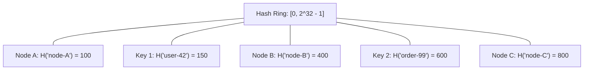
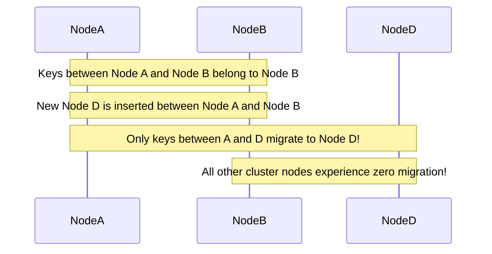
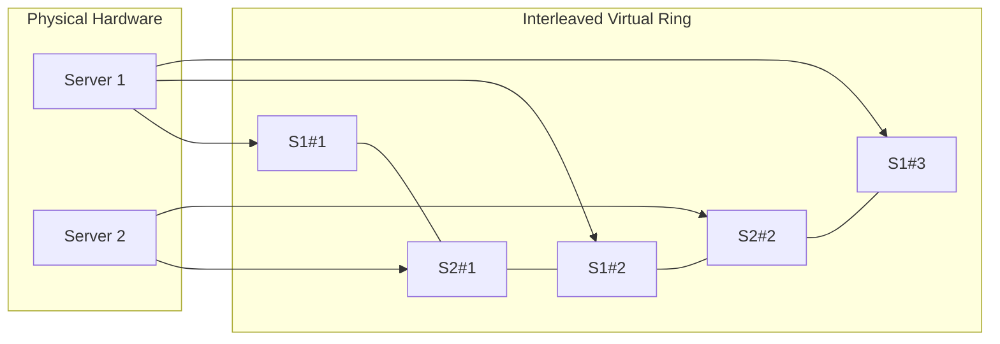

# Consistent Hashing

Consistent hashing [Karger et al. 1997] is a distributed partitioning scheme that minimizes key reassignment during cluster resizing, ensuring efficient scale-out in distributed storage systems.

---

## 1. Problem Statement and Motivation

In a distributed key-value store with $N$ storage nodes, incoming requests must be routed to the node responsible for a given key.

### The Failure of Modulo Hashing
The naive approach uses the modulo operator:
$$\text{node}(key) = \text{hash}(key) \pmod N$$
- When $N = 10$, key hashes are partitioned across 10 nodes.
- If one node crashes ($N = 9$) or a node is added ($N = 11$), **almost every key's destination changes**:
  $$\text{Fraction of keys reassigned} = \frac{N}{N + 1} \approx 90\text{--}99\%$$
- This triggers a massive, catastrophic data migration storm that overwhelms network switches and clears server caches simultaneously (a **thundering herd / cache stampede**).

**Consistent Hashing** ensures that when the cluster size changes from $N$ to $N \pm 1$, **only $K/N$ keys are migrated on average** (where $K$ is the total number of keys), the theoretical minimum.

---

## 2. The Hash Ring Topology

Consistent hashing maps both keys and nodes to the same continuous circular coordinate space (the **Hash Ring**).

Let $H: \mathcal{K} \to [0, 2^{32} - 1]$ be a uniform cryptographic hash function (e.g., MD5, SHA-256, MurmurHash3).
The hash range wraps around such that $2^{32} - 1$ connects back to $0$.

### 2.1 Key Assignment Rule
To locate the node responsible for $key$:
1. Compute the hash position $h = H(key)$.
2. Travel **clockwise** along the ring from $h$ until finding the first node whose hash position is $\ge h$.
3. If no such node exists, wrap around to the first node on the ring.
$$\text{node}(key) = \text{successor}(H(key))$$

---

## 3. Node Addition and Removal Mechanics

### 3.1 Node Addition
When a new node $N_{\text{new}}$ is inserted at position $h_{\text{new}}$:
- Only keys located between $N_{\text{new}}$'s counter-clockwise predecessor and $h_{\text{new}}$ are reassigned to $N_{\text{new}}$.
- All other keys on the ring remain undisturbed on their existing nodes.

---

## 4. Virtual Nodes (Vnodes)

### 4.1 The Non-Uniformity Problem
In simple consistent hashing where each physical server has only one token on the ring:
- Random placement causes high variance in partition arc lengths.
- One node may accidentally receive $50\%$ of the keys, creating severe load hot-spots.

### 4.2 The Virtual Node Solution [Dynamo 2007]
Instead of mapping each physical server to a single point, each physical server is mapped to **$V$ virtual nodes (tokens)** distributed uniformly across the ring (typically $V = 100\text{--}256$):
$$\text{Token}(N_i, k) = H(\text{nodeId}_i \,\|\, \text{replica\_index}_k) \quad \text{for } k \in \{1, \dots, V\}$$

### Benefits of Vnodes
1. **Uniform Load Distribution**: By the Law of Large Numbers, key load across physical servers becomes mathematically uniform.
2. **Heterogeneous Hardware**: A server with $2\times$ CPU and RAM can be assigned $2V$ virtual tokens, naturally absorbing double the traffic.
3. **Parallel Rebalancing**: When a node fails, its $V$ virtual ranges are scattered across *all remaining servers*, parallelizing replica rebuilds across the entire cluster rather than bottlenecking a single peer.

---

## 5. Replication with Preference Lists

In systems providing replication factor $R$ (e.g., Apache Cassandra, Amazon Dynamo):
- The coordinator hashes the key to its successor on the ring.
- It then walks clockwise to select the first $R$ **physically distinct** servers.
- These $R$ servers constitute the **Preference List** for that key, participating in read/write quorums.

---

## 6. Revision Questions

1. Why does modulo hashing reassign nearly all keys during cluster resizing, while consistent hashing reassigns only $O(K/N)$?
2. Explain the purpose of Virtual Nodes (Vnodes) and identify three operational advantages they provide.
3. If a physical node crashes in a system using Vnodes, why is state reconstruction faster than in a system with single-token hashing?
4. How is the preference list constructed on a hash ring to ensure replicas reside on distinct physical racks?

---

## 7. Authoritative References

- **[Karger et al. 1997]** David Karger, Eric Lehman, Tom Leighton, Rina Panigrahy, Matthew Levine, and Daniel Lewin. *Consistent Hashing and Random Trees: Distributed Caching Protocols for Relieving Hot Spots on the World Wide Web*. ACM STOC, pp. 654–663, 1997.
- **[DeCandia et al. 2007]** Giuseppe DeCandia et al. *Dynamo: Amazon’s Highly Available Key-Value Store*. ACM SOSP, 2007.
- **[Kleppmann 2017]** Martin Kleppmann. *Designing Data-Intensive Applications*, Chapter 6: Partitioning. O'Reilly, 2017.
