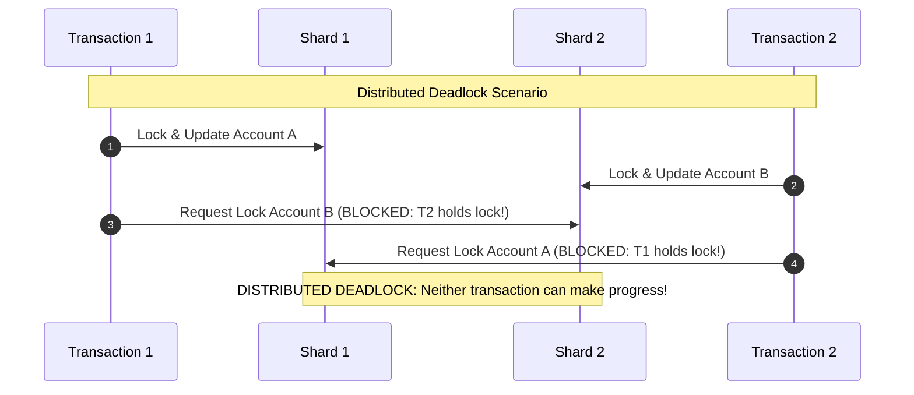
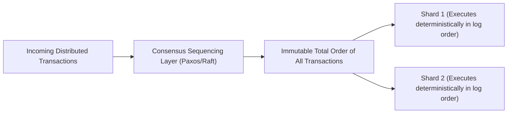

# Distributed Transactions and Concurrency Control

Distributed transactions extend ACID guarantees across multiple independent storage nodes, coordinating concurrency and atomic commitment across sharded databases.

---

## 1. Problem Statement and Motivation

When a business transaction touches data stored on multiple independent shards:
```sql
-- Transfer $100 from Account A (on Shard 1) to Account B (on Shard 2)
BEGIN TRANSACTION;
  UPDATE accounts SET balance = balance - 100 WHERE id = 'Alice';  -- Shard 1
  UPDATE accounts SET balance = balance + 100 WHERE id = 'Bob';    -- Shard 2
COMMIT;
```
If Shard 1 updates its record but Shard 2 crashes, money disappears from the system, violating **Atomicity**.
If a concurrent transaction reads both accounts while the transfer is half-finished, it observes an inconsistent total balance, violating **Isolation**.

Distributed transactions must preserve ACID properties across arbitrary network partitions and node crashes.

---

## 2. Distributed ACID Deconstructed

| ACID Property | Single-Node Mechanism | Distributed System Mechanism |
| :--- | :--- | :--- |
| **Atomicity** | Local undo logs / shadow paging. | **Two-Phase Commit (2PC)** or **Paxos Commit** across shards. |
| **Consistency** | Application schema invariants. | Global constraints, distributed serializability. |
| **Isolation** | In-memory lock manager, latching. | **Distributed 2PL**, **MVCC**, or **Deterministic Ordering**. |
| **Durability** | Local disk `fsync()` of WAL. | **Quorum consensus replication (Raft/Paxos)** per shard. |

---

## 3. Distributed Two-Phase Locking (2PL) and Deadlocks

In Strict Two-Phase Locking (S2PL):
- A transaction acquires shared locks for reads and exclusive locks for writes.
- **Growing Phase**: Locks are acquired as data is accessed.
- **Shrinking Phase**: **All locks are held until the transaction completely commits or aborts** in Phase 2 of 2PC.



### 3.1 Distributed Deadlock Prevention: Wait-Die vs. Wound-Wait
To prevent distributed deadlock without running expensive global wait-for graph cycle detection:
Transactions are assigned unique, monotonic priority timestamps $T(Tx)$ upon initiation [Rosenkrantz et al. 1978].
Suppose transaction $T_{\text{old}}$ (older, higher priority) requests a lock currently held by $T_{\text{young}}$ (younger, lower priority), or vice versa:

1. **Wait-Die Scheme (Non-preemptive)**:
   - If older requests lock held by younger: **Older waits**.
   - If younger requests lock held by older: **Younger dies (aborts and restarts)**.
2. **Wound-Wait Scheme (Preemptive)**:
   - If older requests lock held by younger: **Older wounds younger (younger aborts immediately)**.
   - If younger requests lock held by older: **Younger waits**.

Both schemes are mathematically guaranteed to prevent deadlocks because dependencies can only flow in one direction along the timestamp hierarchy.

---

## 4. Deterministic Transaction Ordering (Calvin [Thomson et al. 2012])

Traditional distributed transactions incur severe latency because they combine Distributed 2PL with 2PC: locks are held across multiple network round-trips while waiting for prepare votes.

**Calvin** eliminates distributed 2PC by pre-sequencing transactions:



### Mechanics
1. Transactions declare all read/write keys in advance.
2. An independent consensus layer (Paxos) orders transactions into an immutable global log.
3. Each shard inspects the log and executes transactions **in strict deterministic sequence order**.
4. Because execution order is fixed before locks are acquired, **transactions never abort due to deadlocks or concurrency conflicts**, and **distributed 2PC is completely eliminated**!

---

## 5. Revision Questions

1. Explain how distributed 2PC and distributed 2PL interact during a cross-shard transaction.
2. Contrast the Wait-Die and Wound-Wait deadlock prevention algorithms.
3. What is a "phantom deadlock", and how does network latency trigger it in centralized deadlock detectors?
4. How does deterministic transaction processing (as in Calvin) eliminate the need for Two-Phase Commit?

---

## 6. Authoritative References

- **[Rosenkrantz et al. 1978]** Daniel J. Rosenkrantz, Richard E. Stearns, and Philip M. Lewis. *System Level Concurrency Control for Distributed Database Systems*. ACM TODS, 3(2):178–198, 1978.
- **[Thomson et al. 2012]** Alexander Thomson et al. *Calvin: Fast Distributed Transactions for Partitioned Database Systems*. ACM SIGMOD, pp. 1–12, 2012.
- **[Corbett et al. 2012]** James C. Corbett et al. *Spanner: Google’s Globally-Distributed Database*. OSDI 2012.
