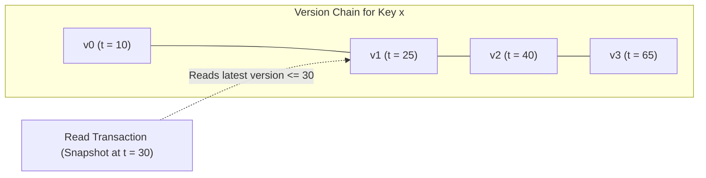
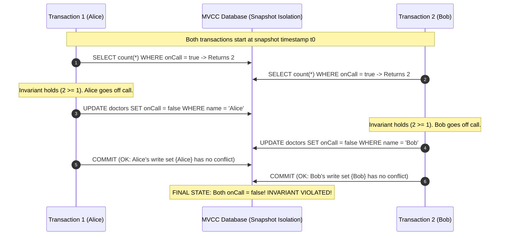
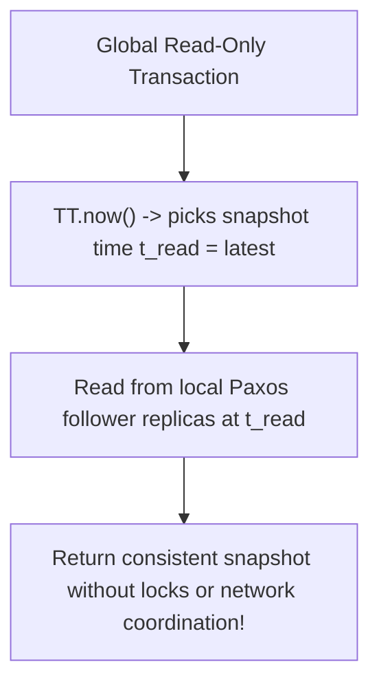

# Multi-Version Concurrency Control (MVCC) and Snapshot Isolation

Multi-Version Concurrency Control (MVCC) is a concurrency control architecture where write operations append new timestamped versions of data items rather than updating records in place, enabling lock-free read operations.

---

## 1. Problem Statement and Motivation

In classical lock-based concurrency control (Two-Phase Locking, 2PL):
- Readers acquire shared read locks, and writers acquire exclusive write locks.
- **Writers block readers, and readers block writers**.
- If a long-running read transaction (such as a database backup, monthly accounting audit, or machine learning export) reads the entire database, it must lock every table for minutes or hours, completely stalling online transactional processing (OLTP).

MVCC eliminates this contention by ensuring: **Readers never block writers, and writers never block readers**.

---

## 2. The Multi-Version Architecture

Instead of maintaining a single mutable value per key, an MVCC storage engine maintains an ordered chain of immutable versions:

$$\text{Key } x \to [ (v_3, t_3), \; (v_2, t_2), \; (v_1, t_1), \; (v_0, t_0) ]$$
where each tuple contains the value written and the commit timestamp $t_k$ of the transaction that created it.

### Read Rule
A read transaction $T_r$ is assigned a logical **snapshot timestamp** $t_r$.
When $T_r$ reads key $x$, it ignores all versions with commit timestamps $> t_r$ and reads the version with the **highest timestamp $\le t_r$**.
Because previous versions are never modified in place, $T_r$ observes an unchanging, consistent snapshot of the database without holding any locks.

---

## 3. Snapshot Isolation (SI)

Snapshot Isolation guarantees that:
1. All reads performed by transaction $T$ see a consistent snapshot of the database as of the start of $T$.
2. Transaction $T$ commits only if no concurrent transaction has written to any key in $T$'s write set since $T$'s snapshot timestamp (the **First-Committer-Wins** or **Write-Conflict Detection** rule).

---

## 4. The Write Skew Anomaly: Why SI $\ne$ Serializability

Snapshot Isolation prevents dirty reads, non-repeatable reads, and lost updates. However, **Snapshot Isolation is NOT Serializability**.

### The Canonical Counterexample: The On-Call Doctor Problem
- **Application Invariant**: At least one doctor must be on call at all times.
- **Initial Database State**: Both Alice and Bob are on call ($\text{Alice.onCall} = \text{true}, \; \text{Bob.onCall} = \text{true}$).
- **Concurrent Scenario**: Both doctors simultaneously request leave.

#### Why Write Skew Occurred
- Transaction 1 wrote to `Alice`.
- Transaction 2 wrote to `Bob`.
- Because their write sets were disjoint ($\{\text{Alice}\} \cap \{\text{Bob}\} = \emptyset$), the first-committer-wins rule detected no conflict!
- In any true serial execution ($T_1$ then $T_2$, or $T_2$ then $T_1$), the second transaction would observe $\text{count} = 1$ and be rejected.

### Remedy: Serializable Snapshot Isolation (SSI) [Cahill et al. 2008]
SSI tracks **rw-antidependencies** (situations where one transaction reads a version that another concurrent transaction overwrites) in an in-memory dependency graph. If the graph contains a cycle of two consecutive antidependency edges, SSI aborts one of the transactions, achieving true Serializability without lock overhead.

---

## 5. Google Spanner's TrueTime MVCC Implementation

Google Spanner [Corbett et al. 2012] utilizes multi-version concurrency control combined with TrueTime physical uncertainty bounds to implement **External Consistency (Strict Serializability)** for globally distributed read-write transactions, while serving **completely lock-free read-only transactions across worldwide datacenters**.

Because TrueTime commit wait ensures that timestamps strictly respect causality, a read-only query evaluated at timestamp $t_{\text{read}}$ is guaranteed to observe a causally consistent snapshot of the entire planetary database.

---

## 6. Revision Questions

1. Explain how MVCC allows readers to never block writers and writers to never block readers.
2. In Snapshot Isolation, what is the First-Committer-Wins rule?
3. What is Write Skew? Why does Snapshot Isolation fail to detect write skew when write sets are disjoint?
4. How does Google Spanner leverage MVCC and TrueTime to perform global multi-datacenter read-only transactions without acquiring locks?

---

## 7. Authoritative References

- **[Berenson et al. 1995]** Hal Berenson et al. *A Critique of ANSI SQL Isolation Levels*. ACM SIGMOD, 1995.
- **[Cahill et al. 2008]** Michael J. Cahill, Uwe Röhm, and Alan D. Fekete. *Serializable Isolation for Snapshot Databases*. ACM TODS, 34(4), 2008.
- **[Corbett et al. 2012]** James C. Corbett et al. *Spanner: Google’s Globally-Distributed Database*. OSDI 2012.
- **[Kleppmann 2021]** Martin Kleppmann. *Distributed Systems Lecture Notes*, Chapter 8: Google's Spanner. 2021/22.
