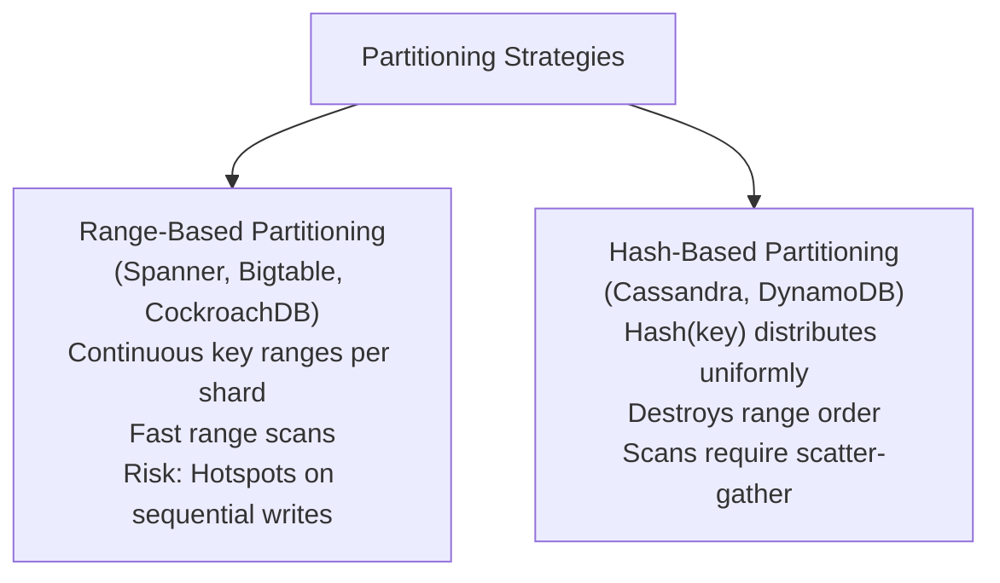
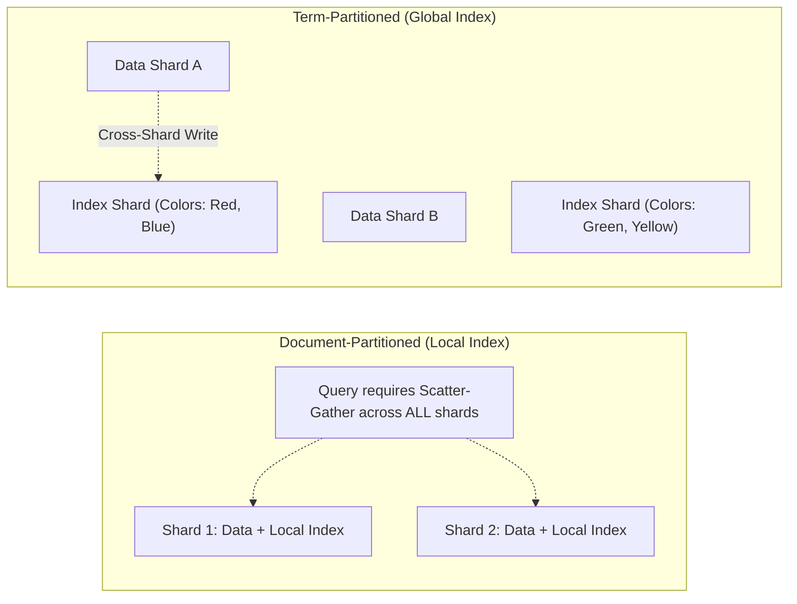

# Partitioning and Sharding

Partitioning (sharding) divides a massive dataset into smaller, independent subsets called partitions or shards, enabling databases to scale storage capacity and query throughput beyond the limits of a single machine.

---

## 1. Problem Statement and Motivation

A single physical server has finite disk capacity, CPU cores, and network bandwidth. When a dataset exceeds terabytes or petabytes, or when query traffic exceeds hundreds of thousands of operations per second:
- Replicating the *entire* dataset on every node (full replication) no longer works because no single node has sufficient disk space.
- The system must partition data such that **each node stores only a disjoint subset of the total records**, while presenting a unified logical view to clients.

---

## 2. Partitioning Strategies: Range vs. Hash

### 2.1 Range-Based Partitioning
- **Mechanism**: Keys are ordered alphabetically or numerically. Partitions are assigned continuous boundaries:
  $$\text{Shard}_1: [\text{"A"}, \text{"D"}), \quad \text{Shard}_2: [\text{"D"}, \text{"M"}), \quad \text{Shard}_3: [\text{"M"}, \text{"Z"}]$$
- **Advantages**: Highly efficient **range queries**. A query for `WHERE user_id BETWEEN 100 AND 200` routes directly to the specific shard holding that range.
- **Vulnerabilities (Hotspotting)**: If the primary key is a timestamp or auto-incrementing ID, all current writes hit the single shard responsible for the latest range, completely negating horizontal write scalability.

### 2.2 Hash-Based Partitioning
- **Mechanism**: A uniform hash function (e.g., Murmur3) is applied to the key. The hash value determines the target shard.
- **Advantages**: Eliminates hotspots. Consecutive keys (e.g., timestamps $t_1, t_2, t_3$) are dispersed across completely different physical servers.
- **Disadvantages**: **Destroys range ordering**. Executing `WHERE user_id BETWEEN 100 AND 200` cannot target a single shard and must query **all shards simultaneously (Scatter-Gather)**, resulting in high tail latency.

---

## 3. Secondary Index Architectures in Sharded Databases

Partitioning records by primary key is straightforward. However, indexing non-primary attributes (e.g., searching users by `email` or orders by `created_at`) requires specialized secondary index topologies:

### 3.1 Document-Partitioned (Local Index)
- Each shard maintains its own secondary index covering *only the documents stored locally on that shard*.
- **Write Path**: Extremely fast. Updating a record and its index occurs locally within a single node.
- **Read Path**: Expensive. A secondary query must **scatter-gather** to every single shard in the cluster and merge results. If any single shard experiences a latency spike, the entire query is delayed.

### 3.2 Term-Partitioned (Global Index)
- The secondary index is partitioned globally by the indexed term itself (e.g., terms A–M on Index Node 1, N–Z on Index Node 2).
- **Read Path**: Extremely fast. Querying by secondary key routes directly to the single index node responsible for that term.
- **Write Path**: Complex and slow. Updating a document on Data Shard 1 requires a **distributed cross-shard transaction** to update the corresponding index entry on Index Node 2.

---

## 4. Request Routing Architectures

When a client issues a query, how does it know which shard to contact?

1. **Client-Side Routing**: The client library caches the partition map (e.g., from ZooKeeper or Raft metadata) and hashes keys directly to connect to the responsible replica.
2. **Routing Proxy Tier (e.g., Envoy, Vitess)**: Clients connect to stateless proxies that determine the destination shard and route traffic transparently.
3. **Peer-to-Peer Routing (e.g., Cassandra)**: Clients can connect to *any* random node in the cluster. That node acts as coordinator for the request, forwarding it to the appropriate shard.

---

## 5. Revision Questions

1. Compare Range-Based Partitioning with Hash-Based Partitioning regarding range query performance and write hotspotting.
2. What is a Scatter-Gather query, and why does it make tail latency sensitive to stragglers?
3. Explain the difference between a Local (Document-Partitioned) Secondary Index and a Global (Term-Partitioned) Secondary Index.
4. If an application requires inserting 50,000 sensor readings per second with monotonic timestamps, how would you design the partition key to avoid write hotspots?

---

## 6. Authoritative References

- **[Chang et al. 2008]** Fay Chang et al. *Bigtable: A Distributed Storage System for Structured Data*. ACM TOCS, 26(2), 2008.
- **[Corbett et al. 2012]** James C. Corbett et al. *Spanner: Google’s Globally-Distributed Database*. OSDI 2012.
- **[Kleppmann 2017]** Martin Kleppmann. *Designing Data-Intensive Applications*, Chapter 6: Partitioning. O'Reilly, 2017.
