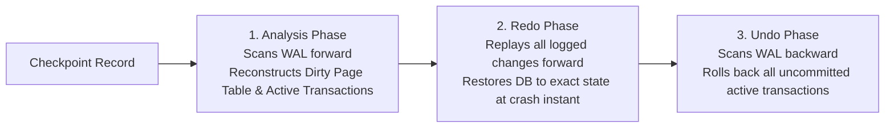
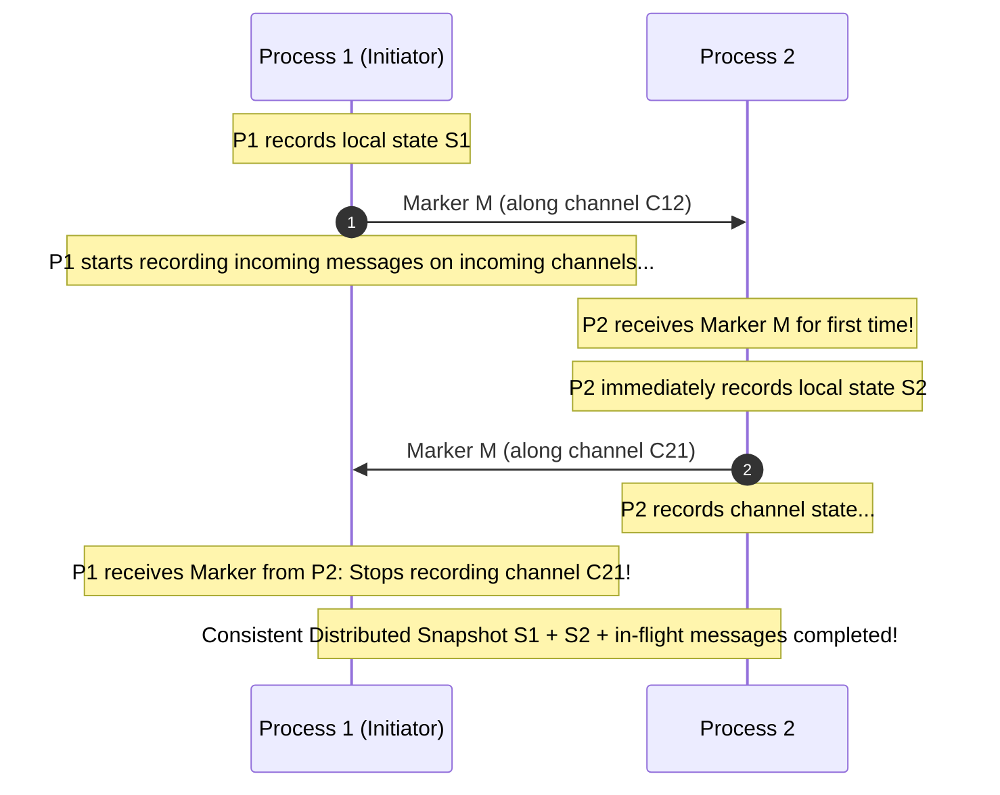
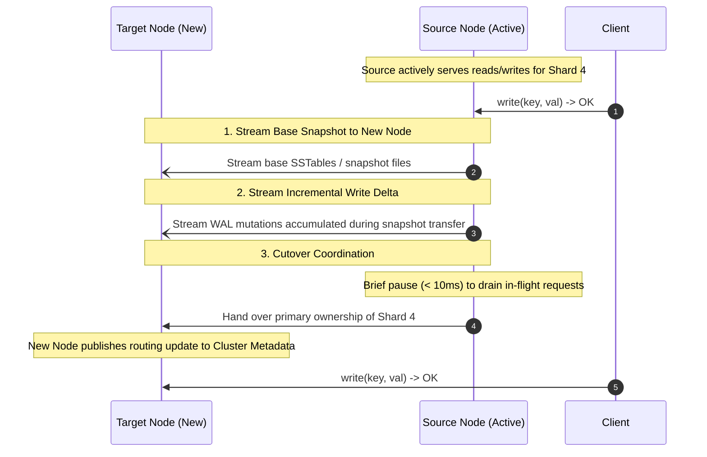

# Recovery, Checkpointing, and Cluster Rebalancing

Crash recovery and cluster rebalancing ensure that distributed nodes restore consistent state following unexpected outages and maintain balanced data distributions as nodes dynamically join or depart.

---

## 1. Crash Recovery and Stable Storage

In the crash-recovery model, a server may crash at any time, instantly wiping all volatile state (RAM, active connection sockets, OS buffers).

### The Three Phases of ARIES Recovery [Mohan et al. 1992]
When a crashed node reboots, it inspects its non-volatile Write-Ahead Log (WAL) starting from the most recent checkpoint:

---

## 2. Checkpointing Techniques

Without checkpointing, crash recovery requires replaying the entire history of the log from the beginning of time ($t = 0$). Checkpointing bounds recovery duration by periodically writing an in-memory state snapshot to disk and truncating the preceding log.

### 2.1 Consistent Global Checkpointing: Chandy-Lamport Algorithm [1985]
In a distributed system, taking a global snapshot across multiple processes cannot stop the world.
The **Chandy-Lamport Algorithm** takes a causally consistent distributed snapshot using special **Marker Messages**:

---

## 3. Cluster Rebalancing and Partition Migration

When cluster membership changes (adding a new server to scale capacity or removing a decommissioned machine), the cluster must migrate a subset of partitions to the new node without going offline.

### 3.1 Migration Workflow

### 3.2 Operational Safeguards
1. **Throttled Bandwidth**: Rebalancing network streams must be throttled (e.g., max 50 MB/s per node) to prevent background sync from saturating switches and causing production query timeouts.
2. **Dual-Writing during Cutover**: Replicas maintain dual buffers or proxy writes to the target shard during final cutover.

---

## 4. Revision Questions

1. Describe the Analysis, Redo, and Undo phases of the ARIES recovery protocol.
2. How does the Chandy-Lamport algorithm record in-flight messages in transit along communication channels?
3. What is the danger of unthrottled partition rebalancing in a production distributed database?
4. How do virtual nodes (vnodes) parallelize data transfer during node addition compared to single-token hashing?

---

## 5. Authoritative References

- **[Mohan et al. 1992]** C. Mohan et al. *ARIES: A Transaction Recovery Method Supporting Fine-Granularity Locking and Partial Rollbacks Using Write-Ahead Logging*. ACM TODS, 1992.
- **[Chandy, Lamport 1985]** K. Mani Chandy and Leslie Lamport. *Distributed Snapshots: Determining Global States of Distributed Systems*. ACM TOCS, 3(1):63–75, 1985.
- **[Kleppmann 2017]** Martin Kleppmann. *Designing Data-Intensive Applications*, Chapter 6 & 11. O'Reilly, 2017.
