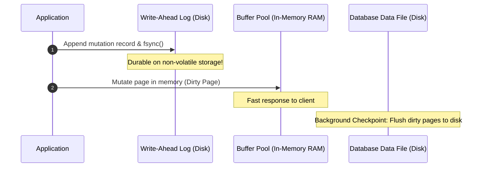
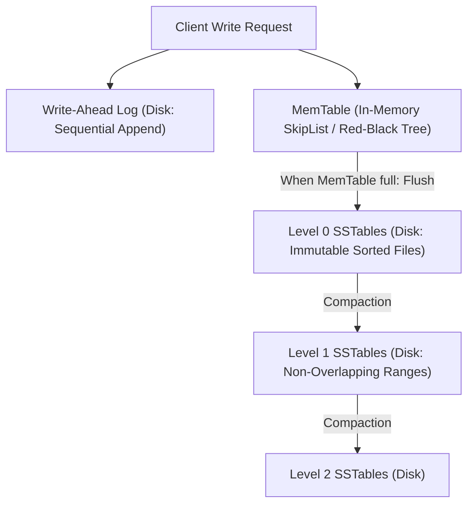

# Replicated Logs and Log-Structured Storage

A **replicated log** is an append-only, totally ordered sequence of immutable records replicated across distributed nodes. It serves as the primary coordination and durability backbone for databases and stream processors.

---

## 1. Problem Statement and Motivation

In traditional storage, random in-place updates to B-trees on disk incur high rotational latency or write-amplification on flash memory. Moreover, coordinating state updates across multiple servers requires an unambiguous, durable source of truth.

As Jay Kreps [2013] formalized, **the log is the core abstraction of distributed computing**:
- A database table represents current state at a point in time.
- A log represents the recorded history of all mutations over time.
- State is simply the projection of the log:
  $$\text{State}(t) = \int_0^t \text{Log}(e) \, de$$

---

## 2. Write-Ahead Logging (WAL)

Before mutating in-memory data structures or cached table pages, a storage engine must write the update to an append-only log on stable storage:

### The WAL Invariant (ARIES Protocol [Mohan et al. 1992])
> **The WAL Rule**: No dirty data page may be written to disk until the corresponding log records describing the update have been written to stable storage and flushed (`fsync`).

This guarantees that if the server crashes while writing a dirty page to disk:
1. The **Undo Phase** rolls back uncommitted transactions using undo log records.
2. The **Redo Phase** replays committed transactions from the log to restore the data file to its exact committed state.

---

## 3. Log-Structured Merge-Trees (LSM-Trees)

Modern distributed databases (Cassandra, RocksDB, Google Bigtable, CockroachDB) organize storage as **Log-Structured Merge-Trees (LSM-Trees)** [O'Neil et al. 1996] to optimize write throughput:

### 3.1 Components
1. **MemTable**: An in-memory concurrent balanced search tree (SkipList or Red-Black Tree). Writes are inserted in $O(\log N)$ time, sorted by key.
2. **Write-Ahead Log (WAL)**: An append-only file on disk ensuring MemTable entries survive power outages.
3. **SSTables (Sorted String Tables)**: When the MemTable reaches capacity (e.g., 64 MB), it is frozen and written to disk as an immutable SSTable file. Keys within an SSTable are strictly sorted.
4. **Bloom Filters**: Fast probabilistic bit-arrays attached to each SSTable to determine in $O(1)$ whether a key is *definitely not present*, preventing expensive disk seeks.

### 3.2 Compaction Strategies
Because old SSTables accumulate overwritten versions and tombstones, background **Compaction** merges multiple SSTables into new sorted files:
- **Size-Tiered Compaction**: Merges SSTables of similar sizes. Fast writes, higher disk space overhead.
- **Levelled Compaction (RocksDB)**: Arranges SSTables into exponential levels ($L_1 = 10\text{ MB}, L_2 = 100\text{ MB}, L_3 = 1\text{ GB}$). Keys in levels $L \ge 1$ never overlap, guaranteeing $O(1)$ SSTable seek per read level.

---

## 4. Replicated Logs in Consensus (Raft / Kafka)

In distributed consensus (Raft, Multi-Paxos) and distributed stream processors (Apache Kafka, Apache BookKeeper):
- The log is partitioned into fixed-size segments.
- Each entry is assigned an immutable, monotonically increasing 64-bit integer: the **Log Offset**.
- Followers replicate the log by streaming chunks sequentially.
- **Zero-Copy Disk I/O**: Network sockets stream log segments directly from the OS page cache to network interface cards using the Linux `sendfile()` kernel system call, bypassing user-space memory buffers.

---

## 5. Revision Questions

1. Explain the WAL invariant in the ARIES recovery protocol.
2. How does an LSM-Tree achieve high write throughput compared to a traditional B-Tree?
3. What is the role of Bloom Filters in an SSTable read path?
4. Explain how log compaction or snapshotting prevents a replicated state machine from exhausting disk space.

---

## 6. Authoritative References

- **[O'Neil et al. 1996]** Patrick O'Neil, Edward O'Neil, and Gerhard Weikum. *The Log-Structured Merge-Tree (LSM-Tree)*. Acta Informatica, 33(4):351–385, 1996.
- **[Mohan et al. 1992]** C. Mohan et al. *ARIES: A Transaction Recovery Method Supporting Fine-Granularity Locking and Partial Rollbacks Using Write-Ahead Logging*. ACM TODS, 17(1), 1992.
- **[Kreps 2013]** Jay Kreps. *The Log: What Every Software Engineer Should Know About Real-Time Data's Unifying Abstraction*. LinkedIn Engineering, 2013.
