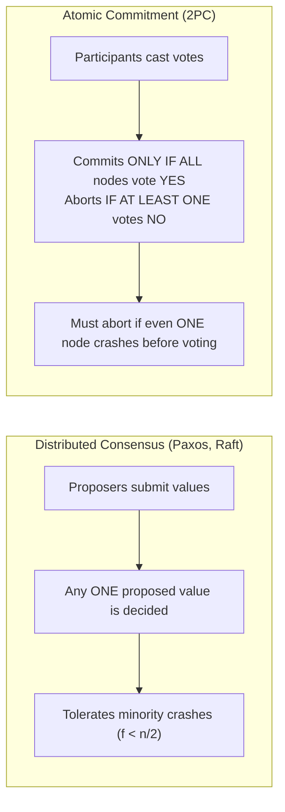
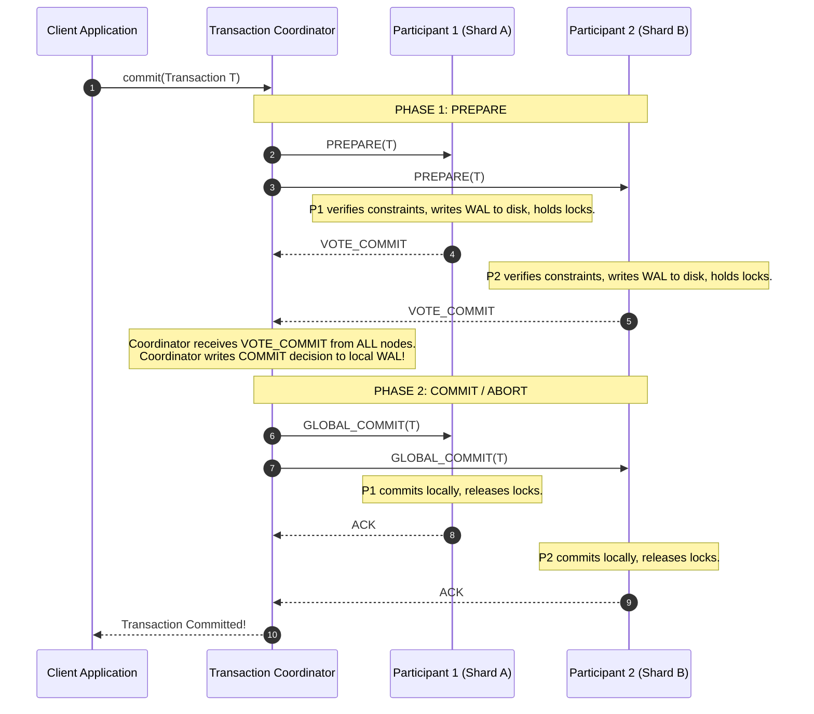
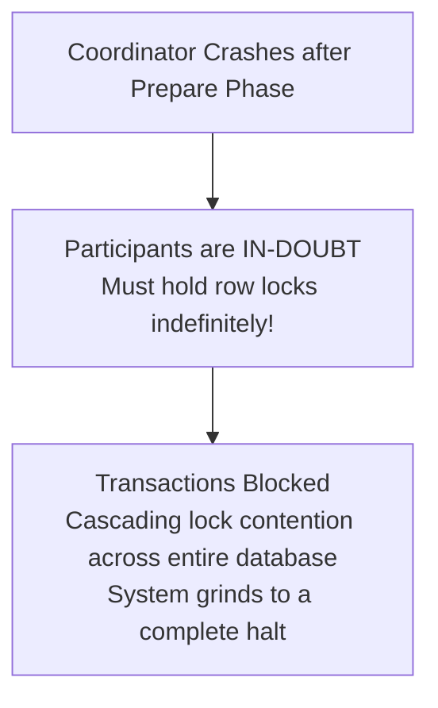

# Two-Phase Commit (2PC) and Atomic Commitment

Two-Phase Commit (2PC) [Gray 1978] is the classic protocol that coordinates atomic commitment across multiple distributed databases, ensuring all participating nodes either commit or abort a distributed transaction.

---

## 1. Problem Statement and Motivation

When a database transaction accesses and mutates records partitioned across multiple independent nodes (shards):
- To satisfy ACID **Atomicity**, the transaction must be "all-or-nothing": either all shards commit their local updates permanently, or all shards roll back their updates without visible side-effects.
- If node $A$ commits while node $B$ aborts due to an integrity constraint violation (e.g., negative balance check) or a crash, database consistency is permanently shattered.

The challenge of **Atomic Commitment** is ensuring unanimous agreement on whether to commit or abort across all participating replicas.

---

## 2. Atomic Commitment vs. Consensus

Although both involve reaching agreement, Atomic Commitment and Consensus have fundamentally different correctness specifications:



| Dimension | Consensus Problem | Atomic Commitment Problem |
| :--- | :--- | :--- |
| **Input** | One or more processes propose arbitrary values. | Every participant votes specifically `COMMIT` or `ABORT`. |
| **Decision Rule** | Any proposed value can be decided. | **Must commit iff all vote `COMMIT`**; must abort if $\ge 1$ votes `ABORT`. |
| **Fault Tolerance** | Makes progress as long as a majority quorum is alive ($f < n/2$). | **Cannot commit if any participating node is unreachable** before voting. |

---

## 3. The Classical Two-Phase Commit Protocol (Gray 1978)

The protocol involves a designated **Coordinator** and a set of **Participant** nodes $R$.



---

### 3.1 Phase 1: Prepare
1. The coordinator broadcasts a `PREPARE` request to all participants.
2. Each participant checks whether it can safely commit:
   - Evaluates integrity constraints and foreign keys.
   - Flushes transaction mutations to its local Write-Ahead Log (WAL) on disk.
   - Retains all row/range locks acquired during transaction execution.
3. If successful, the participant writes a `PREPARED` record to its WAL and replies `VOTE_COMMIT`.
4. If unable to commit (e.g., out of disk space, deadlock abort), the participant writes `ABORT` to its WAL and replies `VOTE_ABORT`.

### 3.2 Phase 2: Commit or Abort
1. **Unanimous Commit**: If the coordinator receives `VOTE_COMMIT` from **all** participants:
   - The coordinator writes a `COMMIT` record to its local WAL.
   - The coordinator broadcasts `GLOBAL_COMMIT` to all participants.
   - Participants commit their local transactions, release locks, and reply `ACK`.
2. **Abort Decision**: If any participant replies `VOTE_ABORT`, or fails to respond within a timeout:
   - The coordinator writes an `ABORT` record to its local WAL.
   - The coordinator broadcasts `GLOBAL_ABORT` to all participants.
   - Participants roll back uncommitted mutations, release locks, and reply `ACK`.

---

## 4. The In-Doubt Hazard: Why 2PC is a Blocking Protocol

The fundamental flaw of 2PC is that **the coordinator is a single point of failure (SPOF)**.

### The In-Doubt State
If the coordinator crashes **after receiving `VOTE_COMMIT` from all participants, but before broadcasting the `GLOBAL_COMMIT` decision**:
- A participant that voted `VOTE_COMMIT` enters the **In-Doubt State**.
- **Can the participant unilaterally decide to abort?**  
  **NO**: The coordinator may have written `COMMIT` to disk and sent `GLOBAL_COMMIT` to another participant before crashing. If this participant aborts, Atomicity is violated.
- **Can the participant unilaterally decide to commit?**  
  **NO**: Another participant might have voted `VOTE_ABORT`, causing the coordinator to abort. If this participant commits, Atomicity is violated.



Because participants cannot make progress without the coordinator, **2PC is a blocking protocol**. The locks must be held until the coordinator restarts and recovers its WAL.

---

## 5. Fault-Tolerant 2PC: Paxos Commit [Gray and Lamport 2006]

To eliminate the blocking coordinator SPOF, Jim Gray and Leslie Lamport designed **Paxos Commit**.

### The Mechanism
Instead of relying on a centralized coordinator:
1. Every participating replica broadcasts its vote (`VOTE_COMMIT` or `VOTE_ABORT`) via **Total Order Broadcast** (backed by a Paxos or Raft consensus group).
2. If node $A$ suspects node $B$ has crashed, $A$ can broadcast an abort vote on $B$'s behalf.
3. Every node delivers the stream of votes from Total Order Broadcast:
   - Because Total Order Broadcast guarantees the exact same message delivery order on all nodes, **every node agrees on which vote was delivered first**.
   - If the first delivered vote for any participant is `ABORT`, the transaction aborts universally.
   - If a `COMMIT` vote is delivered for every participant before any abort vote, the transaction commits universally.

```text
// Fault-Tolerant 2PC via Total Order Broadcast (Kleppmann 2021)
on delivering (Vote, T, replicaId, ok) by Total Order Broadcast do
    if replicaId not in commitVotes[T] and replicaId in replicas[T] and not decided[T] then
        if ok = true then
            commitVotes[T] := commitVotes[T] union {replicaId}
            if commitVotes[T] = replicas[T] then
                decided[T] := true
                commit transaction T locally
            end if
        else
            decided[T] := true
            abort transaction T locally
        end if
    end if
end on
```

---

## 6. Revision Questions

1. Formally contrast the agreement and fault-tolerance criteria of Atomic Commitment with Consensus.
2. In classical 2PC, why must a participant retain all locks after replying `VOTE_COMMIT` until Phase 2 completes?
3. What is an *in-doubt transaction*, and why can an in-doubt participant neither unilaterally commit nor unilaterally abort?
4. How does Paxos Commit use Total Order Broadcast to eliminate the coordinator single point of failure?

---

## 7. Authoritative References

- **[Gray 1978]** Jim N. Gray. *Notes on Data Base Operating Systems*. Springer-Verlag LNCS 60, 1978.
- **[Gray, Lamport 2006]** Jim Gray and Leslie Lamport. *Consensus on Transaction Commit*. ACM Transactions on Database Systems (TODS), 31(1):133–160, 2006.
- **[Kleppmann 2021]** Martin Kleppmann. *Distributed Systems Lecture Notes*, Section 7.1: Two-Phase Commit. University of Cambridge, 2021/22.
