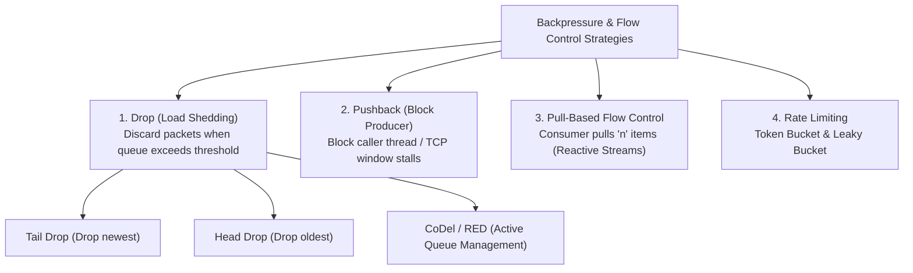
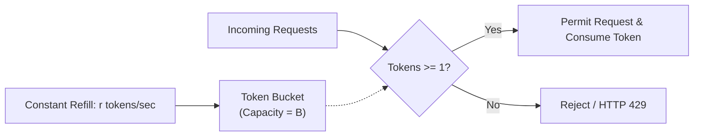

# Backpressure and Flow Control

Backpressure is the set of feedback mechanisms by which a downstream consumer signals an upstream producer to slow down or halt transmission when processing capacity is exceeded.

---

## 1. Problem Statement and Motivation

In any distributed pipeline where components produce and consume messages:
- If a producer generates 5,000 requests/second while a consumer can only process 1,000 requests/second:
  $$\Delta_{\text{queue}} = 4{,}000 \text{ requests/sec}$$
- If the consumer maintains an unbounded in-memory queue, the queue grows monotonically until the process crashes with an **Out-Of-Memory (OOM)** error.
- Even before OOM, queue latency explodes (**Bufferbloat**): a request waiting behind 100,000 queued items experiences dozens of seconds of queue delay before execution begins.

A distributed system without backpressure is unstable by definition.

---

## 2. Taxonomy of Backpressure Strategies

---

## 3. Rate Limiting Algorithms: Token Bucket vs. Leaky Bucket

### 3.1 The Token Bucket Algorithm
The **Token Bucket** algorithm allows bursty traffic while enforcing a strict long-term average rate:
- A bucket holds up to $B$ tokens (maximum burst capacity).
- Tokens are continuously added to the bucket at a constant fill rate $r$ tokens/second:
  $$\text{Tokens}(t) = \min(B, \; \text{Tokens}(t_{\text{last}}) + r \cdot (t - t_{\text{last}}))$$
- When a request arrives requiring $c$ tokens (typically $c = 1$):
  - If $\text{Tokens} \ge c$: Deduct $c$ tokens and permit the request.
  - If $\text{Tokens} < c$: **Reject request with HTTP 429 Too Many Requests** (or queue it).

### 3.2 The Leaky Bucket Algorithm
In contrast to Token Bucket, **Leaky Bucket** enforces a completely smooth, constant output rate:
- Requests enter a bounded FIFO queue of capacity $Q$.
- If the queue is full, incoming requests overflow and are dropped immediately.
- Requests leak out of the bottom of the bucket at a fixed rate of $L$ requests/second, completely flattening any incoming bursts into a predictable stream.

---

## 4. Transport-Level Flow Control: The TCP Sliding Window

At Layer 4, TCP enforces backpressure using the **Receive Window (`rcv_wnd`)**:
1. The receiver advertises its available buffer capacity in every TCP ACK packet:
   $$\text{AdvertisedWindow} = \text{BufferCapacity} - (\text{BytesReceived} - \text{BytesReadByApp})$$
2. The sender is mathematically forbidden from transmitting more unacknowledged bytes than the receiver's advertised window:
   $$\text{LastByteSent} - \text{LastByteAcked} \le \text{AdvertisedWindow}$$
3. If the consumer application pauses (e.g., during a GC pause), the receiver buffer fills up, and `rcv_wnd` drops to $0$ (**Zero Window Probe**). The sender automatically pauses transmission, pushing backpressure up to the OS socket layer.

---

## 5. Reactive Streams (Pull-Based Flow Control)

Modern asynchronous frameworks (Project Reactor, RxJava, Akka Streams) replace push models with **Pull-Based Demand Signals**:
- A consumer subscribes to a publisher.
- The consumer explicitly signals demand: `subscription.request(n)`.
- The publisher is legally permitted to emit at most $n$ items. It cannot emit item $n+1$ until the consumer issues another `request()` call.
- This guarantees that **a slow consumer is never overwhelmed by a fast producer**.

---

## 6. Revision Questions

1. Explain the difference between bufferbloat and out-of-memory crashes in overloaded queues.
2. Formally compare the Token Bucket and Leaky Bucket algorithms regarding burst tolerance.
3. How does the TCP sliding window mechanism propagate backpressure from a slow application up to a network sender?
4. Contrast push-based backpressure (load shedding) with pull-based backpressure (Reactive Streams).

---

## 7. Authoritative References

- **[Nichols, Jacobson 2012]** Kathleen Nichols and Van Jacobson. *Controlling Queue Delay (CoDel)*. ACM Queue, 10(5), 2012.
- **[Reactive Streams 2015]** Reactive Streams Specification for the JVM. *http://www.reactive-streams.org/*.
- **[Kleppmann 2017]** Martin Kleppmann. *Designing Data-Intensive Applications*, Chapter 11: Stream Processing. O'Reilly, 2017.
