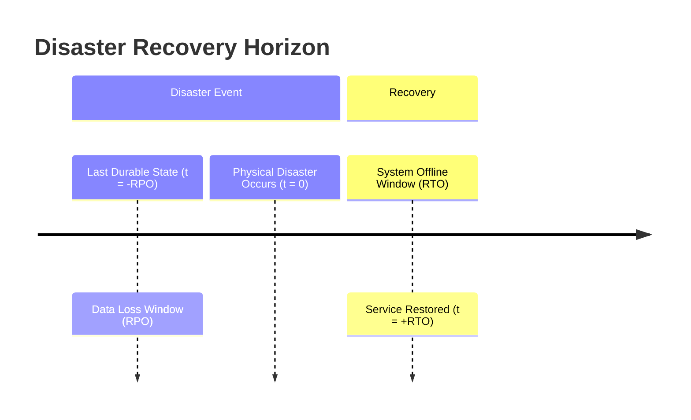
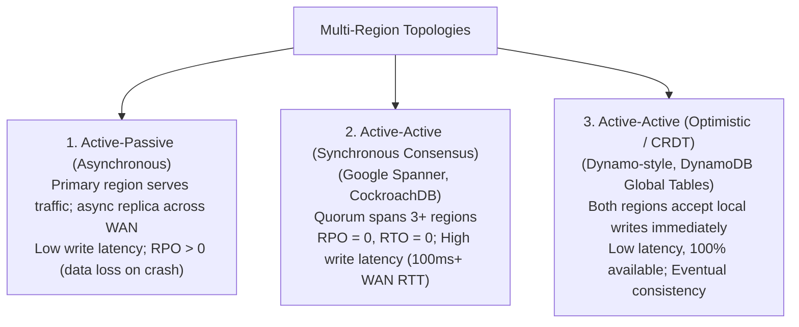

# Disaster Recovery, Multi-Region Replication, and Failover

Disaster recovery (DR) defines the architectures and operational protocols designed to maintain data durability and service continuity in the event of catastrophic physical outages (datacenter fires, fiber cuts, natural disasters).

---

## 1. Problem Statement and RPO / RTO Metrics

A regional datacenter can suffer a complete physical blackout (e.g., hurricane, power grid collapse, cooling failure). Surviving such events requires replicating state across **geographically dispersed regions**.

Disaster recovery is evaluated against two fundamental business and theoretical metrics:

1. **Recovery Point Objective (RPO)**: The maximum acceptable data loss measured in backward time.
   - $\text{RPO} = 0$: Absolute zero data loss. Every acknowledged transaction must survive the disaster.
   - $\text{RPO} = 15\text{ minutes}$: Up to 15 minutes of recent transactions may be permanently lost upon disaster recovery.
2. **Recovery Time Objective (RTO)**: The maximum acceptable duration of service downtime before the system resumes serving requests.
   - $\text{RTO} = 0$: Seamless, instantaneous automated failover without interruption.
   - $\text{RTO} = 4\text{ hours}$: Service must be restored within 4 hours.

---

## 2. Multi-Region Replication Topologies

The choice of multi-region topology is governed by the laws of physics: **the speed of light in optical fiber imposes a $\approx 5\text{ \mu s/km}$ delay**, resulting in minimum intercontinental round-trip times of $100\text{--}200\text{ ms}$.

### 2.1 Topology Trade-offs

| Topology | RPO | RTO | Write Latency Overhead | Consistency Model |
| :--- | :---: | :---: | :--- | :--- |
| **Active-Passive (Async)** | $> 0$ ($5\text{s--}15\text{m}$) | $5\text{--}60\text{ minutes}$ | **Zero** (Local disk commit) | Linearizable in-region; data loss on failover |
| **Active-Active (Consensus)** | **$0$** | **$< 10\text{ seconds}$** | **High** ($100\text{--}200\text{ ms}$ WAN RTT) | **Strictly Linearizable** across the globe |
| **Active-Active (CRDT/Async)**| $> 0$ (until sync) | **$0$** | **Zero** (Local region commit) | **Strong Eventual Consistency** |

---

## 3. Cross-Region Failover Hazards

### 3.1 Split-Brain across Datacenters
If two datacenters (US-East and US-West) lose WAN connectivity with each other, but both remain connected to the public Internet:
- US-West suspects US-East is dead and promotes its passive standby to primary.
- Both datacenters accept client writes, creating catastrophic database divergence.
- **Rule**: Cross-region automated failover requires **at least three regions** to form a majority quorum ($2$ out of $3$ regions). A 2-region deployment cannot execute automated failover safely without a third-party tie-breaker witness.

### 3.2 Cascading Failover (Capacity Cliffs)
If Region $A$ suffers an outage and shifts $100\%$ of its user traffic to Region $B$:
- If Region $B$ was provisioned at $60\%$ utilization, the sudden $2\times$ traffic surge ($120\%$ load) crashes Region $B$ immediately.
- The failure cascades globally.
- **Remediation**: N+1 capacity planning, automatic load shedding, and circuit breakers.

---

## 4. Revision Questions

1. Formally define Recovery Point Objective (RPO) and Recovery Time Objective (RTO).
2. Why is it impossible to achieve $\text{RPO} = 0$ in an asynchronous multi-region database without paying the latency cost of WAN round-trips?
3. Why does an automated failover system between two datacenters require a third independent region or witness node to prevent split-brain?
4. Contrast synchronous multi-region consensus (Google Spanner) with optimistic multi-region replication (DynamoDB Global Tables) in terms of latency and consistency.

---

## 5. Authoritative References

- **[Corbett et al. 2012]** James C. Corbett et al. *Spanner: Google’s Globally-Distributed Database*. OSDI 2012.
- **[Kleppmann 2017]** Martin Kleppmann. *Designing Data-Intensive Applications*, Chapter 5 & 8. O'Reilly, 2017.
- **[Hamilton 2007]** James Hamilton. *On Designing and Deploying Internet-Scale Services*. 21st USENIX LISA, 2007.
