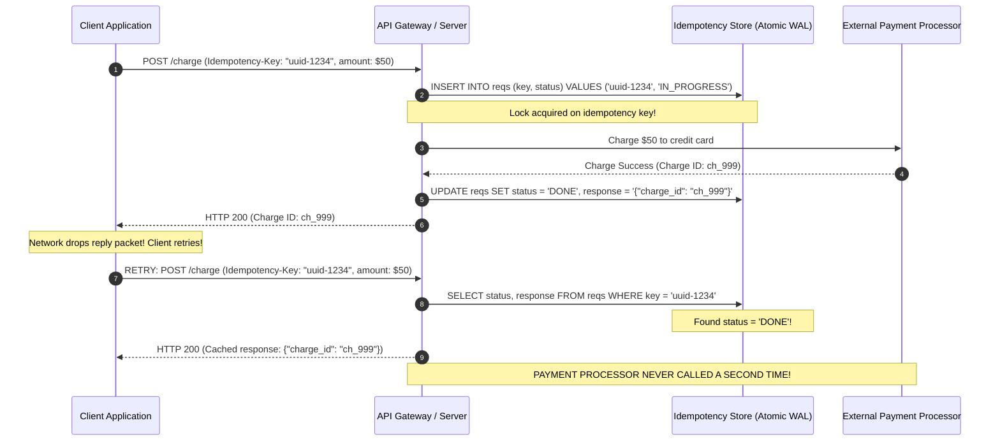

# Idempotency and Deduplication

Idempotency is the mathematical and architectural property ensuring that executing an operation multiple times produces the identical system state as executing it exactly once.

---

## 1. Problem Statement and Motivation

Over an unreliable network, RPC requests or responses can be dropped. When a client experiences a timeout, it cannot determine whether the server executed the call or not. Retrying is necessary to achieve fault tolerance (at-least-once delivery).

However:
- If the operation is non-idempotent (e.g., deducting $100 from an account, charging a credit card, or incrementing an inventory counter), retrying the request risks applying the side-effect multiple times.
- As demonstrated on Martin Kleppmann's Twitter case study [2014], retrying un-deduplicated unfollow requests resulted in a user having a negative follow count.

Idempotency converts **at-least-once network transmission into exactly-once execution semantics**.

---

## 2. Mathematical Definition

A function $f: \mathcal{S} \to \mathcal{S}$ is **idempotent** if applying it twice to any state $s$ yields the same result as applying it once:
$$\forall s \in \mathcal{S}: \quad f(f(s)) = f(s)$$

### Concrete Examples

| Operation | Mathematical Form | Idempotent? | Explanation |
| :--- | :--- | :---: | :--- |
| **Counter Increment** | $f(c) = c + 1$ | ❌ **No** | $f(f(0)) = 2 \ne f(0) = 1$. |
| **Set Addition** | $f(S) = S \cup \{e\}$ | ✔️ **Yes** | $(S \cup \{e\}) \cup \{e\} = S \cup \{e\}$. |
| **Absolute Assignment** | $f(x) = v$ | ✔️ **Yes** | Setting $x = 5$ twice leaves $x = 5$. |
| **Conditional CAS** | $\text{CAS}(x, v_{\text{old}}, v_{\text{new}})$ | ✔️ **Yes** | Second attempt fails safely as $x \ne v_{\text{old}}$. |
| **SQL `DELETE`** | `DELETE FROM t WHERE id = 5` | ✔️ **Yes** | Deleting an already deleted record has no additional effect. |

---

## 3. Idempotency Keys (Deduplication Tokens)

When a business operation is inherently non-idempotent (e.g., payment processing), systems wrap the operation using **Client-Generated Idempotency Keys**:

---

## 4. Idempotency State Machine

The server-side idempotency record tracks the lifecycle of each unique key:

```mermaid
stateDiagram-v2
    [*] --> In_Progress: First attempt arrives
    In_Progress --> Completed: Execution succeeds; cache response
    In_Progress --> Failed: Execution encounters retryable fault (delete key)
    In_Progress --> In_Progress: Duplicate request arrives while executing (Return 409 Conflict)
    Completed --> Completed: Duplicate request arrives (Return cached response)
```

---

## 5. Revision Questions

1. State the mathematical definition of an idempotent function.
2. Why is adding an element to a mathematical set idempotent, whereas incrementing an integer counter is not?
3. What happens if a duplicate request arrives at an API gateway while the first request is still marked as `IN_PROGRESS` in the idempotency database?
4. How do tombstones ensure that a deleted record remains deleted even if an earlier write operation is retried late across the network?

---

## 6. Authoritative References

- **[Kleppmann 2021]** Martin Kleppmann. *Distributed Systems Lecture Notes*, Section 5.1: Idempotence. University of Cambridge, 2021/22.
- **[Brandman et al. 2020]** Stripe Engineering. *Designing Robust and Predictable APIs with Idempotency*. Stripe Technical Blog, 2020.
- **[Helland 2012]** Pat Helland. *Idempotence Is Not a Local Property*. Communications of the ACM, 2012.
