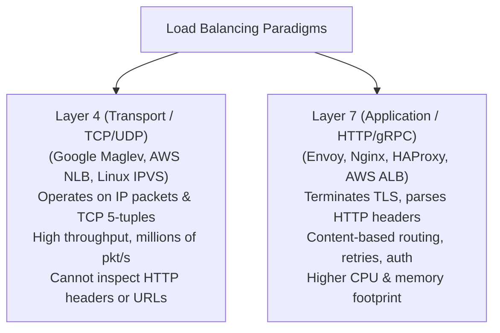
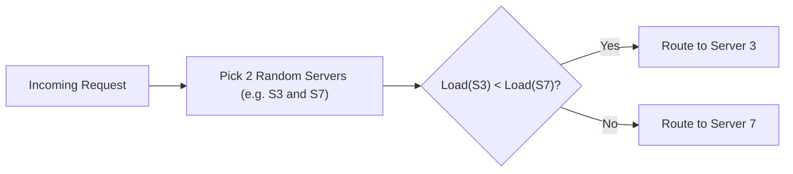
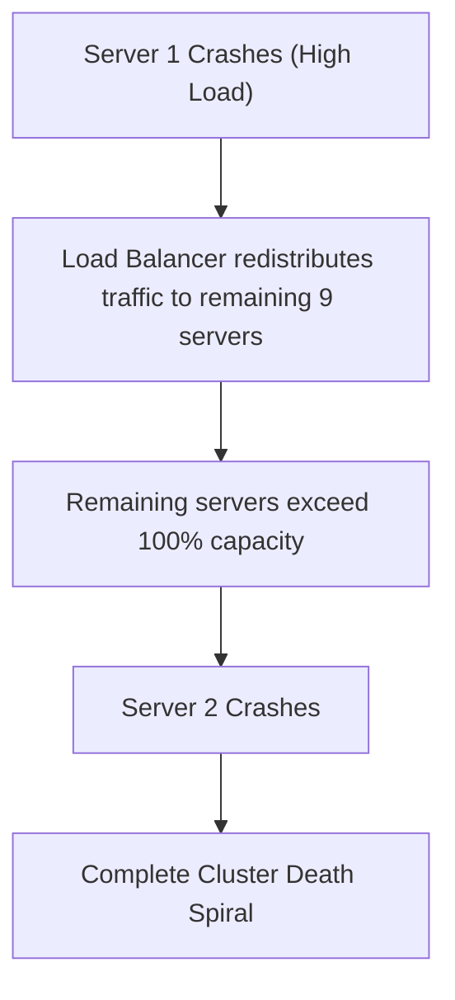

# Load Balancing and Traffic Routing

Load balancing distributes incoming traffic across a pool of backend servers to maximize throughput, minimize response latency, and avoid overloading any single resource.

---

## 1. Problem Statement and Motivation

As web and RPC traffic scales beyond the capacity of a single server:
- Incoming client connections must be balanced across $N$ backend replicas.
- If traffic distribution is non-uniform, one server experiences high latency and crashes, triggering **cascading failures** across the remaining nodes.
- A load balancer must distribute load dynamically, detect failing backends rapidly, and avoid introducing a centralized single point of failure.

---

## 2. Layer 4 vs. Layer 7 Load Balancing

| Dimension | Layer 4 (L4) | Layer 7 (L7) |
| :--- | :--- | :--- |
| **OSI Layer** | Transport (TCP / UDP). | Application (HTTP, gRPC, TLS). |
| **Inspection Capability**| Source/Dest IP, Source/Dest Port. | URL path, cookies, headers, gRPC service methods. |
| **Connection Handling** | Packet forwarding without TCP termination. | Terminates client TCP connection; opens upstream TCP pool. |
| **Performance** | Extremely high (Kernel bypass / DPDK: 10M+ pkts/sec). | Moderate (limited by parsing and memory buffering). |

---

## 3. Load Balancing Algorithms

### 3.1 Round-Robin and Least-Connections
- **Round-Robin**: Requests are cycled sequentially ($1, 2, \dots, N$). Fails when requests have wildly varying processing times (e.g., short health-check vs complex analytical query).
- **Least-Connections (Least Outstanding Requests - LOR)**: Routes incoming request to the server with the fewest active in-flight connections.

### 3.2 The Power of Two Random Choices ($P2C$) [Mitzenmacher 2001]
In a distributed fleet with multiple independent load balancers, querying every backend for its active connection count requires expensive global synchronization.

Instead, the **$P2C$ Algorithm** executes:
1. Select **two backend servers at random** ($s_1, s_2$).
2. Compare their active load:
   $$\text{Select } \arg\min(\text{load}(s_1), \; \text{load}(s_2))$$

> **The Mathematical Miracle of $P2C$**: In a system with $N$ servers, placing items into random bins yields a maximum load of $O\left(\frac{\log N}{\log \log N}\right)$. Simply checking **two random options** drops the maximum load exponentially to:
> $$O(\log \log N)$$
> This achieves near-optimal load distribution with zero coordination between load balancers!

---

## 4. Health Checks and Cascading Failures

### 4.1 The Health Check Stampede
When a server begins struggling under high load:
- Active health checkers from dozens of independent load balancers bombard the server with periodic ping requests.
- The health checks consume the very CPU cycles needed to drain pending requests.
- If the server fails to reply in time, the load balancers declare it dead and **divert all its traffic to the remaining servers**.

### 4.2 The Cascading Failure Death Spiral
1. Suppose a cluster of 10 servers operates at $95\%$ utilization.
2. Server 1 crashes due to transient memory pressure.
3. The load balancer immediately redistributes Server 1's traffic among the remaining 9 servers.
4. Each remaining server now receives $\frac{10}{9} \times 95\% \approx 105.5\%$ load!
5. Server 2 collapses under the overflow, redistributing traffic to the remaining 8 servers ($118\%$ load).
6. Within seconds, **the entire cluster collapses in a cascading chain reaction**.

### Remediation
- **Outlier Detection (Passive Health Checking)**: Observe live request error rates (e.g., 5xx status codes) instead of firing aggressive active probes.
- **Fail-Open Policy**: If more than $50\%$ of backend servers are marked unhealthy, **stop removing servers** and route traffic across all nodes evenly. A degraded cluster is preferable to total shutdown.

---

## 5. Revision Questions

1. Distinguish between Layer 4 and Layer 7 load balancing in terms of performance and routing flexibility.
2. State the Power of Two Random Choices ($P2C$) algorithm and explain why it reduces maximum queue length without coordination.
3. Describe the mechanics of a cascading failure death spiral triggered by load balancer failover.
4. What is the "Fail-Open" safety policy in enterprise load balancing?

---

## 6. Authoritative References

- **[Mitzenmacher 2001]** Michael Mitzenmacher. *The Power of Two Choices in Randomized Load Balancing*. IEEE Transactions on Parallel and Distributed Systems, 12(10):1094–1104, 2001.
- **[Eisenbud et al. 2016]** Daniel E. Eisenbud et al. *Maglev: A Fast and Reliable Software Network Load Balancer*. 13th USENIX NSDI, 2016.
- **[Kleppmann 2017]** Martin Kleppmann. *Designing Data-Intensive Applications*, Chapter 1. O'Reilly, 2017.
