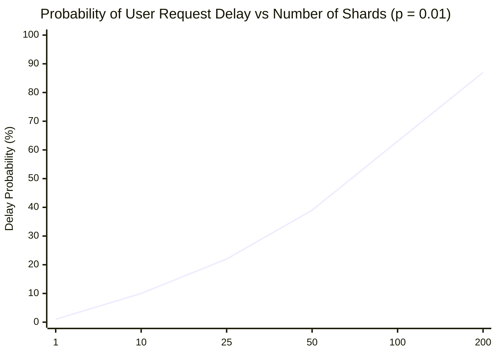
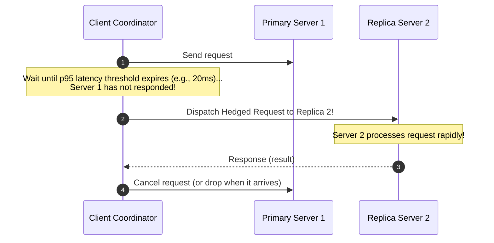

# Observability, Distributed Tracing, and Tail Latency

Observability provides the telemetry infrastructure required to infer the internal health, causal paths, and performance anomalies of complex distributed systems.

---

## 1. Problem Statement and Motivation

On a single server, debugging is straightforward: inspect the thread stack trace, check the local system log, or attach a debugger.

In a microservice or distributed storage cluster:
- A single user click initiates an asynchronous web of 50 to 100 internal RPCs, asynchronous message queues, and sharded database queries.
- Requests execute concurrently across dozens of independent nodes.
- Local logs on individual servers cannot be correlated without explicit causal metadata.
- **The Tail Latency Trap**: Even if each individual server is fast $99\%$ of the time, user requests that depend on multiple servers become unbearably slow.

---

## 2. Distributed Tracing and Context Propagation

Distributed tracing [Sigelman et al. 2010 (Google Dapper), OpenTelemetry] reconstructs the causal execution path of a request across network boundaries.

```mermaid
gantt
    title Distributed Trace DAG (Spans)
    dateFormat X
    axisFormat %s
    section Frontend
    Root Span (HTTP GET /order) : 0, 100
    section Auth Service
    Child Span 1 (Verify JWT) : 5, 25
    section Payment Service
    Child Span 2 (Process Payment) : 30, 85
    section Database
    Grandchild Span (SQL INSERT) : 40, 75
```

### 2.1 W3C Trace Context Specification
To preserve causality, every RPC and HTTP header must inject and propagate the **Trace Context** (`traceparent` header):

$$\text{traceparent} = \text{version} - \text{trace\_id} - \text{parent\_span\_id} - \text{trace\_flags}$$
- `trace_id` (16 bytes): Globally unique identifier shared across all services participating in the single user operation.
- `parent_span_id` (8 bytes): Identifies the immediate parent RPC that invoked this downstream operation.
- `trace_flags` (1 byte): Controls sampling decisions (e.g., `01` = sampled).

Every logging statement and span duration record is tagged with `trace_id`, enabling monitoring systems (Jaeger, Zipkin, Honeycomb) to assemble the execution history into a **Directed Acyclic Graph (DAG)** of spans.

---

## 3. The Mathematics of Tail Latency (Dean & Barroso 2013)

Engineers often report mean or median (p50) latency. In distributed systems, **averages are mathematically misleading**. What dictates user experience is **tail latency** ($99^{\text{th}}$, $99.9^{\text{th}}$, and $99.99^{\text{th}}$ percentiles).

### The Parallel Scatter-Gather Explosion
Suppose a web service processes a query by dispatching requests to $m$ backend shard servers in parallel (e.g., Bigtable, ElasticSearch, web search index):
- Let $p$ be the probability that a single backend server experiences a latency spike (e.g., $p = 0.01$ for the $99^{\text{th}}$ percentile latency).
- The entire client operation completes only when **all $m$ backends have responded**.

The probability that **at least one server suffers a latency spike** is:
$$P(\text{Operation Delayed}) = 1 - (1 - p)^m$$

### Numerical Proof of Tail Amplification ($p = 0.01$ or $1\%$):
- For $m = 1$ server: $P(\text{Delayed}) = 1 - (0.99)^1 = 1\%$
- For $m = 10$ servers: $P(\text{Delayed}) = 1 - (0.99)^{10} = 9.56\%$
- For $m = 100$ servers:
  $$P(\text{Delayed}) = 1 - (0.99)^{100} = 1 - 0.366 = \mathbf{63.4\%}$$

> **Profound Insight**: Even though $99\%$ of server responses are lightning fast, **over $63\%$ of end-user requests suffer the $99^{\text{th}}$ percentile tail delay** because they depend on 100 parallel nodes!

---

## 4. Taming Tail Latency: Hedged Requests

Google [Dean and Barroso 2013] introduced **Hedged Requests (Tied Requests)** to eliminate long tail delays:

### The Mechanism
1. Client sends request to Server 1.
2. If no response is received within the $95^{\text{th}}$ percentile expected latency (e.g., $20\text{ ms}$), the client dispatches a **duplicate (hedged) request** to a backup replica (Server 2).
3. Whichever server responds first is used; the other is canceled.
- **Cost**: Generates only $\approx 5\%$ additional network traffic.
- **Benefit**: Compresses the $99.9^{\text{th}}$ percentile latency by up to **$90\%$**, effectively neutralizing GC pauses and server hiccups.

---

## 5. Revision Questions

1. Describe the three components of the W3C Trace Context `traceparent` header.
2. If an operation issues parallel queries to $m = 50$ shards, and each shard has a $2\%$ chance of being slow, what is the probability that the user experiences a delayed response?
3. What are Hedged Requests, and why do they reduce tail latency without overloading backend clusters?
4. Why is tracking median latency insufficient to detect systemic degradation in distributed microservices?

---

## 6. Authoritative References

- **[Sigelman et al. 2010]** Benjamin H. Sigelman et al. *Dapper, a Large-Scale Distributed Systems Tracing Infrastructure*. Google Technical Report, 2010.
- **[Dean, Barroso 2013]** Jeffrey Dean and Luiz André Barroso. *The Tail at Scale*. Communications of the ACM, 56(2):74–80, 2013.
- **[Kleppmann 2017]** Martin Kleppmann. *Designing Data-Intensive Applications*, Chapter 1. O'Reilly, 2017.
