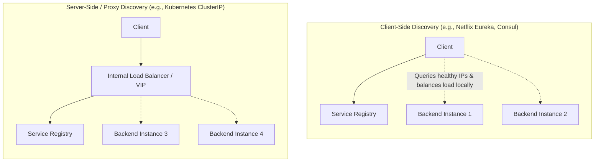
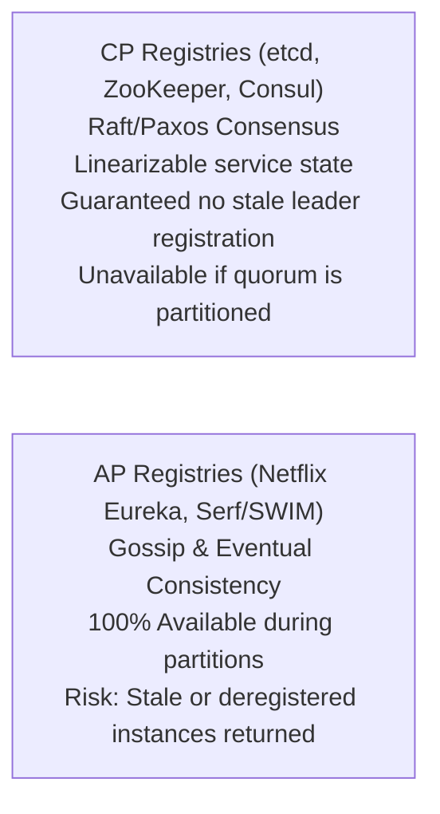

# Service Discovery and Dynamic Registries

Service discovery is the coordination mechanism enabling client processes to dynamically locate the network addresses (IP and port) of ephemeral service instances in autoscaling distributed systems.

---

## 1. Problem Statement and Motivation

In legacy architectures, services ran on static servers with permanent IP addresses configured in configuration files.
In modern containerized and cloud environments (Kubernetes, AWS ECS, Nomad):
- Server instances spin up, autoscale, crash, and relocate dynamically.
- IP addresses are ephemeral and unpredictable.
- Hardcoding IP addresses or restarting clients on every IP change is impossible.

Service discovery provides a live, self-healing directory of active service endpoints.

---

## 2. Discovery Topologies: Client-Side vs. Server-Side

| Dimension | Client-Side Discovery | Server-Side / Proxy Discovery |
| :--- | :--- | :--- |
| **Routing Entity** | Client library directly resolves IPs from registry. | Transparent intermediary (Envoy proxy, Kubernetes `kube-proxy`). |
| **Network Hops** | **1 hop**: Client connects directly to backend instance. | **2 hops**: Client connects to proxy, which forwards to backend. |
| **Client Complexity** | High: Client requires language-specific discovery SDK. | Low: Client treats endpoint as a standard hostname. |
| **Load Balancing** | Executed locally by client (e.g., $P2C$). | Centralized at proxy layer. |

---

## 3. Consistency Models in Service Registries

Service registries are themselves distributed storage systems and must navigate the CAP theorem:

### 3.1 Consensus-Backed Registries (etcd, ZooKeeper)
- **Mechanics**: Nodes register using **Ephemeral Nodes with Time-To-Live (TTL) Leases**.
- **Heartbeating**: The instance must renew its lease every $T$ seconds.
- **Automatic Eviction**: If the instance crashes, the lease expires, and the consensus cluster emits a `DELETE` notification to all watching clients.

### 3.2 Gossip-Backed Registries (SWIM / HashiCorp Serf)
- Replicas communicate via epidemic gossip protocols.
- Highly resilient to WAN partitions, but clients may momentarily route traffic to terminated instances.

---

## 4. Why DNS is Insufficient for Modern Service Discovery

Engineers often ask: *Why not just use standard DNS A/SRV records for service discovery?*

| DNS Limitation | Technical Impact on Microservices |
| :--- | :--- |
| **TTL Caching** | Resolvers and operating systems cache DNS records. If a node crashes, clients continue sending traffic to the dead IP until the TTL expires. |
| **JVM DNS Caching** | Historically, the Java Virtual Machine cached DNS resolutions permanently (`networkaddress.cache.ttl = -1`), never refreshing IPs without a JVM restart! |
| **No Load Feedback** | Standard DNS provides only dumb round-robin; it cannot account for backend CPU load or in-flight requests. |
| **No Atomic Metadata** | DNS cannot return rich operational metadata (e.g., region tags, protocol versions, health state) alongside the IP. |

---

## 5. Revision Questions

1. Compare Client-Side Discovery with Server-Side Discovery regarding network hops and client complexity.
2. How do ephemeral leases in etcd ensure that a crashed microservice instance is automatically deregistered?
3. What are the three primary reasons standard DNS is unsuitable for high-churn microservice discovery?
4. In what scenario would an engineering team select an AP gossip registry (Eureka) over a CP consensus registry (etcd)?

---

## 6. Authoritative References

- **[Das et al. 2002]** Abhinandan Das, Indranil Gupta, and Ashish Motivala. *SWIM: An Efficient and Highly Available Weak Complete Infection-Style Process Group Membership Protocol*. IEEE DSN, 2002.
- **[Hunt et al. 2010]** Patrick Hunt, Mahadev Konar, Flavio P. Junqueira, and Benjamin Reed. *ZooKeeper: Wait-Free Coordination for Large-Scale Distributed Systems*. USENIX ATC, 2010.
- **[Burns et al. 2016]** Brendan Burns et al. *Borg, Omega, and Kubernetes*. Communications of the ACM, 59(5), 2016.
