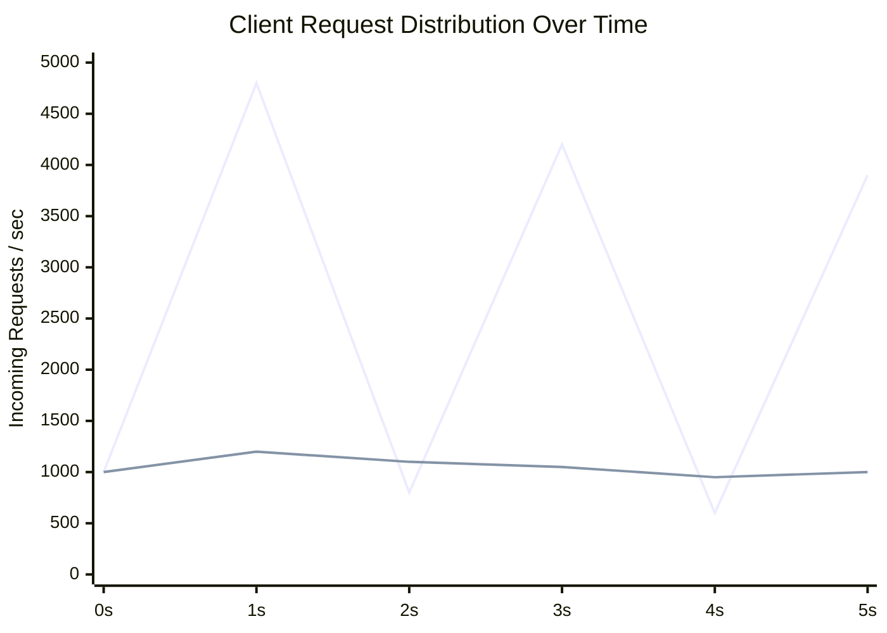
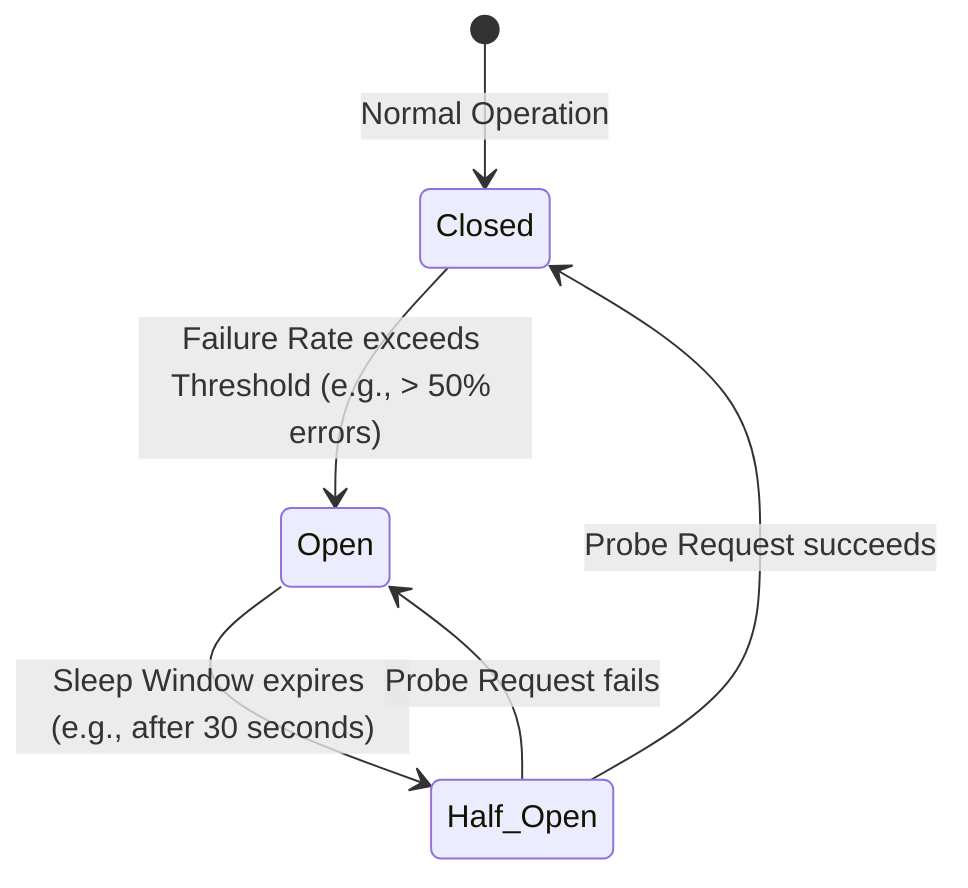

# Timeouts, Retries, and Circuit Breakers

In distributed systems, handling transient network errors and overloaded dependencies requires carefully disciplined retry policies to prevent catastrophic cascade failures.

---

## 1. Problem Statement and Motivation

When a client request fails due to network drop or downstream timeout:
- A naive client immediately retransmits the request.
- If the downstream service was struggling under peak load, incoming retries **multiply the load by $2\times$, $3\times$, or $5\times$**, driving the downstream service into complete collapse.
- If thousands of clients retry at fixed intervals (e.g., every 1 second), their retries synchronize into a periodic wave of massive traffic—the **Thundering Herd / Retry Storm**.

Robust systems employ **Exponential Backoff with Full Jitter** and **Circuit Breakers** to break feedback loops.

---

## 2. Exponential Backoff and Full Jitter (AWS 2015)

### 2.1 The Mathematics of Jittered Backoff
Let $b$ be the base delay (e.g., $100\text{ ms}$), $c$ be the multiplier (typically $2$), and $attempt$ be the retry count:
$$\text{Backoff}(attempt) = \min(M, \; b \cdot c^{attempt})$$
where $M$ is a maximum ceiling (e.g., $30\text{ seconds}$).

Simply backing off exponentially still synchronizes client waves.
In 2015, Marc Brooker [AWS Architecture Blog] proved that **Full Jitter** provides the optimal decorrelation of client retries:

$$\text{Sleep} = \text{random\_uniform}(0, \; \text{Backoff}(attempt))$$

*(Red line: No jitter, severe oscillating retry spikes. Blue line: Full jitter, smooth uniform distribution).*

---

## 3. Deadline Propagation

When an RPC spans a deep call tree ($A \to B \to C \to D$):
- If client $A$ has a 2-second timeout, but service $D$ continues executing for 15 seconds after $A$ has already given up, service $D$ wastes valuable CPU cycles processing a request whose response will be discarded.
- **Deadline Propagation**: The remaining time-to-live is serialized in the RPC metadata headers (e.g., `grpc-timeout`). Every downstream service subtracts elapsed processing time. If the deadline expires, the downstream service immediately halts execution.

---

## 4. The Circuit Breaker Pattern [Nygard 2007]

A **Circuit Breaker** wraps remote calls to protect failing dependencies from traffic and allow them to recover:

1. **Closed**: Normal operations. Requests pass through. Failures are tracked in a sliding time window.
2. **Open**: Threshold exceeded. **All requests fail immediately locally** with a `CircuitOpenException`, without placing packets on the network.
3. **Half-Open**: After a cooling sleep duration, a small number of trial probe requests are permitted through. If successful, the circuit resets to Closed; if any probe fails, it flips back to Open.

---

## 5. Revision Questions

1. Why does simple exponential backoff without jitter fail to prevent retry storms?
2. Explain the difference between Full Jitter and Equal Jitter.
3. How does deadline propagation prevent wasted compute in deep microservice invocation graphs?
4. Describe the state transitions of a Circuit Breaker (Closed, Open, Half-Open).

---

## 6. Authoritative References

- **[Brooker 2015]** Marc Brooker. *Exponential Backoff And Jitter*. AWS Architecture Blog, March 2015.
- **[Nygard 2007]** Michael T. Nygard. *Release It!: Design and Deploy Production-Ready Software*. Pragmatic Bookshelf, 2007.
- **[Kleppmann 2021]** Martin Kleppmann. *Distributed Systems Lecture Notes*, Chapter 1: Timeouts and Retries. 2021/22.
