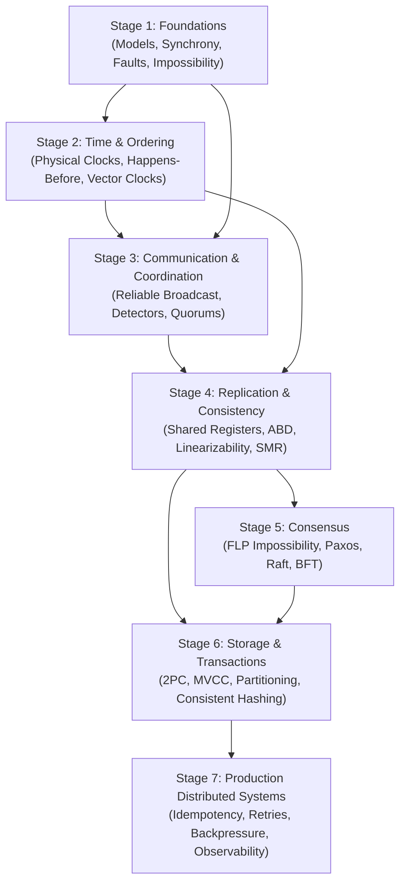

# Distributed Systems Mastery Roadmap

This roadmap provides a dependency-aware, mathematically grounded learning sequence for mastering distributed systems theory. Progression is strictly gated on demonstrated conceptual and analytical understanding, rather than calendar milestones.

---

## Stage 1: Foundations

### 1. Learning Objectives
- Formulate execution histories, states, and event traces across distributed processes.
- Classify network synchrony models ($\mathcal{SYNCH}$, $\mathcal{ASYNCH}$, $\mathcal{PARTIAL}$) and understand the implications of Global Stabilization Time (GST).
- Define the fault hierarchy: crash-stop, crash-recovery with non-volatile storage, and Byzantine (fail-arbitrary).
- Distinguish Safety properties ("nothing bad happens") from Liveness properties ("something good eventually happens") using trace prefixes.
- Analyze fundamental impossibility boundaries: the Two Generals problem and common knowledge limitations.

### 2. Prerequisite Topics
- Basic discrete mathematics (sets, relations, partial orders, induction).
- Fundamental operating systems concepts (threads, processes, concurrency, I/O).

### 3. Notes to Study
- [`00-foundations/distributed-systems-overview.md`](./00-foundations/distributed-systems-overview.md)
- [`00-foundations/system-models.md`](./00-foundations/system-models.md)
- [`00-foundations/synchrony-and-asynchrony.md`](./00-foundations/synchrony-and-asynchrony.md)
- [`00-foundations/failure-models.md`](./00-foundations/failure-models.md)
- [`00-foundations/safety-and-liveness.md`](./00-foundations/safety-and-liveness.md)
- [`00-foundations/impossibility-results.md`](./00-foundations/impossibility-results.md)

### 4. Self-Assessment Questions
1. Why cannot any finite number of message exchanges over an unreliable link establish common knowledge between two generals? Provide the inductive proof sketch.
2. Formally prove that the property *"every request eventually receives a response"* is a liveness property, while *"no response is delivered without a prior request"* is a safety property.
3. Can a fair-loss channel be transformed into a reliable link in an asynchronous crash-stop system? What happens in a crash-recovery system if volatile state is lost?
4. Why is the Byzantine resilience threshold bounded by strictly less than $1/3$ faulty nodes ($n \ge 3f + 1$) in unauthenticated networks?

### 5. Completion Criteria
- You can rigorously classify any given system specification into its synchrony and failure assumptions.
- You can prove whether an arbitrary execution property is safety, liveness, or a conjunction of both.

---

## Stage 2: Time and Ordering

### 1. Learning Objectives
- Master the physics and algorithmic limitations of physical quartz clocks, drift rates ($\rho$), and clock skew ($\theta$).
- Understand the mechanics of NTP round-trip skew estimation ($\theta = \frac{(t_2 - t_1) + (t_3 - t_4)}{2}$) and the difference between slewing and stepping.
- Mathematically formulate Lamport's happens-before partial order ($\to$) and prove its irreflexivity, transitivity, and asymmetry.
- Implement and trace Lamport Logical Clocks and understand why scalar timestamps cannot detect concurrency ($a \parallel b$).
- Master Vector Clocks, their state update rules, and the exact order isomorphism $(V(a) < V(b) \iff a \to b)$.

### 2. Prerequisite Topics
- [Stage 1: Foundations](#stage-1-foundations).

### 3. Notes to Study
- [`01-time-and-ordering/physical-clocks.md`](./01-time-and-ordering/physical-clocks.md)
- [`01-time-and-ordering/happens-before.md`](./01-time-and-ordering/happens-before.md)
- [`01-time-and-ordering/lamport-clocks.md`](./01-time-and-ordering/lamport-clocks.md)
- [`01-time-and-ordering/vector-clocks.md`](./01-time-and-ordering/vector-clocks.md)

### 4. Self-Assessment Questions
1. Given an execution trace with 3 processes exchanging 6 messages, calculate both the Lamport timestamps and the Vector Clock timestamps at each send and receive event.
2. Given two events $a$ and $b$ with $L(a) < L(b)$, can we conclude $a \to b$? Explain with a concrete counterexample trace.
3. Show that for any two events $a, b$, exactly one of three relations holds: $a \to b$, $b \to a$, or $a \parallel b$.
4. How do TrueTime uncertainty intervals $[t_{earliest}, t_{latest}]$ allow Google Spanner to establish external consistency without cross-node message exchanges?

### 5. Completion Criteria
- You can construct vector timestamps for complex concurrent traces and identify causal dependencies and concurrency without ambiguity.
- You understand how physical clock bounds relate to causal ordering.

---

## Stage 3: Communication and Coordination

### 1. Learning Objectives
- Formulate the formal guarantees of message broadcast: Best-effort, Reliable, FIFO, Causal, and Total Order (Atomic) Broadcast.
- Contrast point-to-point RPC failure modes (at-most-once, at-least-once, exactly-once) with broadcast primitives.
- Understand the abstraction of failure detectors ($\mathcal{P}, \diamondsuit\mathcal{P}, \diamondsuit\mathcal{S}, \Omega$), completeness, and accuracy.
- Derive quorum systems: majority quorums, read-write quorums, the pigeonhole intersection invariant ($r + w > n$), and fault-tolerance bounds.

### 2. Prerequisite Topics
- [Stage 1: Foundations](#stage-1-foundations) & [Stage 2: Time and Ordering](#stage-2-time-and-ordering).

### 3. Notes to Study
- [`02-communication-and-coordination/message-passing.md`](./02-communication-and-coordination/message-passing.md)
- [`02-communication-and-coordination/rpc.md`](./02-communication-and-coordination/rpc.md)
- [`02-communication-and-coordination/reliable-broadcast.md`](./02-communication-and-coordination/reliable-broadcast.md)
- [`02-communication-and-coordination/failure-detectors.md`](./02-communication-and-coordination/failure-detectors.md)
- [`02-communication-and-coordination/leader-election.md`](./02-communication-and-coordination/leader-election.md)
- [`02-communication-and-coordination/quorums.md`](./02-communication-and-coordination/quorums.md)

### 4. Self-Assessment Questions
1. Why does total order broadcast require coordination with other processes before a sender can deliver a message to itself, whereas FIFO and causal broadcast do not?
2. Prove that Causal Broadcast satisfies all requirements of FIFO Broadcast.
3. In an asynchronous system, why is it impossible to build a perfect failure detector $\mathcal{P}$? What makes an eventually perfect failure detector $\diamondsuit\mathcal{P}$ feasible in partial synchrony?
4. In a system of $n=5$ replicas, what is the maximum number of failed replicas tolerated for reads if write quorums are configured to $w=4$?

### 5. Completion Criteria
- You can prove the broadcast hierarchy relationships.
- You can calculate quorum sizes for asymmetric read/write workloads and analyze system availability under arbitrary node crash configurations.

---

## Stage 4: Replication and Consistency

### 1. Learning Objectives
- Contrast the register hierarchy: Safe, Regular, and Atomic (Linearizable) registers [Lamport 1986].
- Master **Linearizability** [Herlihy and Wing 1990]: linearization points, sequential specifications, real-time precedence order ($\prec_H$), and composability.
- Master the **ABD Algorithm** [Attiya, Bar-Noy, Dolev 1995]:
  - Single-Writer Multi-Reader (SWMR) protocol.
  - Multi-Writer Multi-Reader (MWMR) protocol.
  - Quorum read phase, timestamp selection, and read write-back.
  - Mathematical proof demonstrating why the read write-back phase is strictly necessary for linearizability.
- Understand Sequential Consistency and Eventual Consistency (and Strong Eventual Consistency / CRDTs).
- Understand State Machine Replication (SMR) and its relationship to Total Order Broadcast.

### 2. Prerequisite Topics
- [Stage 2: Time and Ordering](#stage-2-time-and-ordering) & [Stage 3: Communication and Coordination](#stage-3-communication-and-coordination).

### 3. Notes to Study
- [`03-replication-and-consistency/replication-fundamentals.md`](./03-replication-and-consistency/replication-fundamentals.md)
- [`03-replication-and-consistency/primary-backup.md`](./03-replication-and-consistency/primary-backup.md)
- [`03-replication-and-consistency/shared-registers.md`](./03-replication-and-consistency/shared-registers.md)
- [`03-replication-and-consistency/abd-algorithm.md`](./03-replication-and-consistency/abd-algorithm.md)
- [`03-replication-and-consistency/linearizability.md`](./03-replication-and-consistency/linearizability.md)
- [`03-replication-and-consistency/sequential-consistency.md`](./03-replication-and-consistency/sequential-consistency.md)
- [`03-replication-and-consistency/eventual-consistency.md`](./03-replication-and-consistency/eventual-consistency.md)
- [`03-replication-and-consistency/state-machine-replication.md`](./03-replication-and-consistency/state-machine-replication.md)

### 4. Self-Assessment Questions
1. Diagram an execution trace showing how a quorum system with $r+w > n$ without read write-back violates linearizability (stale read inversion).
2. How does the MWMR ABD algorithm break ties when two concurrent writers choose identical sequence numbers?
3. What is the fundamental difference between Linearizability and Serializability? Can a system be both?
4. Why is linearizability a "local property" (composable), whereas sequential consistency is not?

### 5. Completion Criteria
- You can write out complete pseudocode for SWMR and MWMR ABD from memory and explain every phase's invariant.
- Given an interleaved concurrent history of operations on multiple registers, you can formally test whether a valid linearization exists.

---

## Stage 5: Consensus

### 1. Learning Objectives
- Formulate the Consensus problem: Agreement, Validity, and Termination.
- Understand the proof architecture and profound implications of the **FLP Impossibility Theorem** [Fischer, Lynch, Paterson 1985] (bivalent configurations, critical events).
- Understand how Paxos guarantees safety under asynchrony using two-phase quorums (Prepare/Promise, Accept/Accepted).
- Master the **Raft Consensus Protocol** [Ongaro, Ousterhout 2014]:
  - Term dynamics and leader election.
  - Log replication, prefix matching invariant, and leader completeness.
  - Safety invariants: Election Safety, Leader Append-Only, Log Matching, Leader Completeness, State Machine Safety.
- Analyze Byzantine Fault Tolerance (BFT) mechanisms, PBFT 3-phase flow (Pre-Prepare, Prepare, Commit), and the $3f+1$ bound.

### 2. Prerequisite Topics
- [Stage 1: Foundations](#stage-1-foundations), [Stage 3: Communication and Coordination](#stage-3-communication-and-coordination), and [Stage 4: Replication and Consistency](#stage-4-replication-and-consistency).

### 3. Notes to Study
- [`04-consensus/consensus-problem.md`](./04-consensus/consensus-problem.md)
- [`04-consensus/flp-impossibility.md`](./04-consensus/flp-impossibility.md)
- [`04-consensus/paxos.md`](./04-consensus/paxos.md)
- [`04-consensus/raft.md`](./04-consensus/raft.md)
- [`04-consensus/byzantine-fault-tolerance.md`](./04-consensus/byzantine-fault-tolerance.md)

### 4. Self-Assessment Questions
1. What is the difference between an initial configuration being 0-valent, 1-valent, and bivalent? How does FLP prove a bivalent state can be preserved indefinitely?
2. In Raft, why is it unsafe for a leader to commit a log entry from an *earlier* term simply by counting replicas?
3. How does Raft's `logOk` check in `RequestVote` guarantee that a newly elected leader contains all previously committed entries?
4. Contrast the quorum requirements of non-Byzantine Paxos/Raft ($\lfloor n/2 \rfloor + 1$ out of $2f+1$) with PBFT ($2f+1$ out of $3f+1$).

### 5. Completion Criteria
- You can trace Raft leader election, failover, and log repair across partition scenarios step-by-step.
- You can explain how Paxos and Raft navigate FLP impossibility by decoupling safety from liveness.

---

## Stage 6: Storage and Transactions

### 1. Learning Objectives
- Understand data distribution strategies: Range-based partitioning, Hash-based partitioning, and Consistent Hashing with virtual nodes.
- Master Two-Phase Commit (2PC): message rounds, coordinator recovery, in-doubt transactions, and Paxos Commit fault tolerance.
- Compare Distributed Concurrency Control: Two-Phase Locking (2PL), Optimistic Concurrency Control (OCC), and Multi-Version Concurrency Control (MVCC).
- Understand global transaction ordering, snapshot isolation anomalies (write skew), and Google Spanner's TrueTime implementation.

### 2. Prerequisite Topics
- [Stage 4: Replication and Consistency](#stage-4-replication-and-consistency) & [Stage 5: Consensus](#stage-5-consensus).

### 3. Notes to Study
- [`05-storage-and-transactions/partitioning-and-sharding.md`](./05-storage-and-transactions/partitioning-and-sharding.md)
- [`05-storage-and-transactions/consistent-hashing.md`](./05-storage-and-transactions/consistent-hashing.md)
- [`05-storage-and-transactions/replicated-logs.md`](./05-storage-and-transactions/replicated-logs.md)
- [`05-storage-and-transactions/two-phase-commit.md`](./05-storage-and-transactions/two-phase-commit.md)
- [`05-storage-and-transactions/distributed-transactions.md`](./05-storage-and-transactions/distributed-transactions.md)
- [`05-storage-and-transactions/mvcc.md`](./05-storage-and-transactions/mvcc.md)
- [`05-storage-and-transactions/recovery-and-rebalancing.md`](./05-storage-and-transactions/recovery-and-rebalancing.md)

### 4. Self-Assessment Questions
1. How does Paxos Commit [Gray and Lamport 2006] eliminate the blocking single point of failure in 2PC?
2. Why does consistent hashing reduce keys needing migration during node joins/leaves to $O(K/N)$?
3. What is Write Skew, and why does Snapshot Isolation fail to prevent it without Serializable Snapshot Isolation (SSI) or explicit locking?
4. In Spanner, why must a write transaction pause for $\delta = t_{latest} - t_{earliest}$ before committing?

### 5. Completion Criteria
- You can design an end-to-end distributed transaction architecture reconciling sharded state with atomic commit and replicated logs.

---

## Stage 7: Production Distributed Systems

### 1. Learning Objectives
- Master practical communication resilience: timeouts, jittered exponential backoff, and circuit breakers.
- Implement robust idempotency mechanisms (deduplication keys, state tokens, tombstoning).
- Analyze flow control: reactive and proactive backpressure, sliding window protocols, and token buckets.
- Formulate high-availability patterns: consistent hashing load balancers, service discovery leases, and cross-region disaster recovery (RPO/RTO).

### 2. Prerequisite Topics
- [Stages 1 through 6](#stage-1-foundations).

### 3. Notes to Study
- [`06-production-systems/timeouts-and-retries.md`](./06-production-systems/timeouts-and-retries.md)
- [`06-production-systems/idempotency.md`](./06-production-systems/idempotency.md)
- [`06-production-systems/backpressure.md`](./06-production-systems/backpressure.md)
- [`06-production-systems/load-balancing.md`](./06-production-systems/load-balancing.md)
- [`06-production-systems/service-discovery.md`](./06-production-systems/service-discovery.md)
- [`06-production-systems/observability.md`](./06-production-systems/observability.md)
- [`06-production-systems/disaster-recovery.md`](./06-production-systems/disaster-recovery.md)

### 4. Self-Assessment Questions
1. Why does retrying without random jitter risk triggering retry storms and synchronized thundering herds?
2. Why is adding an item to a set idempotent, whereas incrementing an integer counter is not? How do tombstones resolve race conditions in delete-after-write scenarios?
3. What is the fundamental trade-off between Recovery Point Objective (RPO) and synchronous cross-datacenter replication latency?

### 5. Completion Criteria
- You can audit production distributed architectures for failure propagation risks, split-brain vulnerabilities, and capacity cliffs.
